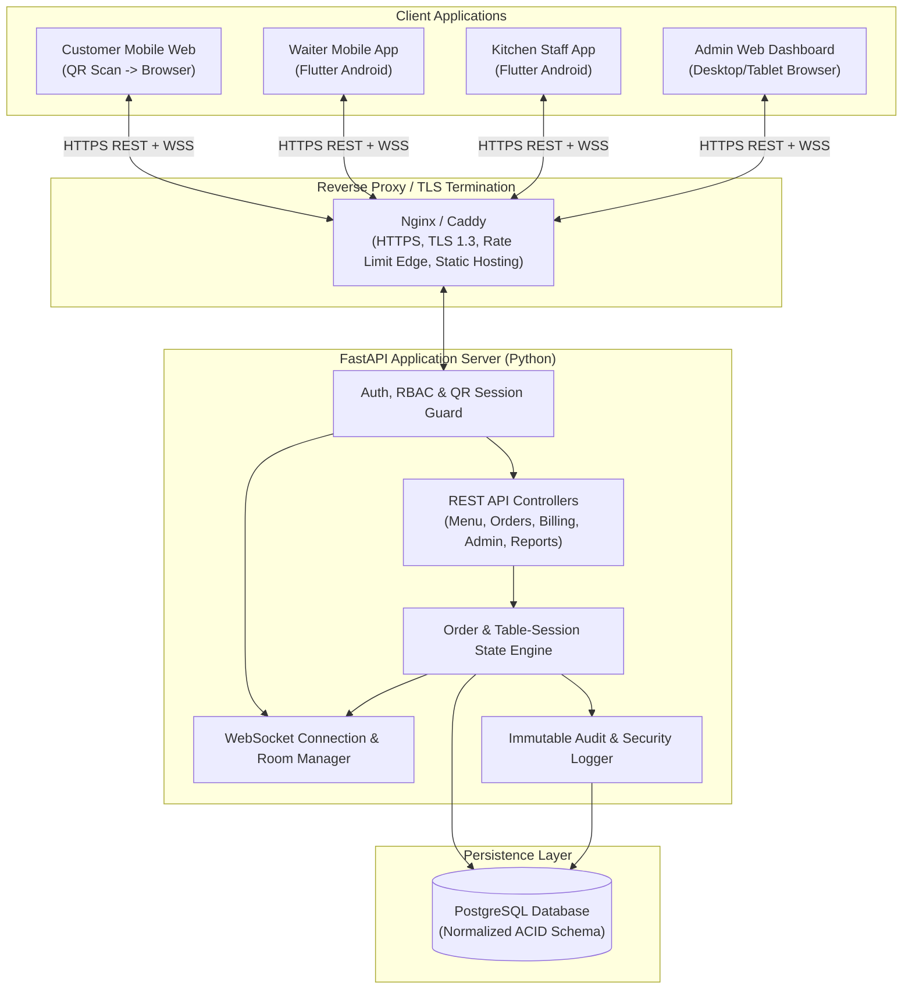
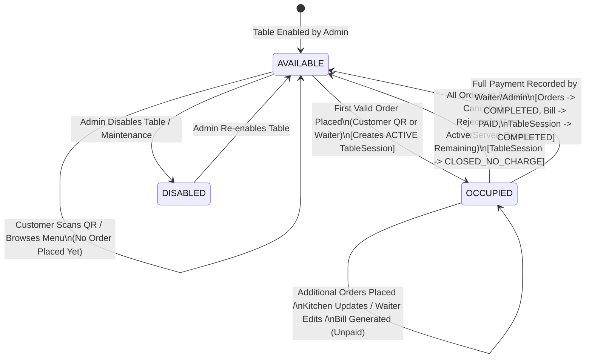
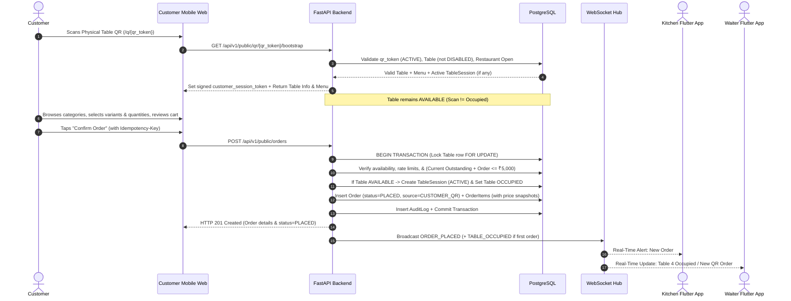

# Volume 1: System Architecture, Roles, QR Security & Menu Model

> **Document Status:** SOURCE OF TRUTH — Phase 0 (Documentation Only; No Application Code)  
> **Scope:** Single Physical Restaurant Management & QR Ordering System (Non-SaaS)  
> **Target Implementation Environment:** Antigravity (AI Coding Agent) + Android Studio (Flutter SDK/Emulator)  
> **Canonical Cross-Reference Notice:** This foundational volume is expanded and governed by **`docs/01-project-overview.md`**, **`docs/02-requirements-and-scope.md`**, **`docs/03-system-architecture.md`**, **`docs/11-project-structure-and-coding-standards.md`**, and **`docs/13-final-implementation-blueprint.md`** (canonical top-level directories: `backend/`, `customer-web/`, `admin-web/`, `waiter-app/`, `kitchen-app/`).

---

## 1. Executive Summary & System Scope

This specification defines the complete functional, technical, database, security, API, real-time, UI, testing, and deployment architecture for a **Single-Restaurant Management & QR Ordering System**.

### 1.1 Confirmed Scope Boundaries
- **Single Physical Restaurant Only:** The system operates for **one physical restaurant location**. Multi-tenant SaaS constructs (`tenant_id`, multi-organization billing, subscription tiers) are strictly excluded.
- **Unified Central Order Pipeline:** Customer self-service QR orders and Waiter-entered manual orders enter the **exact same central backend order pipeline**, state machine, kitchen queue, table-session ledger, and billing engine.
- **No Customer Friction Barriers:**
  - Customers use a mobile-responsive web application opened via table QR scan.
  - Customers **do not** install a native mobile app.
  - Customers **do not** register an account or log in to place an order.
  - Customers **do not** enter a mandatory 4-digit PIN or verification code.
  - There is **no** mandatory waiter/admin table activation step before a customer can place an order.
- **Staff-Controlled Billing:** Customers do not trigger digital billing or online payment via the QR web app. Customers verbally call a waiter for the bill; the waiter generates the bill and records payment via the Waiter Flutter app (or Admin via Admin Web).

---

## 2. System Architecture & Technology Direction

### 2.1 Confirmed Technology Stack

| Layer / Component | Technology | Role in System |
| :--- | :--- | :--- |
| **Customer Client** | Mobile-Responsive Web App (React + TypeScript + Tailwind CSS) | Scans table QR token, browses menu/availability, selects price variants, manages cart, submits orders, tracks live order status. |
| **Admin Client** | Web Dashboard (React + TypeScript + Tailwind CSS) | Full operational control: menu, categories, variants, short codes, availability, tables, QR lifecycle, staff, orders, billing, payments, reports, settings, security & audit logs. |
| **Waiter Client** | Flutter Mobile App (Android) | Table overview, manual order creation via short item codes (`CB`, `CB-H`) or full-name search, order editing, bill generation, payment recording. |
| **Kitchen Client** | Flutter Mobile App (Android phone/tablet) | Real-time KDS (Kitchen Display System): receives QR and waiter orders, accepts/rejects with mandatory reason on reject, marks `PREPARING` and `READY`, receives live order modification alerts. |
| **Backend API & Real-Time** | FastAPI (Python 3.11+) + Uvicorn/ASGI | RESTful JSON APIs, RBAC, session management, rate limiting, idempotency, state machine enforcement, financial calculations, native WebSocket server. |
| **Primary Database** | PostgreSQL (15+) | ACID-compliant relational storage for all entities, transactional state transitions, row-level locking, historical price snapshots, immutable financial & audit logs. |
| **Real-Time Transport** | WebSockets (FastAPI native + Redis Pub/Sub if multi-worker) | Bi-directional push events to Kitchen, Waiter, Admin, and active Customer table sessions without manual page refresh. |
| **Development Tooling** | Antigravity + Android Studio | Antigravity as primary AI coding environment; Android Studio for Android SDK, emulator, and APK/AAB build toolchain. |

### 2.2 High-Level Architecture Diagram

### 2.3 Recommended Architecture Decisions (Within Confirmed Stack)
- **[RAD-01] Shared Monorepo Structure for Antigravity:** Organize the future repository as a single structured monorepo (`/backend`, `/web-customer`, `/web-admin`, `/mobile-waiter`, `/mobile-kitchen`, `/docs`) so the AI coding agent (Antigravity) has full cross-stack visibility of API contracts, TypeScript interfaces, and Dart models.
- **[RAD-02] Single-Process FastAPI Worker vs. Redis Pub/Sub:** For a single physical restaurant (typically 10–60 tables, 5–15 concurrent staff devices, 20–120 concurrent customer browsers), a single Uvicorn ASGI worker process with async SQLAlchemy/asyncpg can handle in-memory WebSocket broadcasting with zero external broker overhead. If multiple Uvicorn workers are configured for high availability, include lightweight local Redis strictly as a WebSocket Pub/Sub backplane and rate-limit counter store.

---

## 3. User Roles & Capabilities Matrix

| Capability | Customer (QR Web) | Waiter (Flutter) | Kitchen Staff (Flutter) | Admin (Web Dashboard) |
| :--- | :---: | :---: | :---: | :---: |
| Scan QR & browse menu / item availability | Yes | No (uses native app) | No | No |
| Place new order for table | Yes (own table via QR) | Yes (any active/available table) | No | Yes (override/support) |
| Search menu by short code (`CB`, `CB-H`) or full name | Full name / category | Yes (both short code & full name) | View only | Yes (manage & search) |
| Accept or Reject `PLACED` order | No | No | Yes (Reject requires reason) | Yes (emergency override) |
| Transition order `ACCEPTED -> PREPARING -> READY` | No | No | Yes | Yes (emergency override) |
| Transition order `READY -> SERVED` | No | Yes | No (Decision Required: see DR-04) | Yes |
| Edit order / request modification | No | Yes (subject to state rules) | No (receives modification alerts) | Yes (subject to audit rules) |
| Cancel order before kitchen acceptance (`PLACED`) | Decision Required (see DR-02) | Yes (with reason) | No (uses Reject) | Yes (with reason) |
| Cancel/void items after kitchen acceptance | No | Request/Record per state rules | No | Yes (with mandatory audit reason) |
| Toggle item availability (In Stock / Out of Stock) | No | No | Decision Required (see DR-05) | Yes |
| Retrieve table active session & generate bill | No (calls waiter verbally) | Yes | No | Yes |
| Record payment & complete table session | No | Yes | No | Yes |
| Manage menu, categories, prices, item codes | No | No | No | Yes |
| Generate, regenerate, revoke, disable table QR codes | No | No | No | Yes |
| Manage staff accounts (Waiters, Kitchen Staff) | No | No | No | Yes |
| Configure ₹5,000 limit, taxes, rate limits, settings | No | No | No | Yes |
| View reports, security alerts & audit logs | No | No | No | Yes |

---

## 4. Tables, QR Lifecycle & Table-Session Lifecycle

### 4.1 Physical Table & QR Token Model
1. Each physical table has a record in `restaurant_tables` (e.g., `table_number = "T1"` or `"12"`, display label, seating capacity, `status`, `is_qr_enabled`).
2. A table's QR code URL **never** uses the sequential primary key or table number as its access credential.
3. Instead, the QR encodes a URL containing a cryptographically generated, high-entropy token (`qr_token`, minimum 32 bytes / 256 bits of CSPRNG randomness encoded in URL-safe Base64 or 43-char alphanumeric string):
   - Format: `https://<restaurant-domain>/q/<qr_token>`
4. **One Active Token Per Table:** At any moment, a table has at most one `ACTIVE` QR token in `table_qr_tokens`.
5. **Admin QR Lifecycle Operations:**
   - **Generate:** Creates the initial `ACTIVE` QR token for a table.
   - **Regenerate (Rotate):** Atomically marks the existing `ACTIVE` QR token as `REVOKED` (with `revoked_at`, `revoked_by_user_id`, `revocation_reason = "REGENERATED"`) and inserts a new `ACTIVE` cryptographic token. Any previously printed or photographed QR code using the old token immediately returns HTTP `410 Gone` / `"This QR code is no longer valid. Please scan the current QR code on your table or ask a waiter."`
   - **Revoke:** Atomically marks the current token as `REVOKED` without generating a replacement until Admin chooses to generate a new one.
   - **Disable / Enable QR Ordering on Table:** Toggles `is_qr_enabled = false/true` on the table (or global QR ordering switch) without destroying the printed QR token, useful when temporarily reserving a table or during maintenance.

### 4.2 Table Status vs. Table Session Lifecycle

A physical table has two distinct concepts:
1. **Table Operational Status (`restaurant_tables.status`):**
   - `AVAILABLE`: Table is free for new guests.
   - `OCCUPIED`: An active dining session (`table_sessions.status = 'ACTIVE'`) is currently in progress with at least one valid order placed.
   - `DISABLED` (or `MAINTENANCE`): Table is out of service; neither QR orders nor waiter orders can be started on this table until Admin re-enables it.
2. **Table Dining Session (`table_sessions`):**
   - Represents a single seated customer group's dining visit from their **first valid placed order** until **bill settlement & session completion** (or full cancellation of all orders).

#### Confirmed Table & Session Lifecycle Rules:
- **Rule 1 (Scan != Occupied):** Merely scanning a table QR code, browsing the menu, or adding items to the client-side cart **must NOT** mark the table as `OCCUPIED` and **must NOT** create a billable `ACTIVE` table session.
- **Rule 2 (First Order Activation):** When a table is `AVAILABLE`, the **first valid order successfully submitted** (whether by a Customer via QR or by a Waiter via the Waiter App) atomically:
  1. Creates a new `table_sessions` record with `status = 'ACTIVE'`, `opened_at = NOW()`, `opened_by_source = 'CUSTOMER_QR' | 'WAITER'`.
  2. Transitions `restaurant_tables.status` from `AVAILABLE` to `OCCUPIED` and sets `restaurant_tables.active_session_id = new_session.id`.
  3. Persists the order with `status = 'PLACED'` linked to `table_session_id`.
- **Rule 3 (Subsequent Orders in Same Session):** While the table has an `ACTIVE` `TableSession`, additional valid orders placed by the customer(s) at that table or by any waiter for that table attach to the **same** `active_session_id` and accumulate toward the session's running total and the ₹5,000 outstanding limit.
- **Rule 4 (All Orders Rejected/Cancelled Reversion):** If **every** order belonging to an `ACTIVE` `TableSession` transitions to `REJECTED` or `CANCELLED` (such that the count of non-cancelled, non-rejected orders in the session is `0` and no items have been `SERVED`), the system automatically transitions `table_sessions.status` to `CLOSED_NO_CHARGE` (or `CANCELLED`) and reverts `restaurant_tables.status` back to `AVAILABLE` (clearing `active_session_id = NULL`).
- **Rule 5 (Payment & Session Completion):** When the waiter generates the final bill for the `ACTIVE` session and records successful full payment (`payments.status = 'SUCCESS'` and `bills.status = 'PAID'`):
  1. All `SERVED` orders in the session transition to `COMPLETED`.
  2. `table_sessions.status` transitions to `COMPLETED` (`closed_at = NOW()`).
  3. `restaurant_tables.status` reverts to `AVAILABLE` (`active_session_id = NULL`).
  4. All temporary customer browser tokens (`customer_session_tokens`) associated with that `TableSession` are immediately invalidated so the departed customer's phone can no longer place orders for that table.

### 4.3 Table & Table-Session State Machine Diagram

---

## 5. Physical QR Security & Remote Abuse Mitigation

### 5.1 Honest Threat Analysis of Unactivated Physical QR Codes
Because business rules explicitly prohibit:
- Customer login/registration,
- Mandatory 4-digit table PIN codes, and
- Mandatory waiter pre-activation before ordering,

any static QR code printed on a table has an inherent physical-world vulnerability: **a person who photographs the QR code while in the restaurant could attempt to open the URL later from outside the restaurant**.

### 5.2 Defense-in-Depth Mitigation Architecture (Zero Customer Friction)
To protect the restaurant without adding PINs, logins, or waiter pre-activation, the system implements **eight layered controls**:

1. **Cryptographic Unpredictable QR Tokens (`qr_token`):**
   - Prevents attackers from guessing or enumerating other tables (`table/1`, `table/2` is impossible).
2. **Ephemeral Signed Customer Browser Tokens (`customer_session_token`):**
   - Scanning `/q/<qr_token>` does not allow raw stateless POST requests with just `<qr_token>` forever.
   - Instead, resolving `/q/<qr_token>` issues a short-lived signed JWT/opaque session token (`customer_session_token`, stored in `HttpOnly; Secure; SameSite=Strict` cookie + session storage) bound to:
     - `table_id` and `qr_token_id`
     - `table_session_id` (once created)
     - Client fingerprint hash (User-Agent + IP subnet)
     - **Idle Expiration:** Expires 30 minutes after scan if no order is placed.
     - **Session Completion Revocation:** Immediately revoked the instant the `TableSession` is completed/paid or closed.
3. **Table Occupancy & Multi-Device Session Binding Rule:**
   - When the first order is placed on an `AVAILABLE` table via QR, the initiating customer device's `customer_session_token` is bound to the newly created `TableSession`.
   - **What if a second person at the same table scans the QR, OR a remote prankster with a photo scans the QR while the table is `OCCUPIED`?**
   - **Recommended Mechanism (with Decision Required DR-01):**
     - Allow devices that scanned the current QR to join the active table session to view menu and submit orders, **subject to**:
       - Real-time notification on the Waiter app and on the primary customer screen whenever an additional order is placed on the table.
       - If an `OCCUPIED` table already has a generated `UNPAID` bill (`bills.status = 'ISSUED'`), block new customer QR orders until a waiter unlocks/amends the bill.
       - Optional Admin-configurable toggle: *"Restrict QR ordering on occupied tables to the original ordering browser device unless Waiter approves"* (see **DR-01**).
4. **Restaurant Operating Hours & Global Kill-Switch:**
   - Customer QR order submissions are strictly rejected outside configured restaurant operating hours (`restaurant_settings.is_accepting_qr_orders = false` or outside `opening_time`–`closing_time`). This completely neutralizes late-night remote prank orders from photographed QRs.
5. **First-Order Waiter Visual Verification Alert:**
   - When a table transitions from `AVAILABLE` to `OCCUPIED` via a **Customer QR Order**, the Waiter app immediately receives a high-priority real-time notification (`"Table T4: First QR Order Placed - ₹460"`). If the waiter sees Table T4 is physically empty, the waiter or kitchen can immediately reject/cancel the fraudulent order in 1 tap and trigger **Flag Suspicious / Regenerate QR**.
6. **Hard Outstanding Value Cap (₹5,000 Default):**
   - Limits maximum financial exposure per active table session to ₹5,000.
7. **Multi-Window Rate Limiting & Item Caps:**
   - Prevents rapid order spamming or absurd quantities (e.g., 500 biryanis).
8. **One-Click QR Regeneration & IP/Device Temp-Ban:**
   - If a specific table's QR is photographed and abused, Admin can regenerate that table's QR token in one click (invalidating the photographed QR permanently) or temporarily block the offending IP/device fingerprint.

---

## 6. Customer & Waiter Ordering Workflows

### 6.1 Customer QR Ordering Flow

### 6.2 Waiter Manual Ordering Flow
1. Customer verbally calls waiter to place an order.
2. Waiter opens Waiter Flutter App -> selects Table (from visual grid or by typing table number).
3. Waiter taps **"New Order"** and enters items using either:
   - **Fast Short-Code Search:** Types `CB` (shows Chicken Biryani with Half/Full variants) or `CB-F` (directly selects Chicken Biryani - Full), enters quantity, taps Add.
   - **Full-Name Search:** Types `"Biryani"` or `"Kebab"` if the short code is forgotten.
4. Waiter reviews cart with customer, adds optional kitchen preparation notes (e.g., `"Less spicy"`), and submits with an automatic `Idempotency-Key`.
5. Backend executes the **exact same order creation pipeline** (`source = 'WAITER'`, `created_by_user_id = waiter.id`), creates/attaches to the table's `ACTIVE` `TableSession`, marks table `OCCUPIED` if it was `AVAILABLE`, and broadcasts `ORDER_PLACED` to Kitchen, Waiters, Admin, and any active Customer browser viewing that table session.

---

## 7. Menu, Pricing Variants & Short Item Code Specification

### 7.1 Mandatory 3-Tier Menu Hierarchy
The database and domain model **must never** store a single scalar price on `menu_items`. Every dish is modeled as:

$$\text{MenuCategory} \longrightarrow \text{MenuItem} \longrightarrow \text{MenuPriceVariant} \longrightarrow \text{OrderItem (Order Line)}$$

- **Single-Price Items:** If an item has only one serving size (e.g., *Fresh Lime Soda — ₹60*), it still has one `MenuItem` record (*Fresh Lime Soda*, `item_code = "FLS"`) and one default `MenuPriceVariant` record (`variant_name = "Regular"`, `variant_code = "FLS"`, `price = 60.00`, `is_default = true`).
- **Multi-Variant Items:**
  - *Chicken Biryani* (`item_code = "CB"`):
    - Variant 1: `variant_name = "Half"`, `variant_code = "CB-H"`, `unit_type = "PORTION"`, `unit_quantity = 1`, `price = 100.00`
    - Variant 2: `variant_name = "Full"`, `variant_code = "CB-F"`, `unit_type = "PORTION"`, `unit_quantity = 1`, `price = 180.00`
  - *Chicken Kebab* (`item_code = "CK"`):
    - Variant 1: `variant_name = "2 Pieces"`, `variant_code = "CK-2"`, `unit_type = "PIECES"`, `unit_quantity = 2`, `price = 120.00`
    - Variant 2: `variant_name = "4 Pieces"`, `variant_code = "CK-4"`, `unit_type = "PIECES"`, `unit_quantity = 4`, `price = 220.00`

### 7.2 Short Item Code Design Rule (Recommended Format)
- **Format Rule:**
  - `item_code` on `menu_items`: 2 to 6 uppercase alphanumeric characters (`^[A-Z0-9]{2,6}$`), globally unique across all menu items (e.g., `CB`, `CK`, `MB`, `PBM`, `TN`).
  - `variant_code` on `menu_price_variants`: `<ITEM_CODE>-<SUFFIX>` (or equal to `<ITEM_CODE>` when the item has only 1 default variant), 2 to 10 uppercase alphanumeric/hyphen characters (`^[A-Z0-9]{2,6}(-[A-Z0-9]{1,4})?$`), globally unique across all variants.
- **Waiter Search Resolution Behavior:**
  - Case-insensitive prefix and exact match: typing `cb` immediately matches `CB` (Chicken Biryani) at the top of the list, displaying inline quick-tap buttons for `[Half ₹100 (CB-H)]` and `[Full ₹180 (CB-F)]`.
  - Typing `cb-h` or `cbh` directly highlights the `Half — ₹100` variant so the waiter can press `+` / `Enter` to add it in 1 second.

### 7.3 Item & Variant Availability Rules
- Availability can be toggled at **both** the `MenuItem` level (`is_available`) and the individual `MenuPriceVariant` level (`is_available`).
- If `MenuItem.is_available = false`, all its variants are effectively unavailable.
- If only `Half` portion is out of stock (`CB-H.is_available = false`), `Full` (`CB-F`) remains orderable.
- **Customer & Waiter UI Visibility:**
  - Unavailable items (`is_available = false` but `is_active = true`) remain visible in the menu with a clear `"Unavailable / Sold Out"` indicator and disabled selection controls.
  - Deactivated/archived items (`is_active = false`, soft-deleted by Admin) are hidden from Customer and Waiter menus completely, while remaining intact in PostgreSQL for historical orders and bills.

### 7.4 Historical Price Immutability Rule
- Whenever an `OrderItem` is created, the backend copies `item_name_snapshot`, `item_code_snapshot`, `variant_name_snapshot`, `variant_code_snapshot`, and `unit_price_snapshot` directly onto the `order_items` row.
- If Admin changes *Chicken Biryani Full* from `₹180` to `₹200` at 8:00 PM, any order placed at 7:45 PM retains `unit_price_snapshot = ₹180.00` on its order lines and final bill.
