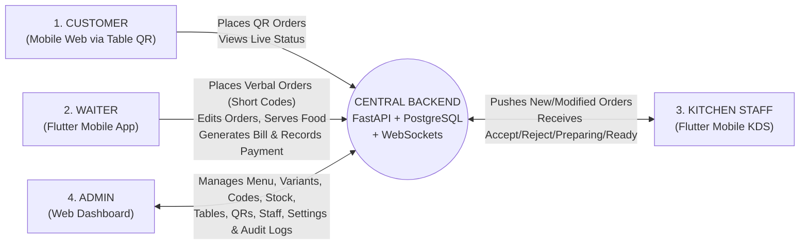
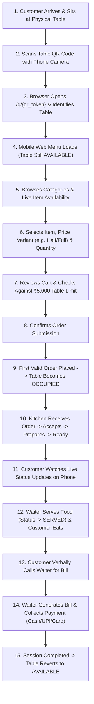
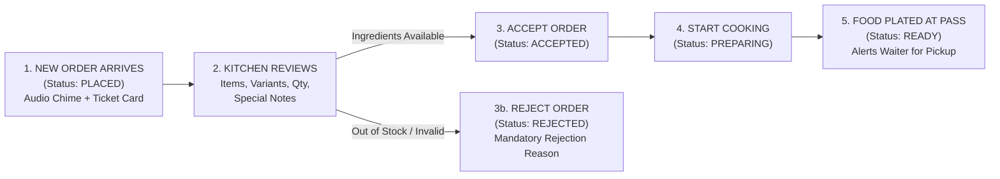

# RESTAURANT MANAGEMENT & QR ORDERING SYSTEM
## Software Requirements & Scope Specification

> **Artifact Path:** `docs/02-requirements-and-scope.md`  
> **Phase:** Documentation Only (Source of Truth — Zero Application Code)  
> **Deployment Target:** Single Physical Restaurant (Non-SaaS)  
> **Cost Constraint:** Strictly Zero-Cost / Free-Tier-First / Open-Source Architecture

---

## 1. PROJECT PURPOSE

### 1.1 Problem Statement
Traditional single-restaurant operations suffer from four recurring operational bottlenecks:
1. **Peak-Hour Waiter Overload:** During lunch and dinner rushes, waiters spend excessive time walking back and forth just to hand out physical menus, wait for guests to decide, write down orders on paper pads, and relay them to the kitchen.
2. **Order Transcription & Pricing Errors:** Handwritten paper KOTs (Kitchen Order Tickets) and verbal communication between waiters and kitchen staff frequently lead to misheard dishes, wrong portion sizes (e.g., Half vs. Full), missed cooking instructions, and billing calculation mistakes.
3. **Lack of Real-Time Status Visibility:** Customers do not know whether their order has been seen, accepted, or started by the kitchen; waiters must repeatedly walk into the kitchen to check if food is ready; and the restaurant manager lacks live visibility into active table totals and kitchen backlogs.
4. **Prohibitive Cost of Commercial POS/QR SaaS:** Commercial restaurant SaaS platforms charge recurring monthly per-table fees, commission percentages, or require expensive proprietary hardware and paid third-party cloud services.

### 1.2 Why QR-Based Ordering is Useful
- **Zero-Friction Instant Menu Access:** Guests seated at a table scan the table's unique QR code using their smartphone camera and immediately see the restaurant's live menu, current item availability, and accurate portion/variant prices in their mobile web browser—without installing an app, creating an account, or waiting for a staff member to bring a printed menu.
- **Direct-to-Kitchen Accuracy:** Customer-confirmed orders go straight into the central order system and appear immediately on the Kitchen Display System (KDS) with exact item codes, portion variants, and quantities.

### 1.3 How It Reduces Waiter Workload (Without Replacing Waiters)
- Routine browsing and repeat add-on orders (e.g., ordering extra rotis or beverages mid-meal) can be placed directly by customers via QR, freeing waiters to focus on hospitality, serving ready dishes promptly, assisting guests who prefer verbal ordering, handling order modifications, and collecting payment at the end of the meal.
- When customers prefer to call a waiter rather than scan the QR, the waiter uses a high-speed **Flutter Mobile App** equipped with **short memorable item codes** (e.g., `CB-H`, `CB-F`, `CK-2`) and full-name fallback search to enter orders in seconds.

### 1.4 How the System Connects All Four Roles

### 1.5 Complete Purpose of the System
The complete purpose of the **Restaurant Management & QR Ordering System** is to provide a **single physical restaurant** with an integrated, real-time, auditable, **zero-cost** software platform that unifies customer self-service QR ordering, fast waiter manual ordering, kitchen preparation workflow, staff-controlled table billing, and administrative governance into **one central source-of-truth database and state engine**.

---

## 2. PROJECT SCOPE (INCLUDED IN VERSION 1)

Version 1 (`v1.0`) encompasses four client applications connected to one central FastAPI + PostgreSQL + WebSocket backend:

### 2.1 CUSTOMER (Mobile-Responsive Web Application)
- **QR-Based Table Access:** Resolve a table-specific URL (`/q/<qr_token>`) scanned from a physical table QR code without requiring app installation, login, registration, 4-digit PIN, or waiter pre-activation.
- **Menu Browsing:** Browse active categories and dishes with descriptions, dietary indicators, and images where configured.
- **Live Item Availability:** View real-time stock status; unavailable items remain visible as `"Unavailable"` and cannot be added to an order.
- **Price Variants Selection:** Select specific serving/portion/quantity options (e.g., *Half ₹100 / Full ₹180*, *2 pieces ₹120*).
- **Client Cart Management:** Add items/variants, adjust quantities within configured limits, add optional special instructions, and review running cart subtotal against the table session's ₹5,000 limit.
- **Order Placement:** Explicitly confirm and submit orders into the central order pipeline with idempotency protection.
- **Live Order Status Tracking:** View real-time status progression (`PLACED`, `ACCEPTED`, `PREPARING`, `READY`, `SERVED`, or `REJECTED` with reason / `CANCELLED`) via WebSockets.
- **Order Cancellation (Where Permitted):** Request/perform cancellation strictly within documented pre-acceptance policy boundaries (see Section 11 & Open Decision `OD-02`).

### 2.2 WAITER (Flutter Mobile Application)
- **Authentication:** Secure staff login using username/employee code and password.
- **Table Selection & Lookup:** View all restaurant tables by status (`AVAILABLE`, `OCCUPIED`, `DISABLED`) or type a table number directly to retrieve its active session, orders, and bill.
- **Manual Customer Order Entry:** Take verbal orders from customers at any available or occupied table and submit them into the **same central order system** used by QR orders.
- **Short Item-Code Search:** Rapidly search and select dishes/variants using short memorable codes (`CB`, `CB-H`, `CB-F`, `CK`, `CK-2`).
- **Full Item-Name Search:** Search by dish name (`Chicken Biryani`, `Kebab`) whenever a short code is forgotten.
- **Price Variant & Quantity Selection:** Pick the exact serving variant and quantity and submit to the kitchen.
- **Audited Order Editing:** Edit orders before or after kitchen acceptance according to state-specific rules while preserving historical audit trails (`order_modification_events`).
- **Live Order Status & Food Served Status:** Receive real-time notifications when orders are `READY` or `REJECTED`, and transition orders from `READY` to `SERVED`.
- **Bill Generation:** Retrieve all consumed items for a table session using historical price snapshots, calculate applicable taxes/discounts, and generate a numbered bill.
- **Manual Payment Recording:** Record payment collection (`CASH`, `UPI`, `CARD`, `OTHER`) to complete the bill and automatically return the table to `AVAILABLE`.

### 2.3 KITCHEN STAFF (Flutter Mobile Application — KDS)
- **Authentication:** Secure staff login scoped strictly to kitchen operations.
- **Real-Time New Order Notifications:** Instant visual and audio alerts when either a Customer QR order or a Waiter manual order is `PLACED`.
- **Accept / Reject Order:** Accept `PLACED` orders into the cooking queue, or reject an order with a **mandatory rejection reason**.
- **Preparation Lifecycle Updates:** Transition accepted orders from `ACCEPTED` to `PREPARING` and from `PREPARING` to `READY`.
- **Order Modification & Cancellation Notifications:** Receive high-visibility real-time alerts showing exact before/after diffs whenever a waiter or admin modifies or cancels an accepted order, with a mandatory kitchen acknowledgment action.
- **Shift Order History:** View completed, rejected, and cancelled kitchen tickets from the shift.

### 2.4 ADMIN (Web Dashboard)
- **Executive Dashboard:** Live overview of table occupancy, active orders, kitchen queue depth, daily revenue, unpaid session balances, and security alerts.
- **Menu, Category, Variant & Item Code Management:** Full CRUD (with soft-delete/deactivation) for categories, dishes, multi-price variants, units/quantities, and unique short item codes.
- **Real-Time Availability Management:** Instant stock-in / stock-out toggles for categories, dishes, and individual price variants.
- **Table & QR Lifecycle Management:** Create/edit tables, generate cryptographic QR tokens, print QR cards, regenerate (rotate) QRs, revoke QRs, and disable/enable QR ordering per table or globally.
- **Waiter & Kitchen Staff Management:** Create staff accounts, assign roles, reset credentials, revoke active sessions, and deactivate former staff without breaking historical records.
- **Order, Billing & Payment Monitoring:** Live order oversight, emergency state overrides (with mandatory reason), bill inspection, audited bill void/adjustment workflow, and payment reconciliation across Cash/UPI/Card.
- **Reports, Settings & Security/Audit Logs:** Sales and operational reports, configuration of taxes, the **₹5,000 outstanding limit**, and rate limits, plus an immutable security and financial audit log viewer.

---

## 3. OUT OF SCOPE (EXCLUDED FROM VERSION 1)

The following features are **explicitly excluded** from Version 1 and must **not** be implemented unless formally approved in a future phase:

1. **Multi-Restaurant SaaS Architecture:** No multi-tenant organizations, tenant isolation schemas, franchise management, or SaaS subscription billing.
2. **Customer Native Mobile App:** Customers use mobile web only; no iOS/Android app is built for customers.
3. **Mandatory Customer Account / Registration / Login:** Customers do not sign up, enter email/phone OTPs, or log in to place table orders.
4. **Mandatory 4-Digit Table PIN / Verification Code:** Customers do not enter a PIN code before ordering.
5. **Mandatory Waiter / Admin Table Activation Before Ordering:** Customers can place the first order on an `AVAILABLE` table immediately after scanning the QR code.
6. **Paid Online Payment Gateway Integration:** No Razorpay, Stripe, PayU, or paid payment gateway SDKs in Version 1; payments are collected offline/physically by staff and recorded in the app.
7. **Home Delivery & Online Delivery Tracking:** Dine-in table ordering only; no delivery rider apps, map tracking, or third-party aggregator integrations (Swiggy/Zomato).
8. **Customer Loyalty, Coupons & CRM Programs:** No points engine or promotional marketing campaigns.
9. **Raw Ingredient / Recipe Inventory Deduction:** Availability is controlled via item/variant stock toggles (`is_available`), not gram-level raw ingredient warehouse accounting.
10. **Employee Payroll, Shift Scheduling & Attendance Biometrics.**
11. **Supplier / Purchase Order / Vendor Management.**
12. **Full Double-Entry General Ledger Accounting System.**
13. **Paid Third-Party APIs or Paid Cloud SaaS Dependencies:** No paid SMS/WhatsApp gateways, paid auth providers (Auth0/Clerk paid tiers), paid error trackers, or paid database-as-a-service plans.

---

## 4. USERS AND ROLES

### 4.1 Role Profile Definitions

| Role | Client Interface | Authentication Requirement | Core Operational Boundary |
| :--- | :--- | :--- | :--- |
| **Customer** | Mobile-Responsive Web | **No login.** Ephemeral signed `customer_session_token` issued upon scanning a valid `ACTIVE` table `qr_token`. | Scoped strictly to the single physical table and active `TableSession` associated with the scanned QR token. |
| **Waiter** | Flutter Mobile App | Staff JWT (`role = WAITER`) via username/employee code + Argon2id password hash. | Floor operations across tables: manual ordering, short-code search, allowed order edits, marking orders `SERVED`, generating bills, and recording payments. |
| **Kitchen Staff** | Flutter Mobile App | Staff JWT (`role = KITCHEN`) via username/employee code + Argon2id password hash. | Back-of-house preparation queue: viewing incoming orders/modifications, accepting/rejecting `PLACED` orders, and marking `PREPARING` and `READY`. |
| **Admin** | Web Dashboard | Staff JWT (`role = ADMIN`) via username/employee code + Argon2id password hash. | Full restaurant governance, menu/price/code configuration, QR security, staff accounts, settings, reports, audited overrides, and audit logs. |

### 4.2 Detailed Role Capabilities Breakdown

| Role | What They CAN View | What They CAN Create | What They CAN Modify | What They CAN Cancel / Void | What They CANNOT Access |
| :--- | :--- | :--- | :--- | :--- | :--- |
| **Customer** | - Public active menu, categories, variants, prices, live availability. - Own table number. - Own active `TableSession` orders & live statuses (`PLACED` to `SERVED`, or `REJECTED` reason). | - New dine-in orders for their scanned table (subject to availability, rate limits, and ₹5,000 cap). | - Client-side cart items/quantities prior to tapping "Confirm Order". | - Unsubmitted cart items. - Submitted orders **only** if policy `OD-02` permits cancellation while still `PLACED` (never after `ACCEPTED`). | - Other tables' orders or sessions. - Waiter short-code console. - Bill generation or payment recording. - Kitchen queue or Admin dashboard. |
| **Waiter** | - All tables & their live statuses (`AVAILABLE`, `OCCUPIED`, `DISABLED`). - Active table sessions, orders, modification history, and bills. - Full menu including short item codes (`CB`, `CB-H`) and full names. - Own shift order/bill history. | - Manual customer orders for any active/available table. - Official `Bill` for an occupied table session. - `Payment` records (`CASH`, `UPI`, `CARD`, `OTHER`). | - Existing orders in `PLACED` or `ACCEPTED` states (adds/reduces items via `order_modification_events`). - Order status from `READY` to `SERVED`. - Unlock a temporarily rate-limit-locked table QR session. | - Orders or order items in `PLACED` or `ACCEPTED` states (with mandatory reason). | - Kitchen `Accept`/`Reject`/`Preparing`/`Ready` transitions. - Cancelling orders already in `PREPARING`, `READY`, or `SERVED` (requires Admin). - Editing menu prices, item codes, or taxes. - Generating/regenerating table QR codes. - Managing staff or viewing system security logs. |
| **Kitchen Staff** | - Active kitchen order queue (`PLACED`, `ACCEPTED`, `PREPARING`, `READY`). - Order items, variants, quantities, special notes. - Real-time `OrderModificationEvents` & cancellations. - Shift kitchen ticket history. | - Mandatory `rejection_reason` when rejecting a `PLACED` order. - Modification acknowledgment timestamps. | - Order status: `PLACED -> ACCEPTED`, `PLACED -> REJECTED`, `ACCEPTED -> PREPARING`, `PREPARING -> READY`. - *(Optional per `OD-05`: toggle dish stock-out).* | - Rejects `PLACED` orders (cannot cancel orders once `PREPARING`/`READY` without Admin). | - Customer billing, prices, or payment recording. - Waiter manual order entry. - Admin settings, staff management, QR management, financial reports. |
| **Admin** | - All live & historical tables, sessions, orders, modifications, bills, payments, staff, settings, reports, security alerts, and immutable `audit_logs`. | - Menu categories, dishes, price variants, short codes. - Physical tables & cryptographic QR tokens. - Staff accounts (`WAITER`, `KITCHEN`, `ADMIN`). - Manual orders, bills, payments. | - Menu details, prices (future snapshots), availability. - QR rotation/revocation/enablement. - Restaurant settings, tax rates, ₹5,000 limit, rate limits. - Emergency order state transitions. | - Any active order or item in `PLACED`, `ACCEPTED`, `PREPARING`, `READY`, or `SERVED` (with mandatory audit reason & wastage flag). - Void an erroneous bill (via append-only credit/void audit record). | - **Cannot** hard-delete or silently overwrite completed bills, payments, historical order price snapshots, or `audit_logs`. |

### 4.3 Granular Permissions Matrix

| Permission Identifier | Customer | Waiter | Kitchen | Admin |
| :--- | :---: | :---: | :---: | :---: |
| `menu:read_public` | Yes | Yes | Yes | Yes |
| `menu:search_by_short_code` | No | Yes | Yes | Yes |
| `menu:manage_items_variants_codes` | No | No | No | Yes |
| `menu:toggle_availability` | No | No | `OD-05` | Yes |
| `qr:scan_and_bootstrap_session` | Yes | No | No | Yes |
| `qr:generate_regenerate_revoke_disable` | No | No | No | Yes |
| `table:view_floor_status` | Own Table | Yes | No | Yes |
| `table:lookup_by_number` | No | Yes | No | Yes |
| `table:manage_configuration` | No | No | No | Yes |
| `order:create_qr` | Yes (Own Table) | No | No | No |
| `order:create_manual` | No | Yes | No | Yes |
| `order:edit_placed_or_accepted` | No | Yes | No | Yes |
| `order:cancel_placed` | `OD-02` | Yes | No (Rejects) | Yes |
| `order:cancel_accepted` | No | Yes (Reason) | No | Yes (Reason) |
| `order:cancel_preparing_ready_served` | No | No | No | Yes (Audit+Wastage) |
| `order:kitchen_accept_reject` | No | No | Yes | Yes |
| `order:kitchen_preparing_ready` | No | No | Yes | Yes |
| `order:mark_served` | No | Yes | `OD-04` | Yes |
| `bill:generate` | No | Yes | No | Yes |
| `bill:apply_discount` | No | `OD-08` | No | Yes |
| `bill:void_with_audit` | No | No | No | Yes |
| `payment:record_manual` | No | Yes | No | Yes |
| `staff:manage_accounts` | No | No | No | Yes |
| `settings:configure_limits_and_taxes` | No | No | No | Yes |
| `audit:view_security_and_financial_logs` | No | No | No | Yes |

---

## 5. CUSTOMER REQUIREMENTS

### 5.1 End-to-End Customer Journey

### 5.2 Exception & Error Handling During Customer Flow

1. **If QR is Invalid (Unknown/Malformed Token):**
   - Backend returns HTTP `404 Not Found` (`QR_TOKEN_INVALID`).
   - Customer Web displays a clear error screen: *"Invalid QR Code. Please scan the official QR code on your table or call a waiter to place your order."*
2. **If QR is Revoked or Regenerated:**
   - Backend detects `table_qr_tokens.status == 'REVOKED'` and returns HTTP `410 Gone` (`QR_TOKEN_REVOKED`).
   - Customer Web displays: *"This QR code has been replaced and is no longer active. Please scan the updated QR code on your table or ask a waiter for help."*
3. **If Table is Unavailable (`DISABLED` / Under Maintenance) or QR Ordering Disabled:**
   - Backend returns HTTP `403 Forbidden` (`TABLE_DISABLED` or `QR_ORDERING_DISABLED`).
   - Customer Web displays: *"Ordering is currently paused for this table. Please speak with a waiter."*
4. **If Table is Already `OCCUPIED`:**
   - **Case A — Customer is refreshing/reopening their own phone browser on the active session:** Their signed `customer_session_token` matches `active_session_id`; they seamlessly see their active orders and can place additional orders (up to ₹5,000).
   - **Case B — A Bill has already been `ISSUED` for the occupied table:** QR ordering on that table session is locked (`is_qr_ordering_locked = true`). New order submissions return `423 Locked` (`"Bill has already been generated for this table. Please ask your waiter if you wish to add more items"`).
   - **Case C — Another phone scans the QR while the table has an active unbilled session:** Governed by Open Decision `OD-01` (Recommended default: allows table companions who scanned the physical QR to view/order within the shared session while notifying the table session and waiter in real time; or optional strict single-device lock).
5. **If an Item Becomes Unavailable:**
   - **Before adding to cart:** Item is rendered visibly in the menu with an `"Unavailable"` label and a disabled Add button.
   - **While already in the customer's cart:** Live `MENU_AVAILABILITY_UPDATED` WebSocket event immediately flags the cart line as unavailable. If the customer taps "Confirm Order" before noticing, the transactional backend check rejects the submission (`409 ITEM_UNAVAILABLE`), names the exact out-of-stock item/variant, and prompts the customer to remove it from the cart.
6. **If the ₹5,000 Outstanding Order Limit is Reached:**
   - If `current_session_outstanding + new_cart_subtotal > ₹5,000.00`, the backend blocks the order (`422 OUTSTANDING_LIMIT_EXCEEDED`).
   - Customer Web displays the exact current balance and remaining limit, instructing: *"This order exceeds the ₹5,000 active limit for a table. Please call a waiter to assist with your order or settle an interim bill."*
7. **If a Rate Limit is Reached:**
   - Backend returns HTTP `429 Too Many Requests` (`RATE_LIMIT_EXCEEDED`) with `retry_after_seconds`.
   - Customer Web displays a polite cooldown message and advises calling a waiter if immediate assistance is needed.
8. **If Network Fails During Order Submission:**
   - The "Place Order" button remains disabled during in-flight retry and preserves the exact UUIDv4 `Idempotency-Key` generated when the customer tapped Confirm.
   - When the connection recovers and the request is retried with the same `Idempotency-Key`, the server guarantees **at-most-once** order creation (returning the existing order if the first attempt had actually succeeded, or creating it cleanly if it had not reached the server).

---

## 6. TABLE REQUIREMENTS

### 6.1 Confirmed Table & Session Rules
1. **Unique Table Identifier:** Every physical table has a unique `table_number` (e.g., `1`, `2`, `T1`) and a human-readable `display_name` (e.g., `Table 1`), plus a seating capacity and operational status (`AVAILABLE`, `OCCUPIED`, `DISABLED`).
2. **No Waiter/Admin Activation Required:** An `AVAILABLE` table is ready to accept its first order immediately without a staff member unlocking or activating it beforehand.
3. **Rule — Scan Does Not Occupy:** Scanning a table's QR code, opening the web menu, or adding items to the browser cart **must never** change the table status from `AVAILABLE` to `OCCUPIED`.
4. **Rule — First Valid Order Occupies Table:**
   $$\text{AVAILABLE} \xrightarrow{\text{First Valid Order Placed (Customer QR or Waiter)}} \text{OCCUPIED}$$
   - Placing the first valid order atomically creates a new `TableSession` (`status = 'ACTIVE'`) and transitions the table to `OCCUPIED`.
5. **Rule — Full Cancellation / Rejection Reverts Table to Available:**
   $$\text{OCCUPIED} \xrightarrow{\text{All Active Orders Cancelled or Rejected (0 Valid Orders Remaining)}} \text{AVAILABLE}$$
   - If every order in the active `TableSession` is rejected by the kitchen or cancelled before completion such that zero active/served orders remain in the session, the session transitions to `CLOSED_NO_CHARGE` and the table automatically reverts to `AVAILABLE`.
6. **Rule — Payment & Session Completion Reverts Table to Available:**
   $$\text{OCCUPIED} \xrightarrow{\text{Successful Payment Recorded \& Session Completed}} \text{AVAILABLE}$$
   - When the waiter records full payment for the session's bill, all `SERVED` orders transition to `COMPLETED`, the `TableSession` transitions to `COMPLETED`, the table becomes `AVAILABLE`, and all ephemeral customer QR session tokens for that session are invalidated.

---

## 7. QR REQUIREMENTS

### 7.1 Cryptographic QR Token Architecture
- **One Unique QR Per Table:** Each table has its own distinct QR code.
- **Unpredictable Token (`qr_token`):** Each QR code resolves via a 256-bit cryptographically random URL-safe token (`secrets.token_urlsafe(32)`), e.g., `https://<domain>/q/8fK9mP2xQ7vL4nR1wZ5cB3yT6hJ0dG8sA4eU9iO2pM1`.
- **Sequential ID Prohibition:** Exposing `/table/1` or `/table/2` as the access mechanism is strictly prohibited.
- **Database Mapping:** Stored in `table_qr_tokens` with a partial unique index enforcing at most **one `ACTIVE` token per table** at any point in time.
- **Admin QR Lifecycle Operations:**
  1. **Generate:** Create the initial `ACTIVE` QR token for a newly created table.
  2. **Print:** Render a clean, printable table tent card (SVG/PNG/PDF) directly in the Admin browser (using open-source client-side QR rendering—zero paid APIs) displaying the restaurant name, `Table #`, and QR code.
  3. **Regenerate (Rotate):** Atomically set the table's current token to `REVOKED` (`revoked_at = NOW()`) and generate a brand-new `ACTIVE` random token.
  4. **Revoke:** Immediately mark the current token as `REVOKED` so it can no longer be used.
  5. **Disable / Enable:** Toggle `is_qr_enabled = false/true` on the table (or globally for the restaurant) to temporarily pause QR ordering without destroying the printed QR sticker.

### 7.2 The "Photographed QR Code" Security Problem & Practical Mitigations
- **The Problem:** Because customers do not log in, do not enter a 4-digit PIN, and do not wait for a waiter to activate the table, a malicious actor could take a photograph of Table 5's QR code today and attempt to scan that photo from home tomorrow to place fake prank orders.
- **Practical Zero-Friction Mitigations (Confirmed Design):**
  1. **Operating Hours & Global Toggle Gate:** QR order submissions are automatically blocked outside restaurant operating hours or when Admin pauses QR ordering.
  2. **Session Token Expiration & Completion Revocation:** Scanning a QR issues a short-lived `customer_session_token` (30-minute idle timeout; immediately revoked when the dining session is paid/completed).
  3. **Instant "First QR Order" Alert to Waiters:** When an `AVAILABLE` table transitions to `OCCUPIED` via a Customer QR order, the Waiter Flutter app immediately displays an alert (`"Table 5: First QR Order Placed"`). If the waiter sees Table 5 is physically empty, the waiter or kitchen cancels/rejects the fake order in one tap.
  4. **Bill-Issued Lock:** Once a real customer group at an occupied table has requested their bill (`bills.status = 'ISSUED'`), new QR orders on that table are locked.
  5. **₹5,000 Cap + Burst Rate Limits + Item Quantity Caps:** Prevents high-value or high-volume abuse.
  6. **Auto-Freeze on Suspicious Activity:** Repeated rejected orders or rate-limit hits automatically lock QR ordering on that session until a waiter unlocks it.
  7. **One-Click QR Regeneration:** If a table's QR photograph is abused, Admin clicks **Regenerate QR** for that table, permanently invalidating the photographed token (`410 Gone`).

---

## 8. MENU REQUIREMENTS

### 8.1 Core Menu Principle
$$\textbf{ONE MENU ITEM} \neq \textbf{ONE PRICE}$$
The system **must never** model price as a single column on the `menu_items` table. Every dish is modeled through a mandatory three-level hierarchy:

$$\text{Menu Category} \longrightarrow \text{Menu Item (Dish)} \longrightarrow \text{Menu Price Variant(s)} \longrightarrow \text{Order Line Item}$$

### 8.2 Concrete Multi-Variant Examples
- **Example 1 — Portion-Size Pricing (*Chicken Biryani*):**
  - `MenuItem`: *Chicken Biryani* (`item_code = "CB"`, Category = *Biryani*)
    - `MenuPriceVariant 1`: `variant_name = "Half"`, `variant_code = "CB-H"`, `unit_type = "PORTION"`, `unit_quantity = 1`, `price = ₹100.00`
    - `MenuPriceVariant 2`: `variant_name = "Full"`, `variant_code = "CB-F"`, `unit_type = "PORTION"`, `unit_quantity = 1`, `price = ₹180.00`
- **Example 2 — Piece/Quantity-Based Pricing (*Chicken Kebab*):**
  - `MenuItem`: *Chicken Kebab* (`item_code = "CK"`, Category = *Starters*)
    - `MenuPriceVariant 1`: `variant_name = "2 Pieces"`, `variant_code = "CK-2"`, `unit_type = "PIECES"`, `unit_quantity = 2`, `price = ₹120.00`
    - `MenuPriceVariant 2`: `variant_name = "4 Pieces"`, `variant_code = "CK-4"`, `unit_type = "PIECES"`, `unit_quantity = 4`, `price = ₹220.00`
- **Example 3 — Volume/Size Pricing (*Fresh Lime Soda* / *Soft Drinks*):**
  - Supports `250 ml` / `500 ml`, `Small` / `Medium` / `Large`, or a single `Regular` default variant when a dish has only one serving size.

### 8.3 Required Menu Attributes
- **Menu Category:** `id`, `name`, `description`, `display_order`, `is_available`, `is_active` (soft-delete).
- **Menu Item:** `id`, `category_id`, unique `item_code`, `name`, `description`, `dietary_type` (`VEG`, `NON_VEG`, `EGG`), optional `image_url`, `preparation_notes` (optional info), `is_available` (stock toggle), `is_active` (soft-delete).
- **Menu Price Variant:** `id`, `menu_item_id`, unique `variant_code`, `variant_name`, `unit_type`, `unit_quantity`, `price` (`NUMERIC(10,2)`), `is_default`, `is_available`, `is_active`.

---

## 9. ITEM CODE REQUIREMENTS

### 9.1 Purpose of Short Item Codes
Waiters taking verbal orders at a busy table need to enter items in 1–2 seconds without scrolling through long menus. Short item codes allow rapid keyboard entry while retaining full-name search as an instant fallback.

### 9.2 Item Code Rules & Specifications
1. **Uniqueness:** Every active `item_code` (on `menu_items`) and `variant_code` (on `menu_price_variants`) must be **globally unique (case-insensitive)** across the restaurant menu. Duplicate codes are rejected by both application validation and a PostgreSQL unique index (`UPPER(item_code)`).
2. **Short, Human-Readable & Memorable Format (Recommended Standard):**
   - Dish Base Code (`item_code`): 2–6 uppercase alphanumeric characters derived from the dish initials (e.g., `CB` = Chicken Biryani, `CK` = Chicken Kebab, `PBM` = Paneer Butter Masala, `BN` = Butter Naan).
   - Variant Code (`variant_code`): `<ITEM_CODE>-<VARIANT_SUFFIX>` (e.g., `CB-H` = Chicken Biryani Half, `CB-F` = Chicken Biryani Full, `CK-2` = Chicken Kebab 2 Pieces).
3. **Dual Search Capability (Mandatory):**
   - **Short-Code Search:** Typing `CB` surfaces *Chicken Biryani* with one-tap `[Half ₹100]` and `[Full ₹180]` buttons; typing `CB-F` directly highlights *Chicken Biryani (Full — ₹180)*.
   - **Full-Name Fallback Search:** If a waiter forgets `CB`, typing `"Chicken"` or `"Biryani"` in the **exact same search bar** returns *Chicken Biryani (`CB`)* along with its code so the waiter naturally learns the code over time.
4. **Admin Management:** Admin can create, edit, and validate item codes in the Admin Web Dashboard and print a 1-page reference sheet of all codes for staff training.

---

## 10. ORDER REQUIREMENTS

### 10.1 Unified Central Order Pipeline
- **Confirmed Rule:** Orders created by a **Customer via QR (`source = 'CUSTOMER_QR'`)** and orders created by a **Waiter via the Flutter App (`source = 'WAITER'`)** (or Admin override `source = 'ADMIN'`) **must enter the exact same `orders` and `order_items` tables**, attach to the same active `TableSession`, trigger the same real-time WebSocket events, appear in the same Kitchen queue, and consolidate onto the same final `Bill`.

### 10.2 Required Order Data Structure
Every order record (`orders` + `order_items`) captures:
- **Order Identifiers:** Internal UUID `id`, human-readable unique `order_number` (e.g., `ORD-20261006-0104`), and a daily resetting `daily_token_number` (e.g., `#14`).
- **Table & Session Binding:** `table_id` and `table_session_id`.
- **Order Source & Actor:** `source` (`CUSTOMER_QR` | `WAITER` | `ADMIN`), `created_by_waiter_id` (nullable for QR), `customer_session_token_id` (nullable for Waiter), plus actor user IDs for `accepted_by`, `rejected_by`, `preparing_by`, `ready_by`, `served_by`, and `cancelled_by`.
- **Line Items & Historical Snapshots (`order_items`):**
  - Foreign keys: `menu_item_id`, `menu_price_variant_id`.
  - **Immutable Snapshots:** `item_code_snapshot`, `item_name_snapshot`, `variant_code_snapshot`, `variant_name_snapshot`, `unit_type_snapshot`, `unit_quantity_snapshot`, and `unit_price_snapshot` (locks the exact price charged at the moment the order was placed).
  - **Quantities:** `original_quantity` (immutable initial quantity), `active_quantity` (current billable quantity after any valid modification), and `line_subtotal = active_quantity * unit_price_snapshot`.
- **Financial & Status Fields:** `subtotal_amount` (sum of active line subtotals; taxes are calculated at the session/bill level per `restaurant_settings`), `status`, `special_instructions`, `rejection_reason` (mandatory if `REJECTED`), `cancellation_reason` (mandatory if `CANCELLED` by staff), `idempotency_key`, `version` (optimistic locking), and lifecycle timestamps (`placed_at`, `accepted_at`, `preparing_at`, `ready_at`, `served_at`, `completed_at`, `rejected_at`, `cancelled_at`, `updated_at`).

---

## 11. ORDER STATE MACHINE

### 11.1 State Transition Diagram

```mermaid
stateDiagram-v2
    [*] --> PLACED: Customer (QR) or Waiter Submits Valid Order

    PLACED --> ACCEPTED: Kitchen Staff Accepts Order
    PLACED --> REJECTED: Kitchen Staff Rejects Order\n[Mandatory Rejection Reason]
    PLACED --> CANCELLED: Waiter / Admin Cancels Order\n[or Customer if OD-02 Enabled]

    ACCEPTED --> PREPARING: Kitchen Staff Starts Cooking
    ACCEPTED --> CANCELLED: Waiter / Admin Cancels Order\n[Mandatory Reason + Urgent Kitchen Alert]

    PREPARING --> READY: Kitchen Staff Marks Food Ready
    PREPARING --> CANCELLED: Admin Override Cancel ONLY\n[Mandatory Reason + Wastage Flag + Kitchen Alert]

    READY --> SERVED: Waiter Marks Delivered to Table
    READY --> CANCELLED: Admin Override Cancel ONLY\n[Mandatory Reason + Wastage Flag]

    SERVED --> COMPLETED: Waiter/Admin Records Full Bill Payment
    SERVED --> CANCELLED: Admin Post-Service Void ONLY\n[Before Bill Paid; Mandatory Audit Reason]

    REJECTED --> [*]
    CANCELLED --> [*]
    COMPLETED --> [*]
```

### 11.2 Allowed vs. Invalid State Transitions & Billing Impact

| Current State | Target State | Allowed By | Invalid Transitions Blocked (`409 Conflict`) | Impact on Table Session & Billing |
| :--- | :--- | :--- | :--- | :--- |
| `PLACED` | `ACCEPTED` | Kitchen, Admin | Cannot jump directly from `PLACED` to `READY`, `SERVED`, or `COMPLETED`. | Remains counted in session outstanding total and billable upon service. |
| `PLACED` | `REJECTED` | Kitchen, Admin | Cannot reject an order once it is `ACCEPTED`, `PREPARING`, `READY`, or `SERVED`. | Immediately subtracts order subtotal from `current_outstanding_amount`. Excluded from bill (`₹0`). If 0 active orders remain in session, table reverts to `AVAILABLE`. |
| `PLACED` | `CANCELLED` | Waiter, Admin *(Customer: see `OD-02`)* | Cannot transition from `CANCELLED` to any other state. | Immediately subtracts order subtotal from `current_outstanding_amount`. Excluded from bill (`₹0`). If 0 active orders remain, table reverts to `AVAILABLE`. |
| `ACCEPTED` | `PREPARING` | Kitchen, Admin | Cannot jump from `ACCEPTED` to `SERVED` or `COMPLETED`. | Remains counted in session outstanding total. |
| `ACCEPTED` | `CANCELLED` | Waiter, Admin | Customer cannot cancel once `ACCEPTED`. | Subtracts order subtotal from `current_outstanding_amount`; excluded from bill; triggers urgent cancellation chime on Kitchen KDS. |
| `PREPARING` | `READY` | Kitchen, Admin | Cannot revert `PREPARING -> PLACED` or `ACCEPTED`. | Remains counted in session outstanding total; triggers `ORDER_READY` pickup notification to Waiters. |
| `PREPARING` | `CANCELLED` | **Admin Only** *(see `OD-03`)* | Waiter and Customer blocked from unilateral cancellation once cooking has started. | Requires Admin reason + `is_wastage` flag; subtracts from session outstanding total and excludes from customer bill. |
| `READY` | `SERVED` | Waiter, Admin *(Kitchen: see `OD-04`)* | Cannot revert `READY -> PREPARING`. | Order is now confirmed delivered to the table and eligible for final Bill Generation. |
| `READY` / `SERVED` | `CANCELLED` | **Admin Only** | Cannot cancel once `COMPLETED` (paid). | Admin-only service recovery / void prior to bill payment; logged in `audit_logs` and removed from billable total. |
| `SERVED` | `COMPLETED` | System (on Payment) | Cannot transition to `COMPLETED` unless `Bill` is `PAID`. | Finalized on paid invoice; session closes and table becomes `AVAILABLE`. |

### 11.3 What Happens When a Transition Fails
- **Concurrent State Change (`409 ORDER_VERSION_CONFLICT`):** Every transition request includes `expected_version`. If Kitchen accepts an order (`v1 -> v2`) 50 milliseconds before a Waiter submits a pre-acceptance cancellation targeting `v1`, the Waiter's request fails cleanly with HTTP `409`, returns the updated `ACCEPTED` order state, and prompts the Waiter for a post-acceptance cancellation reason.
- **Unauthorized Actor (`403 FORBIDDEN_ROLE`):** Attempting a transition outside the role matrix (e.g., Waiter trying to mark `PLACED -> ACCEPTED`, or Customer trying to cancel an `ACCEPTED` order) is rejected and logged.

---

## 12. ORDER EDITING REQUIREMENTS

Waiters require an **Edit Order** capability to handle guest change requests at different stages of dining without ever silently destroying historical data:

| Order State When Edit is Requested | Allowed Modifications & Workflow | Audit & Historical Preservation Mechanism |
| :--- | :--- | :--- |
| **1. Before Kitchen Acceptance (`PLACED`)** | - **Waiter or Admin** can add items, increase/decrease item quantities, cancel an individual line item, or update preparation notes. - Upward price changes must still pass the **₹5,000 outstanding limit** check. | - Original `original_quantity` and `unit_price_snapshot` on `order_items` are preserved; `active_quantity` and `line_subtotal` update. - An immutable row is inserted into `order_modification_events` (`order_status_at_modification = 'PLACED'`). - Kitchen KDS immediately receives the updated order via WebSocket (`ORDER_MODIFIED`). |
| **2. After Kitchen Acceptance (`ACCEPTED`, before cooking starts)** | - **Waiter or Admin** can reduce quantity or cancel a line item **only by providing a mandatory modification reason** (e.g., `"Customer changed mind"`). - Adding new items is supported either by appending a flagged modification line (`is_modification_addition = true`) or placing a new supplementary order. | - **Never overwrites history:** `order_modification_events` stores `before_snapshot_json`, `after_snapshot_json`, `previous_quantity`, `new_quantity`, `price_delta`, `reason`, and `performed_by_user_id`. - Sets `orders.has_unacknowledged_kitchen_mods = true`. - Kitchen KDS flashes an amber modification diff banner with audio chime until Kitchen Staff taps **"Acknowledge Change"**. |
| **3. During Preparation (`PREPARING`)** | - Food is actively being cooked on the stove/tandoor. - **Waiters cannot unilaterally reduce or cancel items in `PREPARING` state** (unless `OD-03` is changed). - Requires **Admin override** (or Kitchen confirmation) with a mandatory reason and `is_wastage = true/false` classification. - For extra items requested by the customer, the waiter simply creates a new order in the same `TableSession`. | - Admin override creates an immutable `order_modification_events` record (`is_wastage` logged for wastage reports) and an `audit_logs` entry, adjusts `active_quantity` and `current_outstanding_amount`, and alerts Kitchen. |
| **4. After Ready (`READY`)** | - Food is already cooked and plated at the pass. - **Admin Override Only** for item cancellation/reduction (with mandatory reason and `is_wastage = true`). - Extra items requested by the customer are entered as a new order. | - Preserves full original preparation record while logging the Admin post-prep void in `order_modification_events` and `audit_logs`. |
| **5. After Served (`SERVED`)** | - Food has been delivered to the table. - Waiters cannot edit a `SERVED` order. - If an item must be comped/removed due to a quality issue before the bill is paid, **Admin** performs an audited item void (`active_quantity` reduced, mandatory reason logged). - Once the bill is paid (`COMPLETED`), no edits of any kind are permitted. | - Full financial diff (`previous_order_subtotal`, `new_order_subtotal`, `price_delta`, `reason`, `performed_by_user_id`) is permanently recorded in `order_modification_events` and `audit_logs`. |

---

## 13. ₹5,000 OUTSTANDING LIMIT

### 13.1 Confirmed Rule & Validation Example
- **Confirmed Initial Limit:** The maximum unpaid outstanding order value per active table session (`TableSession`) is **`₹5,000.00`** (stored in `restaurant_settings.max_outstanding_session_amount` and configurable by Admin).
- **Mandatory Validation Example:**
  - Current unpaid outstanding total for Table 4's active session = **`₹4,850.00`**
  - Customer (via QR) or Waiter submits a new order (or upward order modification) worth = **`₹300.00`**
  - Projected unpaid total = `₹4,850.00 + ₹300.00 =` **`₹5,150.00`** ($> ₹5,000.00$)
  - **System Result:** **ORDER BLOCKED** (`HTTP 422 Unprocessable Entity — OUTSTANDING_LIMIT_EXCEEDED`).
  - **User Instruction:**
    - *Customer Web UI:* `"Order cannot be placed because the active table total (₹4,850 + ₹300 = ₹5,150) would exceed the ₹5,000 table limit. Please contact a waiter or restaurant staff for assistance."`
    - *Waiter Mobile UI:* `"Order exceeds the ₹5,000 table session limit (Projected: ₹5,150). Please record a partial payment or ask Admin to increase this table session's limit."`

### 13.2 Exact Outstanding Value Formula & Factor Impact

$$\text{Current Outstanding Value} = \left( \sum_{o \in \text{ActiveOrders}} \sum_{i \in o.\text{ActiveItems}} (i.\text{active\_quantity} \times i.\text{unit\_price\_snapshot}) \right) - \text{SessionDiscounts} - \sum_{p \in \text{SuccessfulPayments}} p.\text{amount}$$

| Factor | Exact Impact on Outstanding Limit Calculation |
| :--- | :--- |
| **Active Orders (`PLACED`, `ACCEPTED`, `PREPARING`, `READY`, `SERVED`)** | **Included (`+`):** Every active line item (`active_quantity * unit_price_snapshot`) in these five states counts toward the ₹5,000 limit. |
| **Cancelled Orders & Cancelled Line Items (`CANCELLED`)** | **Excluded (`₹0`):** When an entire order or a specific item quantity is cancelled via a valid cancellation/modification event, its value is immediately subtracted from `current_outstanding_amount`, restoring available ordering headroom. |
| **Rejected Orders (`REJECTED`)** | **Excluded (`₹0`):** When Kitchen rejects a `PLACED` order, its entire value is immediately deducted from `current_outstanding_amount`. |
| **Paid Amounts (`payments.status = 'SUCCESS'`)** | **Deducted (`-`):** Any verified partial/interim payment recorded against the active `TableSession` reduces the unpaid outstanding balance rupee-for-rupee. Once final payment is recorded, the session closes (`COMPLETED`). |
| **Discounts** | **Deducted (`-` when applied to an active bill):** Prior to bill generation, outstanding value is based on gross active item subtotals. If an authorized discount is applied during bill generation, it reduces the net payable balance. |
| **Taxes (CGST / SGST)** | **Recommended Rule (See Open Decision `OD-06`):** Evaluate the ₹5,000 cap against the **menu item subtotal** (`sum of active_quantity * unit_price_snapshot`) so that customers adding up menu prices (`₹100`, `₹180`) see exact alignment with the ₹5,000 threshold. *(Alternative in `OD-06`: include estimated tax in the ₹5,000 check).* |

---

## 14. RATE LIMITING & ABUSE PROTECTION

Restaurant guests legitimately place multiple orders during a meal (e.g., ordering soup first, starters 45 seconds later, and extra rotis mid-meal). Therefore, the system **must not** enforce an unrealistic `"1 order per minute"` rule. Instead, it uses **configurable multi-layer protections** (all stored in `restaurant_settings` and adjustable by Admin):

| Protection Rule | Scope | Recommended Initial Default *(Configurable)* | System Behavior When Triggered |
| :--- | :--- | :--- | :--- |
| **1. Short-Window Order Burst Limit** | Per Active `TableSession` (Customer QR) | **Max 3 orders per 2 minutes (120s)** | Allows natural back-to-back ordering (drinks + starters + mains), but blocks rapid automated/prank spamming with `429 Too Many Requests`. |
| **2. Medium-Window Order Frequency** | Per Active `TableSession` (Customer QR) | **Max 10 orders per 30 minutes (1800s)** | Prevents excessive fragmentation of orders over a half-hour window; prompts customer to call a waiter. |
| **3. Unaccepted Kitchen Queue Cap** | Per Active `TableSession` (Customer QR) | **Max 3 concurrent `PLACED` orders** | If a table already has 3 orders sitting in `PLACED` state waiting for Kitchen acceptance, a 4th QR order is held back (`429`) until Kitchen accepts or rejects the pending ones. |
| **4. Duplicate Submission & Idempotency** | Per Request (`Idempotency-Key` + Cart Hash) | **Mandatory UUID `Idempotency-Key` + 15-second identical cart-hash debounce** | Prevents network retries or double-taps from creating duplicate orders in the kitchen. |
| **5. Maximum Line Items Per Order** | Per Single Order | **Max 20 distinct item variants per order** | Blocks oversized cart payloads (`422 MAX_ITEMS_PER_ORDER_EXCEEDED`). |
| **6. Maximum Quantity Per Item Variant** | Per Order Line (`OrderItem`) | **Max 15 quantity per variant per order** | Prevents accidental or malicious `"500 x Chicken Biryani"` submissions (`422 MAX_ITEM_QUANTITY_EXCEEDED`). Large banquet quantities can be entered or overridden by Waiter/Admin. |
| **7. Suspicious Activity Auto-Freeze** | Per `TableSession` / Client IP | **Auto-lock QR ordering on table after 3 consecutive Kitchen Rejections or 5 rate-limit hits** | Sets `table_sessions.is_qr_ordering_locked = true` and alerts Waiter & Admin. Legitimate guests at the table can still order via the Waiter, or the Waiter can unlock the table's QR in 1 tap. |
| **8. Excessive API Request Throttling** | Per Client IP Address | **Max 60 public API requests / minute** (Token bucket in memory) | Blocks brute-force scanning of `/q/{qr_token}` or DoS floods (`429`). |

---

## 15. KITCHEN REQUIREMENTS

### 15.1 Kitchen Preparation Workflow

### 15.2 What Kitchen Staff Must Receive in Real Time
1. **New Orders (`ORDER_PLACED`):** Both Customer QR orders and Waiter-created manual orders appear immediately on the Kitchen Flutter KDS without manual screen refresh, clearly showing `Table Number`, `Daily Token #`, `Order Source (QR vs. Waiter)`, elapsed timer, itemized variants (`2 x CB-F Chicken Biryani Full`), and cooking notes.
2. **Relevant Modifications (`ORDER_MODIFIED`):** Whenever a Waiter or Admin modifies an order after creation, the affected ticket on the Kitchen KDS highlights the exact **Before vs. After diff** (e.g., `"CK-2 Chicken Kebab: Qty 3 -> 1 [Reduced by 2] — Reason: Customer request"`) with a distinct audio chime until Kitchen Staff taps **"Acknowledge Modification"**.
3. **Important Cancellations (`ORDER_CANCELLED`):** If an order in `PLACED`, `ACCEPTED`, or `PREPARING` is cancelled, the ticket immediately flashes red (`CANCELLED`) with an urgent alert tone so the chef stops cooking immediately and prevents food wastage.

### 15.3 Strict Kitchen Access Restrictions
Kitchen Staff accounts (`role = KITCHEN`) **must NOT have access to**:
- Admin dashboard functions, menu price editing, or QR code generation/regeneration.
- Financial configuration (tax rates, discounts, ₹5,000 limit settings, revenue reports).
- User/staff account management.
- Bill generation or customer payment recording.
- Security settings or system-wide audit logs.

---

## 16. WAITER REQUIREMENTS

The Waiter Flutter Mobile Application is the primary operational tool on the restaurant floor and **must enable waiters to serve customers who never touch the QR code as well as customers who order via QR**:

1. **Login:** Authenticate securely with waiter credentials; remain logged in across the shift via secure token refresh.
2. **Live Dashboard:** View immediate action items: orders in `READY` state waiting at the kitchen pass for pickup, new first-time QR orders placed on tables, and any kitchen rejections requiring customer follow-up.
3. **Tables Overview & Quick Table Lookup:** View the color-coded floor grid (`AVAILABLE`, `OCCUPIED`, `DISABLED`) or **enter a table number directly** (e.g., `4`) to open that table's active session, orders, and bill in one step.
4. **Manual Order Creation (For Non-QR Verbal Customers):** Select any `AVAILABLE` or `OCCUPIED` table, enter items requested verbally by the customer, and submit them into the central order pipeline.
5. **Short Item-Code Search:** Type short codes (`CB`, `CB-H`, `CB-F`, `CK-2`) for ultra-fast 2-second item entry.
6. **Full Item-Name Search:** Search by dish name (`Chicken Biryani`, `Kebab`) whenever the waiter forgets an item's short code.
7. **Price Variant & Quantity Selection:** Select the exact variant (`Half` vs. `Full`, `2 pcs` vs. `4 pcs`), specify quantity, and attach optional item-level or order-level preparation notes.
8. **Order Editing:** Edit existing orders on a table according to the state rules in Section 12 (direct edit in `PLACED`; audited reason-required edit in `ACCEPTED`).
9. **Live Order Status Monitoring:** Track every order on a table (`PLACED -> ACCEPTED -> PREPARING -> READY -> SERVED`).
10. **Mark Food Served (`READY -> SERVED`):** Tap **"Mark Served"** when delivering plated food from the kitchen pass to the table.
11. **Bill Lookup & Bill Generation:** When a customer verbally asks for the bill, enter/select the table number, verify all active orders are `SERVED`, review consolidated items and historical prices, and generate the numbered bill.
12. **Payment Recording:** Collect payment from the customer and record the payment method (`CASH`, `UPI`, `CARD`, `OTHER`) to complete the bill and free the table back to `AVAILABLE`.
13. **Order & Bill History:** Review completed orders and bills from the current shift to answer customer or manager questions.

---

## 17. ADMIN REQUIREMENTS

### 17.1 Comprehensive Admin Capabilities & Permission Table

| Admin Module | View / Inspect | Create / Generate | Update / Configure | Deactivate / Soft-Delete / Revoke | Hard-Delete Allowed? |
| :--- | :---: | :---: | :---: | :---: | :---: |
| **1. Executive Dashboard** | Live KPIs, floor map, kitchen queue, active alerts | — | — | Acknowledge/dismiss operational alerts | No |
| **2. Menu Categories** | All active & inactive categories | Create new category | Rename, edit description, reorder `display_order` | Toggle `is_available` or deactivate (`is_active=false`) | **No** (Soft-delete only) |
| **3. Menu Items (Dishes)** | All dishes, dietary types, images | Create new dish | Edit name, description, image, category | Toggle `is_available` or deactivate (`is_active=false`) | **No** (Preserves historical FKs) |
| **4. Pricing & Variants** | All variants, units, quantities, current prices | Add new variant (`Half`, `Full`, `2 pcs`) | Update variant price (affects future orders only), unit, default flag | Toggle variant `is_available` or `is_active=false` | **No** (Preserves `order_items` FKs) |
| **5. Short Item Codes** | Complete code directory & printable cheat sheet | Assign `item_code` & `variant_code` | Change code (enforcing uniqueness) | Released only if item deactivated | **No** |
| **6. Availability Board** | Live stock status across entire menu | — | 1-click bulk or single stock-in / stock-out toggles | — | N/A |
| **7. Physical Tables** | All tables, capacities, live session totals | Create new table (`table_number`) | Edit display name, capacity, section | Set status `DISABLED` (maintenance) or `is_active=false` | **No** |
| **8. QR Code Management** | Active QR status, scan counts, token rotation history | Generate initial QR & printable PDF/PNG | **Regenerate (Rotate)** QR token (invalidates old QR) | **Revoke** QR token or **Disable** QR ordering on table | **No** (Token history retained) |
| **9. Staff Accounts** | All Waiter, Kitchen, and Admin users & login status | Create staff account & role | Edit name/phone, reset password, unlock locked account | Deactivate (`is_active=false`) & revoke active sessions | **No** (Preserves actor audit trail) |
| **10. Orders Monitor** | Live & historical orders + modification timelines | Create manual support order | Emergency state override (`PREPARING/READY/SERVED -> CANCELLED` with reason) | Cancel/void order or line item with mandatory audit reason | **No** (Strictly prohibited) |
| **11. Bills / Invoices** | All `ISSUED`, `PAID`, and `VOIDED` bills | Generate bill on behalf of table | Apply authorized discount to `ISSUED` bill | **Void** erroneous bill via append-only audit record + reason | **No** (Strictly prohibited) |
| **12. Payments Ledger** | All recorded payments by mode (`CASH`, `UPI`, `CARD`) | Record manual payment | Record audited refund/credit adjustment note | Mark erroneous uncompleted entry `VOIDED` with reason | **No** (Strictly prohibited) |
| **13. Reports & Analytics** | Sales, tax, top items, QR vs Waiter, prep time, wastage | Export CSV / printable report | Filter by date range, staff, source | — | N/A |
| **14. Restaurant Settings** | Current taxes, operating hours, ₹5,000 cap, rate limits | — | Update GST %, ₹5,000 limit, rate-limit thresholds, operating hours | Pause global QR ordering (`is_qr_ordering_enabled=false`) | **No** |
| **15. Security & Audit Logs** | Rate-limit blocks, revoked scans, immutable `audit_logs` | — | Temporarily block/unblock abusive session | — | **No** (Append-only DB trigger) |

### 17.2 Dangerous / High-Impact Admin Operations (Special Safeguards Required)
The following high-impact Admin operations require **explicit confirmation dialogs**, **mandatory free-text `reason` entry**, and **immutable before/after JSON logging in `audit_logs`**:
1. **Regenerating or Revoking a Table's QR Code:** Immediately invalidates the physical printed QR sticker on that table (`410 Gone`).
2. **Cancelling an Order in `PREPARING`, `READY`, or `SERVED` State:** Impacts kitchen food wastage and active table billing; requires mandatory reason + `is_wastage` checkbox.
3. **Voiding an `ISSUED` or `PAID` Bill:** High financial sensitivity; never deletes the bill row—transitions bill to `VOIDED` with `void_reason` and `voided_by_user_id`.
4. **Force-Closing an `OCCUPIED` Table Session:** Used only if guests walked out before ordering/paying or a session was abandoned; logs full session state before freeing the table.
5. **Changing Menu Prices or Tax Percentages while Restaurant is Open:** Must apply strictly to **newly placed orders / newly generated bills** after the save timestamp, never mutating in-flight or historical snapshots.
6. **Deactivating a Staff Account:** Immediately increments `users.token_version` and terminates any active Waiter/Kitchen mobile sessions for that employee.

---

## 18. BILLING REQUIREMENTS

1. **No Customer QR Bill Request:** Customers do **not** request or generate the bill from the QR web interface. When finished dining, the customer verbally calls a waiter.
2. **Waiter Table Number Lookup:** The waiter enters or selects the table number (e.g., `Table 4`) in the Waiter Flutter App to retrieve the active `TableSession` and all its orders.
3. **Pre-Billing Order Verification:**
   - The system verifies that all non-cancelled, non-rejected orders in the session have reached the `SERVED` state.
   - If any order is still `PLACED`, `ACCEPTED`, `PREPARING`, or `READY`, the app alerts the waiter to resolve those orders first (e.g., mark a delivered `READY` order as `SERVED`, or cancel an unaccepted `PLACED` order).
4. **Historical Price Preservation on Bills:**
   - The bill consolidates all active `order_items` (`active_quantity > 0`) across the session's `SERVED` orders using each line's immutable `unit_price_snapshot` and `variant_name_snapshot`.
   - Even if Admin changed a dish's price on the menu 10 minutes after the customer ordered it, the bill charges the exact `unit_price_snapshot` displayed when the order was placed.
5. **Required Bill Calculation & Fields (`bills` + `bill_items`):**
   - Unique sequential `bill_number` (e.g., `INV-20261006-0042`).
   - Consolidated line items showing: `item_name_snapshot`, `variant_name_snapshot` (`Half`, `Full`, `2 Pieces`), `item_code_snapshot`, `quantity`, `unit_price`, and `line_total`.
   - `items_subtotal` = $\sum (\text{quantity} \times \text{unit\_price})$.
   - `discount_amount` (if discounts are enabled in settings and authorized, with `discount_reason`).
   - `taxable_amount` = `items_subtotal - discount_amount`.
   - `tax_breakdown`: `cgst_amount` + `sgst_amount` (using snapshotted tax rates from `restaurant_settings`, supporting `EXCLUSIVE`, `INCLUSIVE`, or `NONE` tax modes).
   - `rounding_adjustment` and final `grand_total`.
   - `status`: `ISSUED` (upon generation) $\rightarrow$ `PAID` (upon payment recording) or `VOIDED` (only via audited Admin void).
   - Generating a bill (`ISSUED`) automatically sets `table_sessions.is_qr_ordering_locked = true` so no additional QR orders can be sneaked in after the bill is printed.

---

## 19. PAYMENT REQUIREMENTS

### 19.1 Zero-Cost Manual Payment Recording (Confirmed Version 1 Scope)
- **No Paid Payment Gateway Required:** Version 1 does **not** integrate Razorpay, Stripe, PayU, or any paid online payment gateway that charges transaction fees (typically 2% per transaction).
- **Supported Payment Methods Recorded in System:**
  1. **`CASH`:** Customer pays cash to the waiter; waiter counts cash and records `CASH` payment in the app.
  2. **`UPI`:** Customer scans the restaurant's standard zero-MDR bank/merchant static UPI QR stand at the counter/table (or waiter's merchant UPI QR) using Google Pay / PhonePe / Paytm; waiter visually verifies the payment confirmation and records `UPI` (with optional UTR/reference digits) in the Waiter App.
  3. **`CARD`:** Customer taps/inserts card on the restaurant's standalone bank POS machine; waiter verifies the printed charge slip and records `CARD` in the Waiter App.
  4. **`OTHER`:** Any other offline settlement method approved by Admin.

### 19.2 Explicit Distinction: Manual Payment Recording vs. Payment Gateway Integration

| Aspect | Manual Payment Recording *(Included in Version 1)* | Online Payment Gateway *(Excluded from Version 1 — Future Optional)* |
| :--- | :--- | :--- |
| **How Money Moves** | Customer pays via physical Cash, bank merchant UPI QR stand, or physical card swipe terminal outside the software. | Customer pays inside the mobile web browser via third-party gateway checkout SDK + webhooks. |
| **Role of Waiter App** | Waiter verifies payment receipt and taps **"Confirm Payment Received"** (`CASH` / `UPI` / `CARD`), recording an immutable `payments` ledger row. | Gateway webhook automatically marks bill paid. |
| **Transaction Cost** | **₹0.00 (100% Free)** | 1.5% – 2.5% per transaction + GST charged by gateway provider. |
| **Session Completion Trigger** | Waiter's `POST /api/v1/waiter/bills/{id}/payments` atomically marks `Payment = SUCCESS`, `Bill = PAID`, `Orders = COMPLETED`, `TableSession = COMPLETED`, and `Table = AVAILABLE`. | Webhook callback triggers session completion. |

---

## 20. SECURITY REQUIREMENTS CHECKLIST

All 22 security domains below are mandatory for Version 1 implementation:

- [ ] **1. Staff Authentication:** Username/employee code + password verified against **Argon2id** hashes; issues short-lived JWT access tokens (15–30m) + revocable refresh tokens stored in `user_sessions`.
- [ ] **2. Customer Contextual Authentication:** Zero login; scanning `/q/{qr_token}` issues an HMAC-SHA256 signed `customer_session_token` (`HttpOnly; Secure; SameSite=Strict`) bound to `table_id`, `qr_token_id`, and `table_session_id`.
- [ ] **3. Role-Based Access Control (RBAC):** Every FastAPI route enforces strict role dependencies (`CUSTOMER_QR`, `WAITER`, `KITCHEN`, `ADMIN`).
- [ ] **4. QR Token Security:** 256-bit CSPRNG random tokens (`secrets.token_urlsafe(32)`); never sequential table numbers; instant invalidation (`410 Gone`) upon regeneration or revocation.
- [ ] **5. Session Security & Expiration:** Customer session tokens expire after 30 minutes of idle browsing (if no order placed) and are **immediately revoked** the instant the table session completes (`PAID` or `CLOSED_NO_CHARGE`).
- [ ] **6. Multi-Tier Rate Limiting:** Configurable burst limits (3 orders/2m), session window limits (10 orders/30m), unaccepted queue cap (3 `PLACED` orders), item/qty caps, and IP token-bucket rate limiting.
- [ ] **7. Idempotency Enforcement:** Mandatory `Idempotency-Key` header on order creation, bill generation, and payment recording backed by a unique DB constraint + 15-second identical cart-hash debounce.
- [ ] **8. Strict Input Validation:** Pydantic v2 schemas with `extra="forbid"`, regex validation on codes, positive integer bounds on quantities ($1 \le q \le 15$), and character length limits on notes/reasons.
- [ ] **9. Output Validation & Data Minimization:** Explicit response schemas that strip `password_hash`, internal secrets, and raw stack traces; Customer APIs never expose staff user IDs or internal audit metadata.
- [ ] **10. SQL Injection Prevention:** 100% parameterized SQLAlchemy 2.0 ORM queries; zero raw string concatenation in SQL.
- [ ] **11. Cross-Site Scripting (XSS) Prevention:** Server-side HTML sanitization on all free-text fields (`special_instructions`, `rejection_reason`, `cancellation_reason`) + React auto-escaping + strict `Content-Security-Policy` header.
- [ ] **12. CSRF Protection:** `SameSite=Strict` cookies + custom header (`X-Requested-With` / CSRF token) verification on cookie-authenticated customer web state-mutating requests.
- [ ] **13. CORS Policy:** Explicit origin allowlist for Customer Web and Admin Web domains; wildcard `*` with credentials forbidden.
- [ ] **14. IDOR / Broken Access Control Prevention:** Customer endpoints derive `table_id` and `table_session_id` exclusively from the server-verified `customer_session_token`—never from client-supplied path/body parameters.
- [ ] **15. Password Security:** Argon2id hashing, minimum 8-character policy for staff passwords, and brute-force lockout (15-minute lock after 5 failed attempts).
- [ ] **16. Secrets Management:** All secrets (`JWT_SECRET`, `HMAC_SECRET`, `DATABASE_URL`) loaded from environment variables excluded from Git (`.gitignore`).
- [ ] **17. Immutable Audit Logging:** Append-only `audit_logs` table protected by a PostgreSQL `BEFORE UPDATE OR DELETE` trigger that blocks any modification or deletion of audit history.
- [ ] **18. Financial Record Protection:** `order_items` price snapshots, `bills`, `bill_items`, and `payments` are protected from silent `UPDATE` or `DELETE`; corrections require append-only void/modification records.
- [ ] **19. Concurrency & Race-Condition Protection:** PostgreSQL `SELECT ... FOR UPDATE` row locks on `restaurant_tables` and `table_sessions` + optimistic `version` columns on `orders`.
- [ ] **20. Duplicate Order Prevention:** Combined client button-disable, UUID `Idempotency-Key`, and 15-second cart-hash deduplication.
- [ ] **21. Unauthorized Table Access Prevention:** Unpredictable QR tokens + restaurant operating hours gate + first-QR-order waiter notification + bill-issued QR lock.
- [ ] **22. Unauthorized Bill Access Prevention:** Customers have zero API endpoints to generate, mutate, or mark bills paid; billing endpoints require `WAITER` or `ADMIN` JWTs.

---

## 21. NON-FUNCTIONAL REQUIREMENTS

Realistic, measurable non-functional requirements tailored for a single physical restaurant (e.g., 15–50 tables, 5–15 staff devices, 20–100 concurrent guests) running on free/low-resource infrastructure:

| Category | Requirement Specification |
| :--- | :--- |
| **1. Performance** | - Menu & QR bootstrap API response time: **$< 300\text{ms}$ (p95)** on local/regional connection. - Waiter short-code search (`CB`, `CB-H`) latency: **$< 50\text{ms}$** (using local in-memory menu cache synchronized via WebSockets). - Real-time WebSocket event delivery (`ORDER_PLACED` to Kitchen KDS): **$< 200\text{ms}$**. |
| **2. Reliability & Data Integrity** | - 100% ACID transactional consistency for order placement, ₹5,000 limit checks, bill generation, and payment recording. - Zero lost orders: if a client disconnects mid-request, `Idempotency-Key` retry guarantees safe recovery. |
| **3. Availability** | - Target **99.5%+ uptime during restaurant operating hours**. - Automatic WebSocket reconnection with exponential backoff (`1s, 2s, 4s, 8s`) and full state resynchronization (`GET` active orders/tables) whenever Wi-Fi/mobile data fluctuates. |
| **4. Scalability (Single-Restaurant Bound)** | - Must smoothly support up to **60 physical tables**, **150 concurrent WebSocket connections**, and **1,500+ orders per day** on a single modest server instance (1–2 vCPU, 1–2 GB RAM) without horizontal sharding complexity. |
| **5. Maintainability** | - Clean modular architecture (`routers/`, `services/`, `models/`, `schemas/` in FastAPI; feature-first folders in React and Flutter). - Strict TypeScript types, Dart null-safety, and Pydantic v2 models. - Automated database migrations via Alembic. |
| **6. Mobile Responsiveness & Usability** | - **Customer Web:** Mobile-first touch layout (`320px`–`480px` width), touch targets $\ge 44\text{px}$, zero horizontal scrolling, readable typography. - **Waiter App:** Single-handed thumb-friendly operation; adding an item via short code (`CB-F`) takes $\le 3$ taps. - **Kitchen App:** High-contrast KDS layout readable from 1.5 meters away in a bright kitchen, with distinct audio chimes for new orders vs. modifications/cancellations. |
| **7. Accessibility** | - WCAG AA contrast ratios ($\ge 4.5:1$); status is never conveyed by color alone (every status badge pairs color with an explicit text label such as `PLACED`, `PREPARING`, `READY`, `UNAVAILABLE`). |
| **8. Logging & Monitoring** | - Structured JSON application logs via Python `structlog` / standard `logging` written to rotating local files. - Built-in `GET /api/v1/health` endpoint checking database connectivity. |
| **9. Backup & Recovery** | - Automated daily `pg_dump` script compressing and encrypting the PostgreSQL database to a free off-site storage bucket or local secondary drive, with documented 5-minute `pg_restore` recovery procedure. |

---

## 22. ZERO-COST REQUIREMENT & FREE-TIER ARCHITECTURE

### 22.1 Zero-Cost Technology Stack Selection (100% Free & Open Source)

Every component of the system is selected so a developer/student or single restaurant can develop, test, and run the entire system at **₹0.00 software licensing and API cost**:

| System Need | Paid Service to AVOID | Zero-Cost / Open-Source Solution to USE |
| :--- | :--- | :--- |
| **Backend Framework & Real-Time** | Pusher, Ably, Firebase Realtime/Firestore paid bursts, AWS API Gateway WebSockets | **FastAPI (Python, MIT License) + Native ASGI WebSockets** (in-memory room broadcaster; zero external broker required for 1 restaurant). |
| **Database** | Paid Managed RDS / Cloud SQL / PlanetScale | **PostgreSQL (Open Source)** running locally via Docker / native install during development, and on a free-tier PostgreSQL provider (e.g., Neon Free Tier / Supabase Free Tier) or self-hosted on a free-tier VM / local restaurant mini-PC. |
| **Authentication & RBAC** | Auth0, Clerk, AWS Cognito, Firebase Auth phone OTPs | **Self-Contained JWT + Argon2id (`pwdlib`/`passlib` + `PyJWT`)** built directly into FastAPI +PostgreSQL `users` and `user_sessions` tables (₹0 forever, no MAU limits). |
| **QR Code Generation** | Paid QR Generator SaaS (Bitly/QRCodeChimp subscriptions) | **Open-Source Libraries:** `qrcode.react` / `qrcode` (MIT) in Admin Web or `segno` (BSD) in Python to generate high-resolution SVG/PNG/PDF QR codes locally with zero external API calls. |
| **Menu Dish Images** | Paid Cloudinary / AWS S3 + CloudFront | **Local Static File Serving / Free Object Storage:** Serve optimized WebP images (compressed client-side via browser Canvas API before upload) directly from FastAPI/Nginx static directory or free Cloudflare R2 free tier (10 GB/month free). |
| **Rate Limiting & Idempotency** | Paid Redis Enterprise / Upstash paid tiers | **In-Process Python Memory (`TTLCache` / token bucket) + PostgreSQL `idempotency_key` Unique Constraints** (single-worker FastAPI process handles 1 restaurant effortlessly without requiring a paid Redis cluster). |
| **Customer & Admin Web Hosting** | Paid Vercel Pro / AWS Amplify | **Self-Hosted Nginx/Caddy Static Bundle** alongside backend, OR free static hosting (Cloudflare Pages / GitHub Pages / Render Free Static). |
| **Waiter & Kitchen Mobile Distribution** | Paid Apple App Store ($99/yr) or Paid MDM | **Direct Android APK Sideloading (`flutter build apk --release`)** installed directly onto the restaurant's Android phones/tablets via USB or local download link at **₹0.00 cost**. |
| **Development, Version Control & IDE** | Paid IDEs / Proprietary CI | **Antigravity + Android Studio (Free) + Git + GitHub Free Repositories + GitHub Actions Free Tier**. |

### 22.2 Honest Assessment of Free-Tier Hosting Limits & Zero-Cost Fallback
> **Important Transparency Note:** Third-party cloud providers frequently change their free-tier terms. Never assume any cloud vendor's free tier is permanently unlimited without verification.

| Hosting Approach | Cost | Known Free-Tier Limits / Risks | Built-In Mitigation / Fallback |
| :--- | :--- | :--- | :--- |
| **Option 1: Local Restaurant PC / Laptop + Free Cloudflare Tunnel (`cloudflared`)** | **₹0 / Free** | Runs on the restaurant's existing billing desktop/laptop (Docker Compose: FastAPI + PostgreSQL + Nginx). Requires the PC and internet to stay on during restaurant hours. | **100% immune to cloud free-tier changes, cold starts, or database row limits.** Cloudflare Tunnel (or Tailscale/local Wi-Fi) exposes HTTPS for customer QR scans at zero cost. |
| **Option 2: Cloud Free Tiers (e.g., Render Free Web Service + Neon Free PostgreSQL / Oracle Cloud Always Free VM)** | **₹0 / Free** | - Render free web instances spin down after 15 minutes of inactivity (causing a 30–50s cold start on first QR scan). - Neon free tier has compute-hour and storage (0.5 GB) caps. - Providers may require a credit card for verification or alter free plans in the future. | - Because the entire system is containerized with **standard Docker Compose + PostgreSQL + FastAPI** (zero vendor lock-in), it can be migrated between local hardware and any cloud host in under 15 minutes using `pg_dump` / `pg_restore`. |

---

## 23. TESTABLE ACCEPTANCE CRITERIA

Every major module must satisfy the following explicit Given/When/Then acceptance criteria before Version 1 sign-off:

### Module A: Table & QR Lifecycle
- **AC-A1 (Scan Does Not Occupy):** *Given* Table 1 has status `AVAILABLE`, *when* one or more customers scan Table 1's QR code and browse the menu or add items to their browser cart without submitting an order, *then* Table 1's status **must remain `AVAILABLE`** and no `TableSession` is created.
- **AC-A2 (First Valid Order Occupies Table):** *Given* Table 1 has status `AVAILABLE`, *when* a customer (via QR) or a waiter (via Flutter app) submits the first valid order for Table 1, *then* a new `ACTIVE` `TableSession` is atomically created and Table 1's status **immediately becomes `OCCUPIED`**.
- **AC-A3 (QR Regeneration Invalidates Old QR):** *Given* Table 1 has an active QR token `Token_A`, *when* Admin triggers **Regenerate QR** for Table 1, *then* a new token `Token_B` becomes active and any scan or order attempt using `Token_A` is **immediately rejected with HTTP `410 Gone`**.
- **AC-A4 (Full Cancellation Reverts Table to Available):** *Given* Table 1 is `OCCUPIED` with an active session, *when* all orders in that session are transitioned to `CANCELLED` or `REJECTED` such that zero active/served orders remain, *then* the `TableSession` closes as `CLOSED_NO_CHARGE` and Table 1's status **automatically becomes `AVAILABLE`**.
- **AC-A5 (Payment Completion Reverts Table to Available):** *Given* Table 1 has an `ISSUED` bill, *when* a waiter records successful full payment, *then* the bill becomes `PAID`, all `SERVED` orders become `COMPLETED`, the `TableSession` becomes `COMPLETED`, Table 1's status **becomes `AVAILABLE`**, and any previous customer QR session token for that session can no longer place orders.

### Module B: Menu, Variants, Availability & Short Item Codes
- **AC-B1 (Multi-Variant Pricing):** *Given* *Chicken Biryani (`CB`)* is configured with `Half (CB-H) = ₹100` and `Full (CB-F) = ₹180`, *when* a customer or waiter selects *Chicken Biryani*, *then* the UI requires selecting a specific variant (`Half` or `Full`) and uses that variant's exact price.
- **AC-B2 (Unavailable Item Blocking):** *Given* Admin marks an item or variant as `Unavailable` (`is_available = false`), *when* a customer or waiter views the menu, *then* the item remains visible with a clear `"Unavailable"` indicator, cannot be added to a new order, and any attempt to submit it via API is rejected with HTTP `409 Conflict`.
- **AC-B3 (Waiter Short-Code & Full-Name Search):** *Given* a waiter is creating an order, *when* the waiter types `"CB"` or `"CB-F"`, *then* *Chicken Biryani (Full)* is matched immediately; and *when* the waiter types `"Biryani"` (forgetting the code), *then* *Chicken Biryani (`CB`)* is also returned.
- **AC-B4 (Historical Price Snapshot Preservation):** *Given* an order was placed for `1 x CB-F` at `₹180`, *when* Admin subsequently changes the menu price of `CB-F` to `₹220`, *then* the existing order and its generated bill **must still show and charge `₹180.00`**.

### Module C: Central Order Pipeline, Lifecycle & Editing
- **AC-C1 (Unified Order Pipeline):** *Given* Order A is placed by a customer via QR on Table 4 and Order B is placed by a waiter via the Flutter app for Table 4, *then* both orders appear in the same Kitchen queue, attach to the same `TableSession` for Table 4, and combine onto the same final bill for Table 4.
- **AC-C2 (Kitchen Accept & Mandatory Reject Reason):** *Given* an order is in `PLACED` state, *when* Kitchen staff accepts it, *then* the customer and waiter see the status update to `ACCEPTED` in real time without refreshing; *when* Kitchen staff attempts to reject it without a reason, *then* the action is blocked until a non-empty `rejection_reason` is provided.
- **AC-C3 (Audited Order Editing After Acceptance):** *Given* an order is in `ACCEPTED` state with `2 x CB-F`, *when* a waiter edits the order to `1 x CB-F` with a mandatory reason, *then* `original_quantity (2)` is preserved, `active_quantity` becomes `1`, an `OrderModificationEvent` is recorded, the billable total decreases by `1 x ₹180`, and the Kitchen KDS displays an unacknowledged modification alert.

### Module D: ₹5,000 Limit, Rate Limiting & Billing
- **AC-D1 (₹5,000 Outstanding Limit Enforcement):** *Given* an active table session has a current unpaid outstanding balance of `₹4,850`, *when* a customer or waiter attempts to submit a new order worth `₹300` (bringing the total to `₹5,150`), *then* the order is **blocked (`HTTP 422`)** and the user is instructed to contact staff.
- **AC-D2 (Rejected/Cancelled Order Restores Limit Headroom):** *Given* a table session at `₹4,850` has a `₹500` `PLACED` order rejected by Kitchen (reducing active unpaid balance to `₹4,350`), *when* the customer submits a `₹300` order (`₹4,650 <= ₹5,000`), *then* the new order **succeeds**.
- **AC-D3 (Idempotency / Duplicate Prevention):** *Given* a customer taps "Confirm Order" and a network glitch causes the browser to send the same `POST /orders` request twice with the same `Idempotency-Key`, *then* **only one order is created** in PostgreSQL and sent to the Kitchen.

---

## 24. FINAL REQUIREMENTS CHECK

### A. Confirmed Requirements
1. **Single Restaurant Only:** Non-SaaS system built for one physical restaurant.
2. **Zero-Cost Architecture:** 100% open-source/free-tier stack (FastAPI, PostgreSQL, native WebSockets, React Web, Flutter Android); no paid APIs, paid auth services, or paid payment gateways.
3. **Four Roles & Clients:** Customer (Mobile Web via QR), Waiter (Flutter App), Kitchen Staff (Flutter KDS App), Admin (Web Dashboard).
4. **Zero Customer Onboarding Friction:** No customer app install, no login/account, no mandatory 4-digit PIN, no mandatory waiter activation before ordering.
5. **Confirmed Table Session Lifecycle:**
   - Scan QR $\neq$ `OCCUPIED`.
   - `AVAILABLE` $\rightarrow$ First valid order placed $\rightarrow$ `OCCUPIED`.
   - All active orders cancelled/rejected (0 valid orders left) $\rightarrow$ `AVAILABLE`.
   - Payment recorded & session completed $\rightarrow$ `AVAILABLE`.
6. **QR Security:** Unique unpredictable random token per table; Admin can generate, regenerate (invalidating old token), revoke, or disable QR codes.
7. **Multi-Variant Menu & Short Codes:** `MenuCategory -> MenuItem -> MenuPriceVariant -> OrderItem` model supporting portion/unit variants (*Half ₹100 / Full ₹180*, *2 pieces ₹120*), unique short item codes (`CB`, `CB-H`, `CB-F`, `CK-2`) + full-name search, live availability toggles, and immutable historical price snapshots.
8. **Central Order Pipeline & State Machine:** Both QR and Waiter orders share one central system (`PLACED -> ACCEPTED -> PREPARING -> READY -> SERVED -> COMPLETED`, plus `REJECTED` with mandatory reason and `CANCELLED`) and audited `order_modification_events`.
9. **₹5,000 Outstanding Limit:** Maximum unpaid active order value per table session = `₹5,000.00` (configurable by Admin).
10. **Staff-Controlled Billing & Manual Payment Recording:** Waiter retrieves table session by table number, generates bill, and manually records payment (`CASH`, `UPI`, `CARD`, `OTHER`). Completed financial records and audit logs are never silently deleted or overwritten.

### B. Recommended Requirements
1. **[REC-01] Dual-Level Short Codes (`item_code` + `variant_code`):** Allow waiters to type either `CB` (dish) or `CB-F` (exact dish + variant).
2. **[REC-02] Signed Ephemeral `customer_session_token`:** Issue a short-lived signed session token upon QR scan that auto-revokes when the table session is paid/completed.
3. **[REC-03] First-Order Waiter Alert:** Notify Waiters immediately when an `AVAILABLE` table becomes `OCCUPIED` via a Customer QR order so staff can visually confirm guests are seated at that table.
4. **[REC-04] Configurable Multi-Tier Rate Limits:** Default to max **3 orders / 2 min**, max **10 orders / 30 min**, max **3 concurrent unaccepted (`PLACED`) orders**, max **20 line items / order**, max **15 quantity / item**, and a **15-second duplicate cart debounce**.
5. **[REC-05] Local PC / Docker Compose Zero-Cost Deployment Option:** Support running the entire backend + PostgreSQL on the restaurant's existing local computer/server (exposed via free Cloudflare Tunnel or local network) so the restaurant has zero recurring cloud hosting bills or cold-start delays.

### C. Open Decisions (`Decision Required` — For Your Approval)
1. **`OD-01` (Multi-Device Ordering on Occupied Table):** When Table 4 is `OCCUPIED` (and bill is not yet `ISSUED`), can a second guest at Table 4 scan the QR on their phone and add orders to the same session *(Recommended: Yes, with live alerts)*, or should QR ordering be locked to the first phone only?
2. **`OD-02` (Customer Self-Cancellation in `PLACED` State):** Once a customer submits an order, must they call a waiter to cancel even while `status == 'PLACED'` *(Recommended: Yes, staff-only cancellation)*, or can the customer self-cancel on their phone until Kitchen taps `Accept`?
3. **`OD-03` (Cancelling/Reducing Items During `PREPARING`):** Once Kitchen marks an order `PREPARING`, should item cancellation/reduction require **Admin override (or Kitchen confirmation)** *(Recommended)*, or can a Waiter cancel `PREPARING` items directly with a reason?
4. **`OD-04` (Marking `READY -> SERVED`):** Is `READY -> SERVED` performed by **Waiters (and Admin)** *(Recommended)*, or also by Kitchen staff?
5. **`OD-05` (Kitchen Stock-Out Toggle):** Can Kitchen staff toggle an item/variant to `Unavailable` directly from the Kitchen Flutter App *(Recommended: Yes, in addition to Admin)*, or is availability management strictly Admin-only?
6. **`OD-06` (₹5,000 Limit Tax Basis):** Is the ₹5,000 limit evaluated against the **Menu Item Subtotal** *(Recommended)* or the **Tax-Inclusive Estimated Total**?
7. **`OD-07` (₹5,000 Limit on Waiter Orders):** Does the ₹5,000 limit block Waiter manual orders until partial payment or Admin per-session limit override *(Recommended)*, or can Waiters bypass the ₹5,000 limit directly?
8. **`OD-08` (Bill Discounts):** Are bill discounts restricted to **Admin only** by default *(Recommended)*, or can Waiters apply discounts directly up to a configured percentage?

### D. Assumptions
1. Restaurant has a Wi-Fi router (or mobile data coverage) allowing Customer phones and Staff Android phones/tablets to reach the FastAPI server over HTTPS/WSS.
2. Staff devices run Android (enabling free direct APK installation from Android Studio / Flutter builds without Apple App Store fees).
3. All monetary calculations use exact fixed-point decimal math (`NUMERIC(10,2)` in PostgreSQL, `Decimal` in Python) in Indian Rupees (`₹`).

### E. Out-of-Scope Features (Version 1)
- Multi-restaurant SaaS / multi-tenancy
- Customer native mobile app
- Mandatory customer login, registration, phone OTP, or 4-digit table PIN
- Mandatory waiter activation before customer QR ordering
- Paid online payment gateways (Razorpay/Stripe/PayU)
- Home delivery, rider tracking, or Zomato/Swiggy integration
- Loyalty points, marketing campaigns, payroll, vendor/supplier accounting, or gram-level raw recipe inventory deduction
- Any paid third-party APIs or paid SaaS dependencies

### F. Security Risks & Mitigations Summary
| Security Risk | Mitigation in Specification |
| :--- | :--- |
| **Remote prank orders from a photographed table QR code** | Mitigated without customer PINs via: 1) Unpredictable 256-bit QR tokens, 2) Operating hours gate, 3) Instant Waiter alert on first QR order when table transitions `AVAILABLE -> OCCUPIED`, 4) Bill-issued QR lock, 5) ₹5,000 cap & burst rate limits, 6) Auto-freeze after repeated rejections, and 7) 1-click Admin QR regeneration (`410 Gone`). |
| **Customer accessing or modifying another table's orders (IDOR)** | Customer endpoints derive `table_id` and `table_session_id` strictly from the server-signed `customer_session_token` and ignore client-supplied table IDs. |
| **Client-side price tampering (`unit_price: ₹1`)** | Order endpoints accept only `menu_price_variant_id` and `quantity`; prices are queried and snapshotted server-side inside the PostgreSQL transaction. |
| **Silent deletion or manipulation of bills/payments** | Completed bills, payments, historical price snapshots, and `audit_logs` are immutable; adjustments require Admin void/modification events with mandatory reasons. |

### G. Zero-Cost Risks & Limits Summary
1. **Cloud Free-Tier Cold Starts & Quotas:** Free cloud web hosts (such as Render Free Tier) spin down after 15 minutes of inactivity and impose monthly compute/bandwidth limits; free cloud Postgres tiers (such as Neon/Supabase) impose storage caps (0.5 GB) or pause after inactivity.
   - *Mitigation:* Keep the deployment 100% standard Docker + FastAPI + PostgreSQL so it can run on a **local restaurant laptop/mini-PC at ₹0 cost with zero cold starts**, or use an Always-Free cloud VM with automated daily `pg_dump` backups.
2. **No Paid SMS/WhatsApp Gateway:** Since transactional SMS/WhatsApp APIs cost money per message, Version 1 uses **zero-cost native WebSockets + browser/in-app audio-visual notifications** and printable/on-screen receipts.
3. **iOS App Store Fee Avoidance:** Building iOS staff apps for public distribution requires a $99/year Apple Developer account.
   - *Mitigation:* Customer app is a **Mobile Web App** (works on both iPhone Safari and Android Chrome at ₹0), while Waiter and Kitchen apps are **Flutter Android APKs** sideloaded for free onto Android staff devices.

### H. Version 1 Acceptance Checklist
- [ ] **1.** Single-restaurant database schema (17 tables) created in local/free PostgreSQL with all constraints and partial unique indexes verified.
- [ ] **2.** Unpredictable QR token generation, regeneration (`410 Gone` on old token), revocation, and printable QR card export working in Admin Web.
- [ ] **3.** Customer QR scan opens mobile menu without login/PIN and **does not** mark table `OCCUPIED` until the first valid order is placed.
- [ ] **4.** Multi-variant menu items (*Half ₹100 / Full ₹180*, *2 pcs ₹120*), availability toggles, and historical price snapshots verified.
- [ ] **5.** Waiter Flutter app supports both short item-code search (`CB`, `CB-H`, `CB-F`) and full-name search, submitting into the same central order pipeline as QR orders.
- [ ] **6.** Complete Order State Machine (`PLACED -> ACCEPTED -> PREPARING -> READY -> SERVED -> COMPLETED`, `REJECTED` with mandatory reason, `CANCELLED`) and real-time WebSocket updates verified across all 4 clients.
- [ ] **7.** Audited Order Editing (`order_modification_events`) and Kitchen modification diff acknowledgment verified.
- [ ] **8.** **₹5,000.00 outstanding order limit** blocks excess orders (`₹4,850 + ₹300 = ₹5,150 -> Blocked`) and recalculates accurately when orders are rejected/cancelled or partially paid.
- [ ] **9.** Configurable rate limiting, idempotency (`Idempotency-Key`), and duplicate order prevention verified.
- [ ] **10.** Waiter table-number bill lookup, tax/subtotal calculation using historical prices, manual payment recording (`CASH`, `UPI`, `CARD`), and automatic table reset to `AVAILABLE` verified.

