# Volume 2: Order Lifecycle, Order Editing, Financial Guardrails & Billing

> **Document Status:** SOURCE OF TRUTH — Phase 0 (Documentation Only; No Application Code)

---

## 1. Complete Order Lifecycle & State Machine

### 1.1 Canonical Order States
Every order (`orders.status`) exists in exactly one of the following **8 canonical states**:

| State | Category | Description |
| :--- | :--- | :--- |
| `PLACED` | Active (Pre-Kitchen) | Order submitted by Customer (QR) or Waiter; awaiting Kitchen review. |
| `ACCEPTED` | Active (Kitchen) | Kitchen has reviewed and accepted the order into the preparation queue. |
| `PREPARING` | Active (Kitchen) | Kitchen has actively started cooking/assembling the order. |
| `READY` | Active (Kitchen/Waiter) | Food preparation is complete; order is plated at the pass waiting for waiter pickup. |
| `SERVED` | Active (Dining) | Waiter has delivered the order to the customer's table. Billable unless voided by Admin. |
| `COMPLETED` | Terminal (Success) | The table session's bill has been paid in full and closed. |
| `REJECTED` | Terminal (Exception) | Kitchen rejected the order while it was in `PLACED` state (mandatory rejection reason recorded). |
| `CANCELLED` | Terminal (Exception) | Order was cancelled before completion according to state-specific authorization rules. |

*Note on Modifications:* Rather than trapping an entire order in a blocking `MODIFICATION_REQUESTED` state that halts kitchen progress on other items, order modifications are tracked via explicit, auditable `order_modification_events` records and per-line-item status (`order_items.status`: `ACTIVE`, `CANCELLED`, `MODIFIED`), while broadcasting real-time modification alerts to the Kitchen app. (See Section 2 for full details and **DR-03** if a blocking approval flow is preferred.)

### 1.2 Order State Machine Diagram

```mermaid
stateDiagram-v2
    [*] --> PLACED: Customer (QR) or Waiter Submits Order

    PLACED --> ACCEPTED: Kitchen Accepts Order
    PLACED --> REJECTED: Kitchen Rejects Order\n(Mandatory Rejection Reason)
    PLACED --> CANCELLED: Waiter / Admin Cancels Order\n(or Customer if DR-02 enabled)

    ACCEPTED --> PREPARING: Kitchen Starts Cooking
    ACCEPTED --> CANCELLED: Waiter / Admin Cancels Order\n(Mandatory Reason + Kitchen Alert)

    PREPARING --> READY: Kitchen Marks Food Ready
    PREPARING --> CANCELLED: Admin Override Cancel ONLY\n(Mandatory Wastage/Audit Reason + Kitchen Alert)

    READY --> SERVED: Waiter Marks Delivered to Table
    READY --> CANCELLED: Admin Override Cancel ONLY\n(Mandatory Wastage/Audit Reason)

    SERVED --> COMPLETED: Waiter/Admin Records Full Bill Payment\n(Table Session Closes)
    SERVED --> CANCELLED: Admin Post-Service Void ONLY\n(Before Bill Paid; Mandatory Audit Reason)

    REJECTED --> [*]
    CANCELLED --> [*]
    COMPLETED --> [*]
```

### 1.3 State Transition Authorization & Behavior Matrix

| From State | To State | Allowed Actors | Required Input | System Side Effects & Real-Time Events |
| :--- | :--- | :--- | :--- | :--- |
| `None` | `PLACED` | Customer (QR), Waiter, Admin | Valid items, quantities, `Idempotency-Key` | Checks availability, rate limits, ₹5,000 limit. Creates `TableSession` if table `AVAILABLE` -> marks table `OCCUPIED`. Emits `ORDER_PLACED`. |
| `PLACED` | `ACCEPTED` | Kitchen, Admin | `order_id`, expected version | Sets `accepted_at`, `accepted_by_user_id`. Locks direct unlogged edits. Emits `ORDER_ACCEPTED` to Customer, Waiter, Admin. |
| `PLACED` | `REJECTED` | Kitchen, Admin | `order_id`, mandatory `rejection_reason` | Sets `rejected_at`, `rejected_by_user_id`, `rejection_reason`. Deducts order amount from session outstanding total. If session has 0 active orders left, closes session & reverts table to `AVAILABLE`. Emits `ORDER_REJECTED`. |
| `PLACED` | `CANCELLED` | Waiter, Admin *(Customer: see DR-02)* | `order_id`, mandatory `cancellation_reason` (for staff) | Sets `cancelled_at`, `cancelled_by`. Recalculates session outstanding total; reverts table to `AVAILABLE` if 0 active orders remain. Emits `ORDER_CANCELLED` to Kitchen, Waiter, Customer. |
| `ACCEPTED` | `PREPARING` | Kitchen, Admin | `order_id` | Sets `preparing_at`, `preparing_by_user_id`. Emits `ORDER_PREPARING` to Customer, Waiter, Admin. |
| `ACCEPTED` | `CANCELLED` | Waiter, Admin | `order_id`, mandatory `cancellation_reason` | Food has not entered `PREPARING` yet. Cancels order, records `OrderModificationEvent`, emits high-priority audio/visual `ORDER_CANCELLED_AFTER_ACCEPT` alert to Kitchen. |
| `PREPARING` | `READY` | Kitchen, Admin | `order_id` | Sets `ready_at`, `ready_by_user_id`. Emits `ORDER_READY` push/WebSocket alert to Waiters (`"Order #1042 for Table 4 is READY for pickup"`). |
| `PREPARING` | `CANCELLED` | **Admin Only** *(Waiter blocked; see DR-03)* | `order_id`, mandatory `cancellation_reason` + `is_wastage_logged` | Food is already being cooked. Waiters cannot unilaterally cancel; requires Admin authorization (or waiter submits cancel request for Admin/Kitchen confirmation). Emits urgent `ORDER_CANCELLED` alert to Kitchen. |
| `READY` | `SERVED` | Waiter, Admin *(Kitchen: see DR-04)* | `order_id` | Sets `served_at`, `served_by_user_id`. Emits `ORDER_SERVED` to Customer, Waiter, Kitchen, Admin. |
| `READY` | `CANCELLED` | **Admin Only** | `order_id`, mandatory `cancellation_reason` + `is_wastage_logged` | Food is already cooked. Requires Admin override with audit log. |
| `SERVED` | `COMPLETED` | System (triggered by Waiter/Admin Payment) | Full bill payment recorded | Sets `completed_at`. Triggered atomically when `Bill` transitions to `PAID`. |
| `SERVED` | `CANCELLED` | **Admin Only** | `order_id`, mandatory `cancellation_reason` | Only possible before the session's Bill is `PAID`. Used for severe service recovery/comping; fully logged in `audit_logs`. |

### 1.4 Detailed Scenarios Required by Specification

1. **What happens when the Kitchen rejects an order?**
   - Kitchen must select a predefined reason (e.g., `"Item just ran out of stock"`, `"Kitchen equipment issue"`, `"Invalid special instruction"`) or enter custom text.
   - Order transitions `PLACED -> REJECTED`.
   - Customer Web and Waiter App immediately display the rejection status and reason so the customer/waiter can order an alternative dish.
   - The rejected order's value (`₹X`) is immediately excluded from the table session's ₹5,000 outstanding limit calculation and excluded from billing.
   - If this was the only order in the table session, the table automatically reverts from `OCCUPIED` to `AVAILABLE`.

2. **What happens when a Customer cancels?**
   - **Confirmed Rule:** Once an order is `ACCEPTED`, `PREPARING`, `READY`, or `SERVED`, a customer **cannot** cancel it from the QR web interface; they must speak to a waiter.
   - **While in `PLACED` state (Before Kitchen Acceptance):** See **Decision Required [DR-02]**:
     - *Option A (Recommended):* Customer cannot directly cancel even in `PLACED` state (must ask waiter) OR has a 60-second grace window while still `PLACED`.
     - *Option B:* Customer can cancel their own order anytime while `status == 'PLACED'`.

3. **What happens when an order has already been accepted / is preparing / is ready / is served?**
   - See Section 2 below for the exact state-by-state editing and modification rules.

---

## 2. Order Editing & Modification Event Architecture

### 2.1 Core Principles of Order Editing
1. **No Silent Overwrites:** Once an order is created—and especially after Kitchen acceptance—modifying an order **must never** silently overwrite or delete historical rows without an audit record.
2. **Event-Sourced Audit Trail (`order_modification_events`):** Every edit to an order creates an immutable row in `order_modification_events` recording:
   - `order_id`, `order_item_id` (nullable if order-level)
   - `modification_type`: `ITEM_ADDED`, `ITEM_QUANTITY_INCREASED`, `ITEM_QUANTITY_DECREASED`, `ITEM_CANCELLED`, `ITEM_NOTE_UPDATED`, `ORDER_CANCELLED`
   - `order_status_at_modification`: (`PLACED`, `ACCEPTED`, `PREPARING`, `READY`, `SERVED`)
   - `previous_quantity`, `new_quantity`
   - `previous_subtotal`, `new_subtotal`, `price_delta`
   - `reason` (mandatory whenever status $\ge$ `ACCEPTED`)
   - `performed_by_user_id` (Waiter or Admin ID)
   - `kitchen_acknowledged_at`, `kitchen_acknowledged_by_user_id`

### 2.2 Allowed Order Modifications by Order State

| Order State | Add New Item / Increase Qty | Decrease Qty / Remove Item | Edit Preparation Note | How Kitchen Receives & Processes It |
| :--- | :--- | :--- | :--- | :--- |
| **`PLACED`** *(Before Kitchen Acceptance)* | **Allowed (Waiter/Admin):** Updates `order_items` (subject to ₹5,000 cap), logs `OrderModificationEvent`. | **Allowed (Waiter/Admin):** Decreases qty or sets `order_items.status = 'CANCELLED'`. If all items cancelled, Order -> `CANCELLED`. | **Allowed (Waiter/Admin)** | Kitchen sees the updated order payload immediately via `ORDER_MODIFIED` WebSocket event before accepting. Optimistic lock (`orders.version`) prevents race condition if Kitchen taps Accept simultaneously. |
| **`ACCEPTED`** *(Accepted, Not Yet Preparing)* | **Allowed (Waiter/Admin):** Adds new `order_items` row (marked `is_modification_addition = true`) or recommends creating a new supplementary Order. | **Allowed (Waiter/Admin) with mandatory reason:** Logs `OrderModificationEvent`, marks reduced/removed item, recalculates order & session total. | **Allowed (Waiter/Admin)** | Kitchen screen flashes an unacknowledged **`MODIFIED`** banner on the order card with audio chime showing exact diff (e.g., `"Chicken Biryani Full: Qty 2 -> 1 (-1)"`). Kitchen staff taps **"Acknowledge Modification"**. |
| **`PREPARING`** *(Food Being Cooked)* | **Create New Order Recommended** (or add item as new prep line). | **Restricted (See DR-03):** Waiter cannot unilaterally reduce/cancel an item already cooking unless **Admin overrides** OR Kitchen approves cancellation request. | **Blocked** (Waiter must speak to Kitchen or add note via Kitchen Ack). | If Admin overrides or Kitchen approves reduction, `OrderModificationEvent` is recorded with `wastage_flag = true/false`, order total updates, and Kitchen card updates. |
| **`READY`** / **`SERVED`** | **Blocked on existing order** (Waiter creates a new Order in the same TableSession for extra items). | **Admin Override Only** (e.g., wrong dish served / quality complaint comping before bill payment). Mandatory reason logged. | **Blocked** | Financial delta is logged in `order_modification_events` and `audit_logs`; bill reflects only active non-cancelled items/quantities. |
| **`COMPLETED` / `REJECTED` / `CANCELLED`** | **Strictly Blocked** (Terminal states are 100% immutable). | **Strictly Blocked** | **Strictly Blocked** | N/A |

### 2.3 Handling Price Differences & Bill Accuracy
- Each `order_items` row stores:
  - `original_quantity` (integer, never mutated after creation)
  - `active_quantity` (integer, updated by valid modifications; `0` if item cancelled)
  - `unit_price_snapshot` (decimal, captured at item insertion)
  - `line_subtotal` = `active_quantity * unit_price_snapshot`
- `orders.subtotal_amount` = $\sum \text{line\_subtotal}$ of all items in that order.
- Every modification atomically recalculates `orders.subtotal_amount` and checks the `TableSession` outstanding limit if `price_delta > 0`.

---

## 3. Outstanding Order Limit (₹5,000 Rule)

### 3.1 Confirmed Business Rule
- **Initial Limit:** `₹5,000.00` per active `TableSession` (configurable by Admin in `restaurant_settings.max_outstanding_session_amount`).
- **Example Validation:**
  - Active table session current unpaid total = `₹4,850.00`
  - New order (or upward order modification) = `₹300.00`
  - Projected unpaid total = `₹5,150.00` ($> ₹5,000.00$)
  - **Result:** The backend rejects the order with HTTP `422 Unprocessable Entity` (`error_code = "OUTSTANDING_LIMIT_EXCEEDED"`) and returns a clear user-facing message:
    - *Customer UI:* `"This order exceeds the maximum active table limit of ₹5,000 (Current active total: ₹4,850). Please call a waiter for assistance."`
    - *Waiter UI:* `"Order exceeds table session limit of ₹5,000 (Current: ₹4,850, New: ₹300, Projected: ₹5,150). Please settle a partial bill or request Admin override."`

### 3.2 Exact Calculation Formula

$$\text{Outstanding Session Value} = \left( \sum_{o \in \text{ActiveOrders}} \text{OrderBillableAmount}(o) \right) - \sum_{p \in \text{SuccessfulPayments}} p.\text{amount}$$

Where:
1. **What Counts Toward Outstanding Value (`ActiveOrders`):**
   - All orders in the current `ACTIVE` `TableSession` whose status is in: `PLACED`, `ACCEPTED`, `PREPARING`, `READY`, or `SERVED`.
   - Within those orders, only `order_items` with `active_quantity > 0` (`status != 'CANCELLED'`).
2. **How Cancelled / Rejected Items Affect Calculation:**
   - Orders with status `REJECTED` or `CANCELLED` contribute **`₹0.00`**.
   - Individual items removed or reduced via `OrderModificationEvent` immediately reduce the session's `Outstanding Session Value` by `(previous_quantity - new_quantity) * unit_price_snapshot`.
3. **How Paid Amounts Affect Calculation:**
   - If the restaurant records an interim/partial payment (`payments.status = 'SUCCESS'`) against the active session, that paid amount is subtracted from the unpaid total, freeing up headroom under the ₹5,000 cap.
4. **Pre-Tax Subtotal vs. Tax-Inclusive Calculation:**
   - **Recommended Rule (See Decision Required DR-06):** Evaluate the ₹5,000 limit against the **item subtotal (sum of `active_quantity * unit_price_snapshot`)** so that menu prices displayed to the customer directly add up to the ₹5,000 threshold without confusing mental tax math (or tax-inclusive if prices are inclusive of GST).
5. **Scope Across Customer QR vs. Waiter Orders:**
   - Applies to **both Customer QR orders and Waiter orders** sharing the `TableSession`.
   - **Admin Override / Waiter Override (See Decision Required DR-07):** By default, both Customer QR and Waiter orders are blocked above ₹5,000; Admin can either raise the global limit in Settings or grant a temporary per-session override limit (`table_sessions.custom_max_outstanding_limit = 15000.00`) for large banquet/family tables.

---

## 4. Rate Limiting, Idempotency & Abuse Prevention

To prevent accidental double-taps, network retry duplicates, and malicious spamming while allowing natural multi-round family ordering, the system implements multi-layer protections configurable by Admin in `restaurant_settings`:

| Control Name | Scope | Recommended Default | Configurable by Admin? | Behavior When Triggered |
| :--- | :--- | :--- | :--- | :--- |
| **Idempotency Guard** | Per `Idempotency-Key` header | 24-hour key retention | System Mandatory | Returns the exact cached HTTP `201` response of the original order without creating a duplicate order. |
| **Identical Payload Debounce** | Per `TableSession` + Cart Hash | 15 seconds | Yes (`duplicate_order_window_sec`) | Blocks identical item+variant+qty cart submissions within 15s if client failed to reuse `Idempotency-Key`. |
| **Order Burst Limit (Short Window)** | Per `TableSession` (Customer QR) | Max **3 orders per 2 minutes** | Yes (`qr_max_orders_per_short_window`) | Allows a table to place starters, drinks, and mains in quick succession, but blocks rapid bot spamming (HTTP `429`). |
| **Order Frequency Limit (Session Window)** | Per `TableSession` (Customer QR) | Max **10 orders per 30 minutes** | Yes (`qr_max_orders_per_long_window`) | Blocks excessive order fragmentation; prompts customer to call waiter. |
| **Max Unaccepted (`PLACED`) Orders Queue** | Per `TableSession` (Customer QR) | Max **3 concurrent `PLACED` orders** | Yes (`max_pending_placed_orders_per_table`) | Prevents flooding the kitchen with dozens of unreviewed orders before kitchen staff can accept/reject the first batch. |
| **Max Line Items Per Order** | Per single Order | Max **20 distinct item variants** | Yes (`max_distinct_items_per_order`) | Rejects cart exceeding 20 distinct lines. |
| **Max Quantity Per Item Variant** | Per Order Line (`OrderItem`) | Max **15 units per variant** per order | Yes (`max_qty_per_order_item`) | Prevents accidental `"999 x Chicken Biryani"` input. Large party orders >15 units can be entered by Waiter/Admin. |
| **QR Scan / Menu Fetch Rate Limit** | Per Client IP | Max **60 requests / minute** | Yes (`ip_api_rate_limit_per_min`) | Protects backend from DoS / token brute-forcing. |
| **Suspicious Session Auto-Freeze** | Per `TableSession` | Triggered after **3 consecutive Kitchen Rejections** or **5 rate-limit hits** | Yes | Sets `table_sessions.is_qr_ordering_locked = true`. Customer sees `"Please call a waiter to place additional orders."` Waiter/Admin can unlock in 1 tap. |

---

## 5. Billing & Payment Specification

### 5.1 Billing Workflow
1. **No Customer Self-Billing:** Customers verbally ask the waiter for the bill.
2. **Table Lookup:** Waiter opens the Waiter App, selects the occupied table (or enters the table number, e.g., `4`), and views the active `TableSession` summary.
3. **Pre-Billing Order State Check:**
   - To generate a final bill, all non-cancelled, non-rejected orders in the `TableSession` should normally be in the `SERVED` state.
   - **What if an order is still in `PLACED`, `ACCEPTED`, `PREPARING`, or `READY` when the customer asks for the bill?**
     - The Waiter App highlights any unserved orders and requires the waiter to resolve them first (e.g., mark `READY -> SERVED` if already delivered, cancel an unaccepted `PLACED` order, or contact Kitchen/Admin if an item is still `PREPARING`).
4. **Bill Generation (`POST /api/v1/waiter/tables/{table_id}/bills`):**
   - Aggregates all active `order_items` (`active_quantity > 0`) across all `SERVED` orders in the `TableSession`.
   - Uses each order line's `unit_price_snapshot` (preserving historical prices).
   - Calculates:
     - `items_subtotal`: $\sum (\text{active\_quantity} \times \text{unit\_price\_snapshot})$
     - `discount_amount`: `0.00` by default (if discounts are enabled in settings, applies authorized percentage or flat discount with mandatory discount reason; see **DR-08** on whether Waiters or only Admins can apply discounts).
     - `taxable_amount`: `items_subtotal - discount_amount`
     - `tax_breakdown`: Configurable in `restaurant_settings` (e.g., CGST 2.5% + SGST 2.5% = 5% GST, or tax-inclusive pricing mode).
     - `grand_total`: Rounded to 2 decimal places (with optional rounding adjustment recorded).
   - Assigns a unique, sequential, human-readable bill number (e.g., `INV-20261006-0042`).
   - Transitions `bills.status` to `ISSUED` (and locks the `TableSession` against new customer QR orders while the bill is `ISSUED`).
5. **Payment Recording (`POST /api/v1/waiter/bills/{bill_id}/payments`):**
   - Waiter collects payment from the customer and records:
     - `payment_method`: `CASH`, `UPI`, `CARD`, `OTHER` (recorded manually after physical cash collection or external POS/UPI QR verification; no online payment gateway is required in Phase 1).
     - `amount_paid`: Must match `bills.grand_total` (or remaining balance if split payment is used).
     - `reference_note`: Optional external UPI/Card transaction reference digits.
6. **Atomic Session Completion on Full Payment:**
   - Within a single PostgreSQL ACID transaction:
     - `payments.status` = `'SUCCESS'`
     - `bills.status` = `'PAID'`, `paid_at = NOW()`
     - All `SERVED` orders in the session -> `orders.status = 'COMPLETED'`, `completed_at = NOW()`
     - `table_sessions.status` = `'COMPLETED'`, `closed_at = NOW()`
     - `restaurant_tables.status` = `'AVAILABLE'`, `active_session_id = NULL`
     - `customer_session_tokens` for that `table_session_id` -> `is_revoked = true`
     - `audit_logs` entry written.
   - Real-time `TABLE_AVAILABLE` and `BILL_PAID` events broadcast to all connected staff apps.

### 5.2 Financial Record Immutability Rules
- Completed `bills` (`status = 'PAID'`) and `payments` (`status = 'SUCCESS'`) **can never be hard-deleted (`DELETE`) or silently overwritten (`UPDATE` of monetary amounts)** by any user, including Admin.
- If an accounting correction or refund is required after bill completion, Admin must execute a dedicated **Void / Credit Note Adjustment** action which appends a reversal record with a mandatory audit reason, preserving the original bill and payment intact.

---

## 6. Admin Responsibilities & Governance Specification

The Admin Web Dashboard provides comprehensive operational governance across 14 functional modules:

1. **Live Operational Dashboard:** Real-time KPIs (occupied vs. available tables, active orders by status `PLACED`/`PREPARING`/`READY`, today's revenue, unsettled bills, recent kitchen rejections, and active security/rate-limit alerts).
2. **Menu Category Management:** Create, reorder (`display_order`), rename, activate/deactivate (`is_active`), and toggle visibility of menu categories (e.g., *Starters*, *Biryani*, *Breads*, *Beverages*).
3. **Dish / Menu Item Management:** Create and edit dishes, descriptions, dietary tags (Veg/Non-Veg), images, category assignment, and soft-delete/deactivation (`is_active = false`).
4. **Price Variant & Unit Management:** Add/edit multiple pricing variants per item (Half/Full, 2 pcs/4 pcs, 250ml/500ml), set default variant, update prices (affecting only future orders while preserving historical snapshots).
5. **Short Item Code Management:** Assign and validate unique short codes (`CB`, `CB-H`, `CB-F`, `CK-2`), view a printable "Waiter Quick-Code Cheat Sheet", and prevent duplicate codes.
6. **Real-Time Availability Management:** Instant 1-click stock toggles for entire categories, specific menu items, or individual price variants, pushing live `MENU_AVAILABILITY_UPDATED` WebSocket events to Customer Web and Waiter Apps.
7. **Table Management:** Add physical tables, configure table numbers/labels, seating capacity, floor/zone labels, and set table status (`AVAILABLE`, `DISABLED`/`MAINTENANCE`), or force-close an abandoned table session with audit logging.
8. **QR Code Lifecycle Management:** Generate new table QR codes, download printable high-resolution PNG/SVG/PDF QR cards per table, **Regenerate** (rotate) QR tokens (instantly revoking old tokens), **Revoke** tokens, or **Disable** QR ordering per table or restaurant-wide.
9. **Order Monitoring & History:** Live view of all active orders across all tables, full filterable historical order ledger (by date range, table, waiter, source `CUSTOMER_QR` vs `WAITER`, status), detailed order timeline & modification events viewer, and Admin emergency state overrides (e.g., cancelling a `PREPARING` or `SERVED` order with mandatory reason).
10. **Staff Management (Waiters & Kitchen Staff):** Create staff accounts, assign roles (`WAITER`, `KITCHEN`, `ADMIN`), reset passwords/PINs, revoke active JWT sessions, and deactivate (`is_active = false`) former employees without breaking historical foreign keys.
11. **Billing & Payment Monitoring:** Inspect all `ISSUED`, `PAID`, and `VOIDED` bills, reconcile payments by payment mode (`CASH`, `UPI`, `CARD`), apply authorized discounts, or record post-hoc void/credit adjustments with mandatory audit trails.
12. **Reports & Analytics:** Daily/weekly/monthly sales summaries, top-selling items and variants, QR vs. Waiter order volume comparison, average kitchen preparation time (`accepted_at` to `ready_at`), rejected/cancelled order wastage reports, and waiter performance summaries.
13. **Restaurant Settings & Guardrail Configuration:** Configure restaurant name, address, GSTIN/tax rates (CGST/SGST, inclusive vs. exclusive), operating hours, the **₹5,000 maximum outstanding order limit**, and rate-limiting thresholds (max items per order, max qty per item, burst limits).
14. **Security Monitoring & Immutable Audit Logs:** Inspect blocked rate-limit attempts, suspicious table sessions, revoked QR scan attempts, and search the append-only `audit_logs` ledger capturing every sensitive state change, price edit, QR rotation, order modification, and financial operation.
