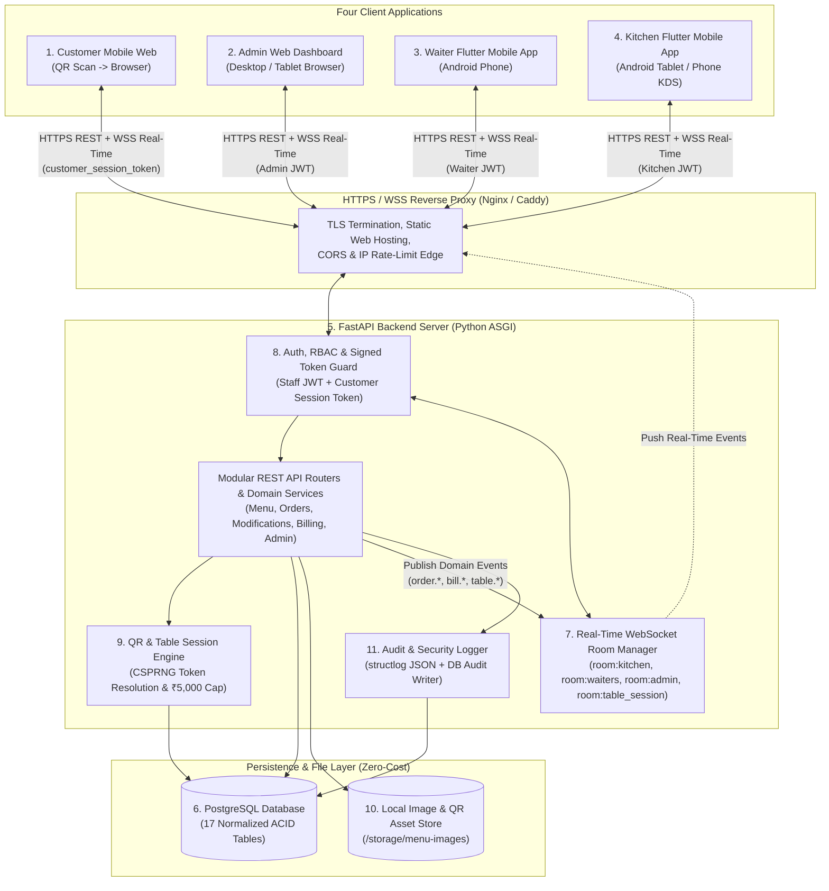
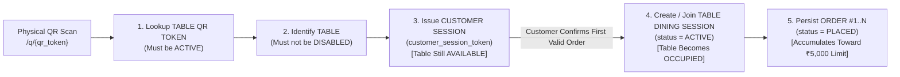
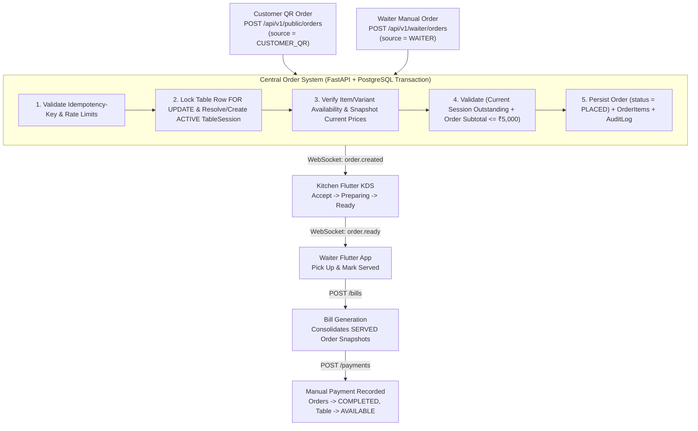
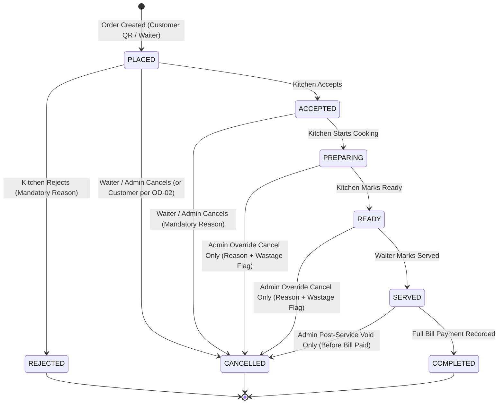
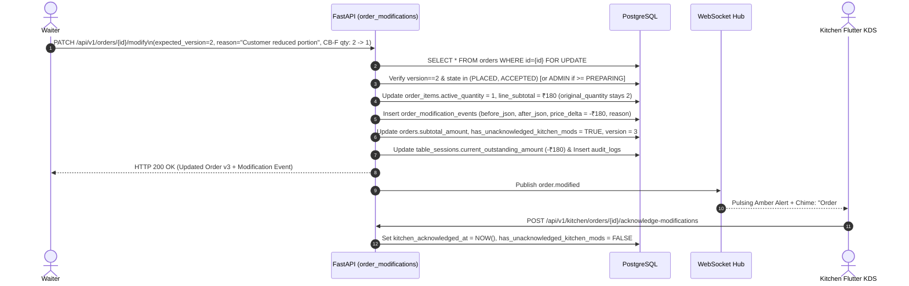
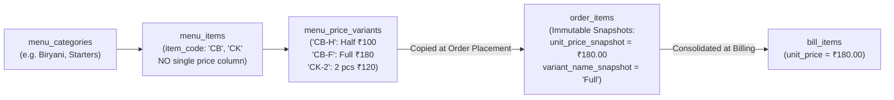
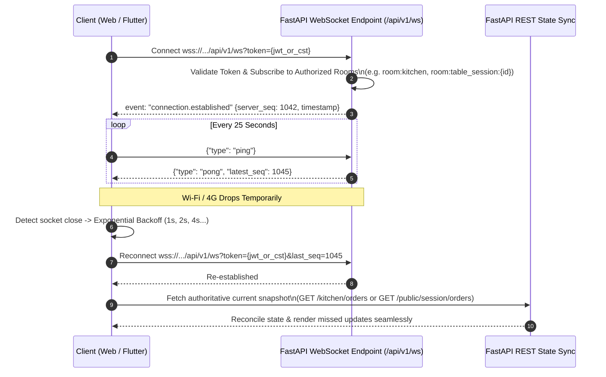
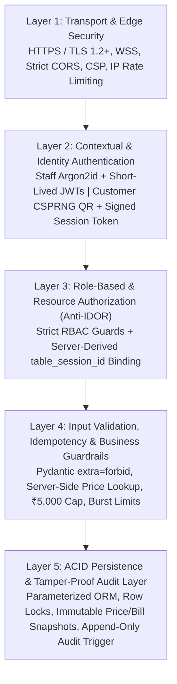
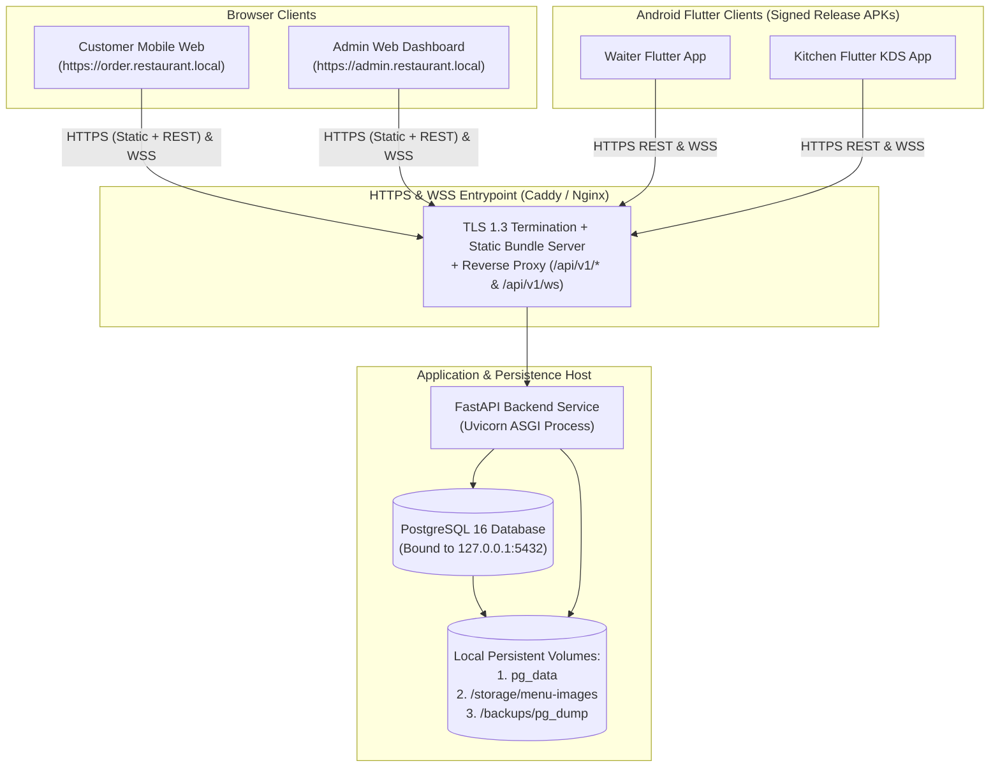

# RESTAURANT MANAGEMENT & QR ORDERING SYSTEM
## System Architecture Specification

> **Artifact Path:** `docs/03-system-architecture.md`  
> **Phase:** Documentation Only (Source of Truth — Zero Application Code)  
> **Cross-Checked Against:** `docs/02-requirements-and-scope.md` & Master Specification Volumes  
> **Scope:** Single Physical Restaurant (Non-SaaS)  
> **Cost Constraint:** Strictly Zero-Cost / Free-Tier-First / Open-Source Architecture

---

## 0. CROSS-CHECK AGAINST `docs/02-requirements-and-scope.md`

Before finalizing this System Architecture Specification, every component, state transition, session boundary, and event name was cross-checked against `docs/02-requirements-and-scope.md`:
- **Contradiction Audit Result:** **Zero business-rule contradictions found.**
- **Naming Harmonization Note:** `docs/02-requirements-and-scope.md` referenced conceptual WebSocket events in uppercase (`ORDER_PLACED`, `ORDER_ACCEPTED`, `TABLE_AVAILABLE`), while Section 15 of this architecture prompt specifies dot-namespaced event identifiers (`order.created`, `order.accepted`, `order.rejected`, `order.preparing`, `order.ready`, `order.modified`, `order.served`, `order.cancelled`, `bill.created`, `payment.completed`, `table.available`, `menu.availability_updated`). **Resolution:** This System Architecture Specification standardizes on the canonical **lowercase dot-namespaced event names (`<domain>.<action>`)** across all WebSocket payloads so the AI coding agent (Antigravity) implements a single unambiguous event contract.

---

## 1. ARCHITECTURE OVERVIEW

### 1.1 The 11 Core System Components

| # | Architectural Component | Technology / Mechanism (Zero-Cost) | Primary Architectural Role |
| :--- | :--- | :--- | :--- |
| **1** | **Customer Mobile Web** | Responsive Web SPA (React + TypeScript + Tailwind CSS) | Zero-install browser interface opened via table QR scan for menu browsing, variant selection, cart management, order submission, and live status tracking. |
| **2** | **Admin Web Dashboard** | Responsive Desktop/Tablet Web SPA (React + TypeScript + Tailwind CSS) | Administrative control plane for menu, categories, variants, short codes, availability, tables, QR lifecycle, staff, orders, billing, payments, reports, settings, and audit logs. |
| **3** | **Waiter Flutter Mobile App** | Flutter Android Application (Dart) | Floor staff operational app for table lookup, verbal order entry via short codes (`CB`, `CB-H`) or full names, audited order editing, serving food (`READY -> SERVED`), bill generation, and manual payment recording. |
| **4** | **Kitchen Flutter Mobile App** | Flutter Android Application (Dart KDS) | Real-time Kitchen Display System for receiving customer QR and waiter orders, accepting/rejecting (with mandatory reason), updating `PREPARING` and `READY` states, and acknowledging order modifications. |
| **5** | **FastAPI Backend** | Python 3.11+ / FastAPI / Uvicorn ASGI / SQLAlchemy 2.0 | Central authoritative business logic server enforcing state machines, historical price snapshotting, the ₹5,000 outstanding limit, rate limiting, and idempotency. |
| **6** | **PostgreSQL Database** | PostgreSQL 15+ (Open Source) | Single ACID-compliant relational source of truth using row-level locks (`SELECT ... FOR UPDATE`), partial unique indexes, and append-only financial/audit tables. |
| **7** | **Real-Time Communication Layer** | Native FastAPI ASGI WebSockets (`WSS`) + In-Memory Room Broker | Bi-directional low-latency push transport delivering `order.*`, `bill.*`, `payment.*`, `table.*`, and `menu.*` events without manual page refreshes. |
| **8** | **Authentication & Authorization Layer** | Argon2id Password Hashing + Staff JWTs + Signed `customer_session_token` | Separates staff identity authentication (`WAITER`, `KITCHEN`, `ADMIN`) from zero-login contextual customer table sessions (`CUSTOMER_QR`), enforcing RBAC and preventing IDOR. |
| **9** | **QR & Table Session System** | 256-Bit CSPRNG Tokens (`secrets.token_urlsafe(32)`) + Session State Engine | Resolves physical table QR scans into ephemeral browser sessions and binds orders into an active `TableSession` only after the first valid order is placed. |
| **10** | **File / Image Storage** | Local Filesystem Static Directory (`/storage/menu-images`) + Client WebP Compression | Zero-cost local static file serving via Nginx/FastAPI for dish images and generated printable QR sheets (with optional free-tier Cloudflare R2 fallback). |
| **11** | **Logging & Audit System** | Structured JSON Logs (`structlog`) + Immutable PostgreSQL `audit_logs` Table | Captures application diagnostics, security alerts, and tamper-proof before/after snapshots of all administrative, order modification, and financial actions. |

### 1.2 High-Level System & Real-Time Architecture Diagram



---

## 2. CLIENT ARCHITECTURE

### 2.1 A. CUSTOMER WEB (`web-customer`)
- **Architecture & Layout:** Single-Page Application (React + TypeScript + Vite + Tailwind CSS) engineered with a **mobile-first responsive viewport (`320px`–`480px` primary target)**. No native app installation is required.
- **QR Entry & Table Identification:** Customer scans the table's physical QR code (`https://<domain>/q/<qr_token>`). The SPA extracts `<qr_token>` and calls `GET /api/v1/public/qr/{qr_token}/bootstrap`.
- **Customer Session Handling:** The bootstrap response sets an `HttpOnly; Secure; SameSite=Strict` cookie (and returns a signed `customer_session_token` header fallback) bound strictly to `table_id` and `qr_token_id`. Scanning **never** marks the table `OCCUPIED`.
- **Menu Browsing & Variant Selection:** Renders categories, dietary filters (`VEG`, `NON_VEG`, `EGG`), live item availability (`Unavailable` items remain visible but disabled), and mandatory variant selection sheets (e.g., *Chicken Biryani: Half ₹100 / Full ₹180*).
- **Cart & Order Submission:** Persists unsubmitted cart lines in `sessionStorage` keyed by `qr_token`. Displays running cart total against the table session's remaining **₹5,000 outstanding limit**. Submitting an order generates a UUIDv4 `Idempotency-Key` and calls `POST /api/v1/public/orders`.
- **Order Tracking:** Connects to `wss://<domain>/api/v1/ws` subscribed exclusively to `room:table_session:{table_session_id}` and `room:public_menu`, rendering real-time state progressions (`PLACED -> ACCEPTED -> PREPARING -> READY -> SERVED` or `REJECTED` with reason).
- **Error Handling:** Dedicated full-screen and inline recovery states for `410 QR Revoked`, `403 Table Disabled / Restaurant Closed`, `409 Item Just Sold Out`, `422 ₹5,000 Limit Exceeded`, `429 Rate Limit`, and offline network retry.

### 2.2 B. WAITER APP (`mobile-waiter`)
- **Architecture:** Flutter Android application using clean layered state management (`Riverpod` or `Bloc`), `dio` HTTP client with automatic JWT refresh + `Idempotency-Key` interceptor, and `web_socket_channel` for live floor updates.
- **Authentication:** Staff login (`POST /api/v1/auth/login`) storing `access_token` and `refresh_token` in encrypted `FlutterSecureStorage`.
- **Dashboard & Tables:** Displays priority `READY` pickup cards, first-time QR order alerts, and a color-coded floor grid (`AVAILABLE`, `OCCUPIED`, `DISABLED`). Waiters can **type a table number directly** to jump to that table's active session.
- **Order Creation & Dual Search:** Enables manual order entry for customers who order verbally. Features an indexed in-memory + server-backed search bar supporting **both**:
  1. **Short Item Codes (`CB`, `CB-H`, `CB-F`, `CK-2`)** for 2-second entry.
  2. **Full Item Names (`Chicken Biryani`, `Kebab`)** if the code is forgotten.
- **Order Editing & Serving:** Supports pre-acceptance (`PLACED`) and post-acceptance (`ACCEPTED`, with mandatory reason) order modifications (`PATCH /api/v1/orders/{id}/modify`), and 1-tap `READY -> SERVED` transitions.
- **Billing & Payment Recording:** Retrieves the table's active session by table number, verifies all active orders are `SERVED`, generates the official `Bill` (`POST /api/v1/waiter/tables/{id}/bills`), and records manual payment (`CASH`, `UPI`, `CARD`, `OTHER`) to complete the session and free the table.

### 2.3 C. KITCHEN APP (`mobile-kitchen`)
- **Architecture:** Flutter Android application optimized for landscape tablet or mounted phone KDS usage (wake-lock enabled so screen never sleeps during service, local audio alert synthesizer/assets).
- **Authentication:** Staff login requiring `role == KITCHEN` (or `ADMIN`).
- **Live Order Feed:** Multi-column KDS board (`PLACED / NEW`, `ACCEPTED`, `PREPARING`, `READY`) updated instantaneously via `room:kitchen` WebSocket events. Receives both Customer QR orders and Waiter manual orders identically.
- **Accept / Reject / Preparing / Ready:** One-tap `Accept`, modal-enforced mandatory `rejection_reason` on `Reject`, and step transitions `ACCEPTED -> PREPARING -> READY`.
- **Modifications & History:** Displays pulsing amber/red diff banners (`Before vs. After` quantities/notes) when an accepted order is edited or cancelled by a waiter/admin, requiring explicit **"Acknowledge Modification"** tap. Includes a read-only shift history tab.

### 2.4 D. ADMIN WEB (`web-admin`)
- **Architecture:** Desktop/tablet-first React + TypeScript + Tailwind CSS dashboard application.
- **Modules:** Authentication (`role == ADMIN`), Live KPI & Floor Dashboard, Categories CRUD, Menu Items CRUD, Price Variants CRUD, Short Item Code Directory & Printable Cheat Sheet, 1-Click Availability Board, Physical Tables Manager, QR Code Generator/Regenerator/Revoker & Printable Card Exporter, Staff Accounts Manager (`WAITER`, `KITCHEN`, `ADMIN`), Orders Monitor & Emergency Override Console, Bills & Void Ledger, Payments Reconciliation, Analytical Reports, Immutable Audit Logs Viewer, and Restaurant Settings (GST taxes, ₹5,000 outstanding limit, rate limits).

### 2.5 Client Architectural Boundary & Access Matrix

| Architectural Dimension | Customer Web | Waiter Flutter App | Kitchen Flutter App | Admin Web Dashboard |
| :--- | :--- | :--- | :--- | :--- |
| **Auth Credential** | Signed `customer_session_token` | Staff JWT (`WAITER`) | Staff JWT (`KITCHEN`) | Staff JWT (`ADMIN`) |
| **Data It Can Access** | Public active menu; own table info; own active `TableSession` orders & status. | All tables, active sessions, orders, bills, menu + short codes, own shift history. | Active kitchen queue orders, items, notes, modification events, shift kitchen history. | All operational, menu, QR, staff, financial, report, setting, and audit data. |
| **APIs It Uses** | `/api/v1/public/*` | `/api/v1/auth/*`, `/api/v1/waiter/*`, `/api/v1/orders/*` | `/api/v1/auth/*`, `/api/v1/kitchen/*` | `/api/v1/auth/*`, `/api/v1/admin/*`, plus staff endpoints |
| **Real-Time Events Received** | `order.accepted`, `order.rejected`, `order.preparing`, `order.ready`, `order.modified`, `order.served`, `order.cancelled`, `bill.created`, `payment.completed`, `menu.availability_updated` *(scoped to own session)* | All `order.*`, `bill.created`, `payment.completed`, `table.available`, `menu.availability_updated` across floor | `order.created`, `order.modified`, `order.cancelled`, `order.served`, `menu.availability_updated` | All `order.*`, `bill.*`, `payment.*`, `table.*`, `menu.*`, `security.alert` events |
| **Strict Security Boundary** | Cannot view other tables' sessions; cannot send prices; cannot generate bills or mark payments; cannot call staff endpoints. | Cannot accept/reject kitchen orders; cannot edit menu prices/codes; cannot rotate QRs; cannot void paid bills or manage staff. | Cannot view bill amounts, record payments, edit menu prices, rotate QRs, or access admin reports/settings. | Cannot hard-delete or silently mutate completed bills, payments, historical order snapshots, or `audit_logs`. |

---

## 3. BACKEND ARCHITECTURE (MODULAR FASTAPI DESIGN)

The FastAPI backend is organized as a **modular monolith** with strict separation between HTTP routers, domain services, database repositories/models, WebSocket broadcasting, and cross-cutting security guards. Rather than scattering logic across 20 tiny overlapping folders, the 20 conceptual domains are consolidated into **10 cohesive backend modules**:

| Module Name | Consolidated Sub-Domains | Core Responsibility | Main Database Entities | Exposed APIs (Prefix) | Published Events | Dependencies & Security Requirements |
| :--- | :--- | :--- | :--- | :--- | :--- | :--- |
| **1. `auth_users`** | Authentication, Users, Roles, Staff Sessions | Staff login, Argon2id verification, JWT issuance/refresh, brute-force lockout, staff CRUD & session revocation. | `users`, `user_sessions` | `/api/v1/auth/*`, `/api/v1/admin/staff/*` | `security.alert` | Rate-limited login; `ADMIN` required for staff management; increments `token_version` on deactivation. |
| **2. `tables_qr_sessions`** | Tables, QR Tokens, Customer Sessions, Table Dining Sessions | Physical table CRUD, CSPRNG QR token generation/rotation/revocation, QR bootstrap, customer token signing, and `TableSession` lifecycle (`AVAILABLE <-> OCCUPIED`). | `restaurant_tables`, `table_qr_tokens`, `table_sessions`, `customer_session_tokens` | `/api/v1/public/qr/*`, `/api/v1/waiter/tables/*`, `/api/v1/admin/tables/*` | `table.occupied`, `table.available` | Partial unique indexes for 1 active QR & 1 active session per table; row locking `FOR UPDATE` on table state transitions. |
| **3. `menu_catalog`** | Categories, Menu Items, Price Variants, Item Codes, Availability | 3-tier menu hierarchy, unique short codes (`CB`, `CB-H`), fast waiter search, dish image storage, and live availability toggling. | `menu_categories`, `menu_items`, `menu_price_variants` | `/api/v1/public/menu`, `/api/v1/waiter/menu/search`, `/api/v1/admin/categories/*`, `/api/v1/admin/menu-items/*`, `/api/v1/admin/availability/*` | `menu.availability_updated` | Unique case-insensitive indexes on `item_code` and `variant_code`; soft-delete (`is_active=false`) only. |
| **4. `orders_core`** | Orders, Order Items, Waiter & Customer Order Creation | Unified central order creation pipeline, historical price snapshotting, ₹5,000 outstanding limit enforcement, rate-limit & idempotency verification. | `orders`, `order_items` | `/api/v1/public/orders`, `/api/v1/public/session/orders`, `/api/v1/waiter/orders`, `/api/v1/orders/*` | `order.created`, `order.served`, `order.cancelled` | Ignores client prices; requires `Idempotency-Key`; locks `table_sessions` row during ₹5,000 limit validation. |
| **5. `order_modifications`** | Order Editing & Modification Audit Ledger | Pre-acceptance and post-acceptance order editing, delta calculation, and Kitchen modification acknowledgment. | `order_modification_events`, `orders`, `order_items` | `/api/v1/orders/{id}/modify`, `/api/v1/kitchen/orders/{id}/acknowledge-modifications` | `order.modified` | Optimistic concurrency (`expected_version`); mandatory reason if status $\ge$ `ACCEPTED`; preserves `original_quantity`. |
| **6. `kitchen_kds`** | Kitchen Queue & Preparation State Machine | Kitchen order queue retrieval and state transitions (`PLACED -> ACCEPTED/REJECTED`, `ACCEPTED -> PREPARING -> READY`). | `orders` | `/api/v1/kitchen/orders/*` | `order.accepted`, `order.rejected`, `order.preparing`, `order.ready` | Strictly `KITCHEN` or `ADMIN` role; DB check constraint enforces non-null `rejection_reason` on `REJECTED`. |
| **7. `billing_payments`** | Billing, Bill Items, Manual Payments | Consolidates `SERVED` order items using historical price snapshots, computes taxes/discounts, issues numbered bills, records payments, and closes sessions. | `bills`, `bill_items`, `payments` | `/api/v1/waiter/tables/{id}/bills`, `/api/v1/waiter/bills/{id}/payments`, `/api/v1/admin/bills/*`, `/api/v1/admin/payments/*` | `bill.created`, `payment.completed`, `table.available` | `WAITER` or `ADMIN` only; requires `Idempotency-Key`; locks QR ordering on `bill.created`; atomic session completion on payment. |
| **8. `realtime_notifications`** | WebSocket Hub & Staff Notifications | Manages authenticated WebSocket connections, room subscriptions, heartbeats, and persistent notification records. | `notifications` | `/api/v1/ws`, `/api/v1/notifications/*` | All real-time push envelopes | Validates JWT or `customer_session_token` on handshake; isolates `room:table_session:{id}` per table. |
| **9. `reports_settings`** | Restaurant Settings & Analytical Reports | Singleton configuration management (taxes, ₹5,000 limit, rate limits, hours) and read-only analytical aggregations. | `restaurant_settings` (+ read-only joins on `orders`, `bills`, `payments`) | `/api/v1/admin/settings`, `/api/v1/admin/reports/*` | `settings.updated` | Strictly `ADMIN` role; logs all setting changes to `audit_logs`. |
| **10. `audit_security`** | Audit Logs, Rate Limiter, Idempotency Middleware | Append-only security and financial audit trail writer, in-memory token bucket rate limiter, and suspicious session blocker. | `audit_logs` | `/api/v1/admin/audit-logs`, `/api/v1/admin/security/*` | `security.alert` | Protected by PostgreSQL `BEFORE UPDATE OR DELETE` trigger blocking any mutation of `audit_logs`. |

---

## 4. API ARCHITECTURE

### 4.1 REST API Conventions
- **Versioning & Base URI:** All REST endpoints are versioned under `/api/v1/...`.
- **HTTP Methods:**
  - `GET`: Read-only, safe, idempotent resource retrieval.
  - `POST`: Resource creation (`orders`, `bills`, `payments`) or explicit state-machine command transitions (`/accept`, `/reject`, `/preparing`, `/ready`, `/mark-served`, `/cancel`).
  - `PATCH`: Partial resource updates (`menu-items`, `settings`, `/orders/{id}/modify`).
  - `DELETE`: **Never used for hard deletion of domain/financial records**; deactivation uses `PATCH` (`is_active: false`) or explicit `/revoke` and `/void` actions.
- **Request & Response Format:** `application/json; charset=utf-8`. All timestamps use ISO-8601 UTC (`2026-10-06T14:20:00Z`); all monetary values use fixed 2-decimal string/number representation (`180.00`).
- **Validation:** Strict Pydantic v2 schemas with `model_config = ConfigDict(extra="forbid")` on all request bodies so unexpected or tampered fields (such as client-supplied `unit_price` or `role`) are rejected immediately with HTTP `422`.
- **Standard Error Envelope:**
  - Every `4xx`/`5xx` response returns `{ "error_code": "STRING_CODE", "message": "Human-readable message", "details": {...}, "request_id": "uuid" }`.
- **Pagination, Filtering & Sorting:**
  - List endpoints (`/admin/orders`, `/admin/bills`, `/admin/audit-logs`) use cursor or offset pagination (`?page=1&page_size=25`, max `page_size=100`), explicit filter parameters (`?status=PLACED&source=CUSTOMER_QR&table_id=...&date_from=...`), and allowlisted sort fields (`?sort_by=placed_at&sort_dir=desc`).

### 4.2 Consolidated Endpoint Inventory by Group

| Functional Group | Method & Route | Auth Requirement | Purpose |
| :--- | :--- | :--- | :--- |
| **Authentication** | `POST /api/v1/auth/login` | Public (Rate-limited) | Staff login (`WAITER`, `KITCHEN`, `ADMIN`) returning JWT access + refresh tokens. |
| | `POST /api/v1/auth/refresh` | Refresh Token | Rotate staff access & refresh tokens. |
| | `POST /api/v1/auth/logout` | Staff JWT | Revoke current `user_sessions` record & disconnect WebSocket. |
| | `GET /api/v1/auth/me` | Staff JWT | Return authenticated staff profile and role. |
| **Customer & QR** | `GET /api/v1/public/qr/{qr_token}/bootstrap` | Public (IP Rate-limited) | Validate `qr_token`, issue `customer_session_token`, return table & restaurant status (Scan $\neq$ Occupied). |
| | `GET /api/v1/public/menu` | `customer_session_token` | Return active categories, dishes, price variants, and live availability. |
| | `GET /api/v1/public/session/orders` | `customer_session_token` | Return orders and remaining ₹5,000 limit for the customer's active `TableSession`. |
| | `POST /api/v1/public/orders` | `customer_session_token` + `Idempotency-Key` | Place a Customer QR order (creates `TableSession` and marks table `OCCUPIED` on first order). |
| **Waiter** | `GET /api/v1/waiter/menu/search` | `WAITER`, `ADMIN` | Instant search by short code (`CB`, `CB-H`, `CK-2`) or full dish name. |
| | `GET /api/v1/waiter/tables` | `WAITER`, `ADMIN` | Floor table list with live status, active session balance, and `READY` order counts. |
| | `GET /api/v1/waiter/tables/{number_or_id}/active-session` | `WAITER`, `ADMIN` | Lookup table by number to retrieve active session, orders, and bill preview. |
| | `POST /api/v1/waiter/orders` | `WAITER`, `ADMIN` + `Idempotency-Key` | Place a manual Waiter order into the central order pipeline. |
| | `POST /api/v1/waiter/orders/{order_id}/mark-served` | `WAITER`, `ADMIN` | Transition order `READY -> SERVED`. |
| | `POST /api/v1/waiter/sessions/{session_id}/unlock-qr` | `WAITER`, `ADMIN` | Unlock a table session whose QR ordering was auto-frozen by rate limits. |
| **Orders & Edits** | `GET /api/v1/orders/{order_id}` | `WAITER`, `KITCHEN`, `ADMIN` | Retrieve full order details, line snapshots, and modification events. |
| | `PATCH /api/v1/orders/{order_id}/modify` | `WAITER`, `ADMIN` | Audited order editing (`order_modification_events`) per state rules. |
| | `POST /api/v1/orders/{order_id}/cancel` | `WAITER`, `ADMIN` *(or `OD-02`)* | Cancel order per state authorization matrix. |
| **Kitchen (KDS)** | `GET /api/v1/kitchen/orders` | `KITCHEN`, `ADMIN` | Fetch active kitchen queue (`PLACED`, `ACCEPTED`, `PREPARING`, `READY`). |
| | `POST /api/v1/kitchen/orders/{order_id}/accept` | `KITCHEN`, `ADMIN` | Transition `PLACED -> ACCEPTED`. |
| | `POST /api/v1/kitchen/orders/{order_id}/reject` | `KITCHEN`, `ADMIN` | Transition `PLACED -> REJECTED` (mandatory `rejection_reason`). |
| | `POST /api/v1/kitchen/orders/{order_id}/preparing` | `KITCHEN`, `ADMIN` | Transition `ACCEPTED -> PREPARING`. |
| | `POST /api/v1/kitchen/orders/{order_id}/ready` | `KITCHEN`, `ADMIN` | Transition `PREPARING -> READY` and alert waiters. |
| | `POST /api/v1/kitchen/orders/{order_id}/acknowledge-modifications` | `KITCHEN`, `ADMIN` | Acknowledge post-acceptance waiter/admin order modifications. |
| **Billing & Payments** | `POST /api/v1/waiter/tables/{table_id}/bills` | `WAITER`, `ADMIN` + `Idempotency-Key` | Generate numbered `Bill` (`ISSUED`) from historical order line snapshots & lock QR ordering. |
| | `POST /api/v1/waiter/bills/{bill_id}/payments` | `WAITER`, `ADMIN` + `Idempotency-Key` | Record manual payment (`CASH`, `UPI`, `CARD`, `OTHER`), mark bill `PAID`, complete session, and set table `AVAILABLE`. |
| **Admin, Tables, QR, Menu & Reports** | `GET/POST/PATCH /api/v1/admin/categories` | `ADMIN` | Manage menu categories (soft-delete only). |
| | `GET/POST/PATCH /api/v1/admin/menu-items` | `ADMIN` | Manage dishes, short `item_code`, images, and availability. |
| | `POST/PATCH /api/v1/admin/menu-items/{id}/variants` | `ADMIN` | Manage price variants (`variant_code`, `unit_type`, `unit_quantity`, `price`). |
| | `PATCH /api/v1/admin/availability/bulk` | `ADMIN` *(+ `OD-05`)* | Fast stock-in / stock-out toggles. |
| | `GET/POST/PATCH /api/v1/admin/tables` | `ADMIN` | Manage physical tables and operational status (`AVAILABLE`, `DISABLED`). |
| | `POST /api/v1/admin/tables/{id}/qr/generate` | `ADMIN` | Generate or **Regenerate** cryptographic QR token (atomically revoking old token). |
| | `POST /api/v1/admin/tables/{id}/qr/revoke` | `ADMIN` | Revoke active QR token or toggle `is_qr_enabled`. |
| | `GET/POST/PATCH /api/v1/admin/staff` | `ADMIN` | Create/update/deactivate Waiter, Kitchen, and Admin accounts. |
| | `POST /api/v1/admin/bills/{bill_id}/void` | `ADMIN` | Audited void of an erroneous bill with mandatory `void_reason`. |
| | `GET/PATCH /api/v1/admin/settings` | `ADMIN` | Configure restaurant profile, GST taxes, ₹5,000 cap, and rate limits. |
| | `GET /api/v1/admin/reports/{report_type}` | `ADMIN` | Sales, top variants, QR vs. Waiter split, prep time, and wastage reports. |
| | `GET /api/v1/admin/audit-logs` | `ADMIN` | Query immutable security and financial audit trail. |

---

## 5. AUTHENTICATION AND AUTHORIZATION ARCHITECTURE

### 5.1 Staff Authentication (`ADMIN`, `WAITER`, `KITCHEN`)
1. **Password Storage:** Passwords are hashed using **Argon2id** (`pwdlib` / `argon2-cffi` with memory cost 64 MiB, time cost 3, parallelism 4). Plaintext passwords are never logged or stored.
2. **Token Strategy:**
   - **Access Token (JWT, HS256, 15-minute TTL):** Contains `sub` (`user_id`), `role` (`ADMIN` | `WAITER` | `KITCHEN`), `ver` (`users.token_version`), `iat`, and `exp`.
   - **Refresh Token (Opaque 256-bit token, 7-day TTL):** Stored as a SHA-256 hash in `user_sessions`. Rotated on every `/auth/refresh` call.
3. **Instant Session Revocation:** When Admin deactivates a staff user (`is_active = false`), resets their password, or clicks "Revoke Sessions", the backend increments `users.token_version` and marks all rows in `user_sessions` for that `user_id` as `is_revoked = true`. Active WebSocket connections for that user are immediately closed (`1008 Policy Violation`).

### 5.2 Customer Contextual Authentication (No Account / No PIN)
- Customers do not log in. Scanning `/q/{qr_token}` validates the table's active `qr_token` and issues a signed **`customer_session_token`** stored in an `HttpOnly; Secure; SameSite=Strict` cookie (and returned for `X-Customer-Session` header binding).
- The token payload contains `cst_id` (UUID in `customer_session_tokens`), `table_id`, `qr_token_id`, and `table_session_id` (populated once the first order creates the session).

### 5.3 Strict Access-Control Isolation Rules
1. **Preventing Waiter from Accessing Admin APIs:** Every `/api/v1/admin/*` endpoint depends on `require_role(Role.ADMIN)`. A valid `WAITER` JWT receives `HTTP 403 Forbidden` and generates a security audit entry.
2. **Preventing Kitchen from Accessing Financial/Admin APIs:** `KITCHEN` JWTs are restricted strictly to `/api/v1/kitchen/*` and `/api/v1/auth/*`. Any attempt to call `/api/v1/waiter/bills/*` or `/api/v1/admin/*` is rejected with `HTTP 403 Forbidden`.
3. **Preventing One Waiter from Unauthorized Actions:** Waiters cannot cancel orders already in `PREPARING`, `READY`, or `SERVED` states, cannot void bills, and every waiter action (`created_by_waiter_id`, `performed_by_user_id`, `generated_by_user_id`, `recorded_by_user_id`) is permanently stamped with the authenticated waiter's `user_id` from their JWT (never from a request body field).
4. **Preventing Customer from Accessing Another Table's Private Information (Anti-IDOR):** Customer endpoints (`GET /api/v1/public/session/orders`, `POST /api/v1/public/orders`) **never accept `table_id` or `table_session_id` as URL or body parameters**. They extract `table_id` and `table_session_id` exclusively from the server-verified `customer_session_token`. Consequently, a customer at Table 1 has zero syntactic or logical way to query or mutate Table 2's orders.

---

## 6. CUSTOMER TABLE SESSION ARCHITECTURE

### 6.1 Crucial Distinction Between the 5 Core Concepts

| Concept | Database Table | Lifespan | Cardinality & Exact Architectural Meaning |
| :--- | :--- | :--- | :--- |
| **1. TABLE** | `restaurant_tables` | Permanent physical asset | Represents the physical dining table (`Table 4`). Has operational status `AVAILABLE`, `OCCUPIED`, or `DISABLED`. |
| **2. TABLE QR TOKEN** | `table_qr_tokens` | Medium/Long-lived (until Admin rotates/revokes) | The unpredictable 256-bit token printed on the table's physical QR card (`status = 'ACTIVE'`). One table has **1 active QR token** (and N historical `REVOKED` tokens). |
| **3. CUSTOMER SESSION** | `customer_session_tokens` | Ephemeral browser session (30m idle / max 3h / revoked on payment) | Represents **one customer's phone browser** that scanned the table's QR code. Created on QR scan (`bootstrap`) **before** any order is placed so the customer can browse the menu. |
| **4. TABLE DINING SESSION** | `table_sessions` | One seated group's dining visit (First valid order $\rightarrow$ Payment/Closure) | Represents the **active financial & operational dining visit** on a table. Created **only when the first valid order is placed** (by Customer QR or Waiter). One table has at most **1 `ACTIVE` Table Dining Session** at a time. |
| **5. ORDER** | `orders` (+ `order_items`) | Single batch of food items submitted together | One submission of dishes/variants (`#ORD-1042`). A single **Table Dining Session** can contain **1 to N Orders** (e.g., Order 1: Starters via QR; Order 2: Biryani via Waiter; Order 3: Drinks via QR), all consolidated onto one final Bill. |

### 6.2 End-to-End Resolution & Lifecycle Chain


### 6.3 Session Lifecycle Rules
- **Session Creation:** `customer_session_tokens` row is created on QR scan (`bootstrap`); `table_sessions` row is created atomically inside `POST /orders` when the first valid order is placed on an `AVAILABLE` table.
- **Session Reuse:** If a customer closes their browser tab or refreshes the page, their cookie/stored `customer_session_token` reconnects them to the same `customer_session_tokens` and `table_sessions` record so they never lose visibility of their active orders.
- **Multiple Customers / Multiple Devices at One Table:**
  - If two friends sitting at `AVAILABLE` Table 4 both scan the QR code, each phone gets its own `customer_session_tokens` row pointing to `table_id = Table 4`.
  - Whichever friend places the first valid order triggers creation of the single `ACTIVE` `table_sessions` row on Table 4 (`OCCUPIED`).
  - When the second friend places an order (or refreshes), their `customer_session_tokens` links to that same `ACTIVE` `table_sessions.id` (per `OD-01`), and both phones receive real-time WebSocket updates for Table 4's session and share the ₹5,000 session limit.
- **Session Expiration & Abandoned Browsing:** If a customer scans a QR code, browses the menu, never places an order, and walks out, the table was never marked `OCCUPIED` and the idle `customer_session_token` simply expires after 30 minutes.
- **Session Closure on All Orders Cancelled/Rejected:** If a `TableSession` is `ACTIVE` (`OCCUPIED`), and every order within it transitions to `CANCELLED` or `REJECTED` leaving `0` valid active/served orders, `table_sessions.status` automatically transitions to `CLOSED_NO_CHARGE`, `restaurant_tables.status` reverts to `AVAILABLE`, and associated `customer_session_tokens` are marked `is_revoked = true`.
- **Session Closure on Payment Completion:** Recording full payment transitions `bills -> PAID`, `orders -> COMPLETED`, `table_sessions -> COMPLETED`, `restaurant_tables -> AVAILABLE`, and immediately revokes all `customer_session_tokens` for that session.

---

## 7. QR SECURITY ARCHITECTURE

### 7.1 Cryptographic QR Token Lifecycle
1. **Token Generation:** Generated server-side using Python's OS-backed CSPRNG (`secrets.token_urlsafe(32)` $\rightarrow$ 43-character URL-safe Base64 string with 256 bits of entropy).
2. **Token Storage & Lookup:** Stored in `table_qr_tokens.qr_token` with a `UNIQUE` B-tree index for $O(1)$ lookup and a partial unique index `WHERE status = 'ACTIVE'` guaranteeing only one active token per table.
3. **Token Rotation / QR Regeneration:** When Admin clicks **Regenerate QR** for Table 12, a single database transaction sets the existing token's `status = 'REVOKED'` (`revoked_at = NOW()`, `revocation_reason = 'REGENERATED'`) and inserts a new `ACTIVE` token.
4. **Old QR Invalidation:** Any subsequent scan or API request referencing a `REVOKED` token is immediately rejected with `HTTP 410 Gone` (`QR_TOKEN_REVOKED`).
5. **QR Disabling:** Admin can set `restaurant_tables.is_qr_enabled = false` (per table) or `restaurant_settings.is_qr_ordering_enabled = false` (global) to temporarily block QR ordering without invalidating the printed QR token.

### 7.2 Threat Model: Remote Ordering from a Photographed QR Code
- **What a Publicly Scannable Physical QR Cannot Guarantee Alone:**
  - Without mandatory hardware proximity beacons, GPS geofencing (which fails indoors and requires invasive browser location permissions), or mandatory waiter/PIN activation, a static URL encoded in a QR code **cannot cryptographically prove** by itself that the scanner is still physically sitting at Table 12 two hours later.
- **How the Architecture Mitigates Remote Photographed QR Abuse (Without Customer Friction):**
  1. **Post-Payment Session Token Revocation:** Even if a customer keeps their browser tab open when walking out after paying, their `customer_session_token` is revoked the instant the bill is marked `PAID`.
  2. **Operating Hours Gate:** Remote scans/orders outside restaurant operating hours are automatically blocked (`403 RESTAURANT_CLOSED`).
  3. **First-Order Waiter Physical Verification Alert:** If Table 12 is `AVAILABLE` (physically empty) and a remote attacker scans a photograph of Table 12's QR and submits an order, the Waiter Flutter App immediately chimes with **`"New First QR Order on Table 12"`**. The floor waiter sees Table 12 is empty, cancels/rejects the fake order in 1 tap, and Admin clicks **Regenerate QR** for Table 12—permanently killing the attacker's photographed QR code.
  4. **Bill-Issued Lock on Occupied Tables:** Once a real dining group's bill is `ISSUED`, QR ordering on that table session is locked.
  5. **Hard ₹5,000 Financial Cap + Burst Rate Limits + Max 3 Unaccepted Orders Cap:** Strictly bounds how many orders can enter the kitchen queue before staff intervention.
  6. **Automatic Suspicious Session Lock:** If Kitchen rejects 3 orders on a session or rate limits are repeatedly tripped, `table_sessions.is_qr_ordering_locked` flips to `TRUE` automatically until a waiter physically at the table unlocks it.

---

## 8. ORDER ARCHITECTURE

### 8.1 Unified End-to-End Order Pipeline


### 8.2 Core Order Model & Price Snapshot Rules
- Both `CUSTOMER_QR` and `WAITER` orders write to the exact same `orders` and `order_items` tables.
- **Authoritative Server-Side Pricing:** Client requests pass only `menu_price_variant_id` and `quantity`. The backend queries `menu_price_variants` + `menu_items` inside the transaction and copies `item_code_snapshot`, `item_name_snapshot`, `variant_code_snapshot`, `variant_name_snapshot`, `unit_type_snapshot`, `unit_quantity_snapshot`, and `unit_price_snapshot` into `order_items`.

---

## 9. ORDER STATE MACHINE ARCHITECTURE

### 9.1 Canonical State Diagram


### 9.2 Complete State Transition Specification Matrix

| Transition | Allowed Actor(s) | Preconditions | Atomic Side Effects | Real-Time Notifications Emitted | Audit Log Event |
| :--- | :--- | :--- | :--- | :--- | :--- |
| `[*] -> PLACED` | `CUSTOMER_QR`, `WAITER`, `ADMIN` | Valid session/table, items available, `Idempotency-Key` unused, `outstanding + order <= ₹5,000`. | Creates `TableSession` (`ACTIVE`) & sets table `OCCUPIED` if table was `AVAILABLE`; increments `current_outstanding_amount`. | `order.created` ($\rightarrow$ Kitchen, Waiters, Admin, TableSession); `table.occupied` (if 1st order). | `ORDER_PLACED` |
| `PLACED -> ACCEPTED` | `KITCHEN`, `ADMIN` | `orders.status == 'PLACED'` and `version == expected_version`. | Sets `accepted_at = NOW()`, `accepted_by_user_id`; increments `version`. | `order.accepted` ($\rightarrow$ TableSession, Waiters, Kitchen, Admin). | `ORDER_ACCEPTED` |
| `PLACED -> REJECTED` | `KITCHEN`, `ADMIN` | `orders.status == 'PLACED'`, `version` matches, non-empty `rejection_reason`. | Sets `rejected_at`, `rejection_reason`; subtracts `subtotal_amount` from `current_outstanding_amount`. If session has 0 active orders left, closes session (`CLOSED_NO_CHARGE`) & sets table `AVAILABLE`. | `order.rejected` ($\rightarrow$ TableSession, Waiters, Kitchen, Admin); `table.available` (if session closed). | `ORDER_REJECTED` |
| `PLACED -> CANCELLED` | `WAITER`, `ADMIN` *(+ `CUSTOMER_QR` if `OD-02` enabled)* | `orders.status == 'PLACED'`, `version` matches, mandatory `cancellation_reason` for staff. | Sets `cancelled_at`, `cancellation_reason`; subtracts `subtotal_amount` from `current_outstanding_amount`; reverts table to `AVAILABLE` if 0 active orders remain. | `order.cancelled` ($\rightarrow$ Kitchen, Waiters, TableSession, Admin); `table.available` (if session closed). | `ORDER_CANCELLED_PRE_ACCEPT` |
| `ACCEPTED -> PREPARING` | `KITCHEN`, `ADMIN` | `orders.status == 'ACCEPTED'`, `version` matches. | Sets `preparing_at = NOW()`, `preparing_by_user_id`; increments `version`. | `order.preparing` ($\rightarrow$ TableSession, Waiters, Kitchen, Admin). | `ORDER_PREPARING` |
| `ACCEPTED -> CANCELLED` | `WAITER`, `ADMIN` | `orders.status == 'ACCEPTED'`, `version` matches, mandatory `cancellation_reason`. | Sets `cancelled_at`; records `OrderModificationEvent`; subtracts from `current_outstanding_amount`; reverts table if 0 active orders remain. | `order.cancelled` (High-priority audio/visual alert to Kitchen + Waiters + TableSession). | `ORDER_CANCELLED_POST_ACCEPT` |
| `PREPARING -> READY` | `KITCHEN`, `ADMIN` | `orders.status == 'PREPARING'`, `version` matches. | Sets `ready_at = NOW()`, `ready_by_user_id`; increments `version`. | `order.ready` (Pickup chime to Waiters + status update to TableSession, Kitchen, Admin). | `ORDER_READY` |
| `PREPARING -> CANCELLED` | **`ADMIN` Only** *(see `OD-03`)* | `orders.status == 'PREPARING'`, mandatory `cancellation_reason` + `is_wastage` boolean. | Sets `cancelled_at`; logs wastage in `order_modification_events`; subtracts from `current_outstanding_amount`. | `order.cancelled` (Urgent stop-cooking alert to Kitchen). | `ORDER_ADMIN_CANCELLED_PREPARING` |
| `READY -> SERVED` | `WAITER`, `ADMIN` *(+ `KITCHEN` if `OD-04`)* | `orders.status == 'READY'`, `version` matches. | Sets `served_at = NOW()`, `served_by_user_id`; increments `version`. | `order.served` ($\rightarrow$ TableSession, Waiters, Kitchen, Admin). | `ORDER_SERVED` |
| `READY / SERVED -> CANCELLED` | **`ADMIN` Only** | Order is `READY` or `SERVED` (and session Bill is not yet `PAID`), mandatory `cancellation_reason`. | Voids order before payment; logs wastage/comp reason; recalculates session outstanding total. | `order.cancelled` ($\rightarrow$ Waiters, Kitchen, Admin, TableSession). | `ORDER_ADMIN_VOIDED_POST_PREP` |
| `SERVED -> COMPLETED` | System (via `WAITER` / `ADMIN` Payment) | All active orders in session are `SERVED` and full `Bill` payment is recorded. | Sets `completed_at = NOW()`; closes `TableSession` (`COMPLETED`); sets table `AVAILABLE`; revokes customer QR tokens. | `payment.completed`, `table.available` ($\rightarrow$ Waiters, Admin, TableSession). | `ORDER_COMPLETED_ON_PAYMENT` |

---

## 10. ORDER MODIFICATION ARCHITECTURE

### 10.1 Non-Destructive Event-Sourced Editing Model
To guarantee that historical order data is **never silently overwritten**, `order_items` separates `original_quantity` (immutable after creation) from `active_quantity` (current effective quantity), and every edit appends an immutable row to `order_modification_events`:



### 10.2 State-Specific Modification Matrix
1. **Before Kitchen Acceptance (`PLACED`):** Waiter/Admin can add items, increase/decrease quantities, remove items, or edit notes. Upward price deltas are validated against the ₹5,000 session limit. `order_modification_events` is recorded (`requires_kitchen_ack = false` since Kitchen has not accepted yet), and Kitchen's `PLACED` ticket updates live.
2. **After Acceptance (`ACCEPTED`):** Waiter/Admin can reduce quantities, cancel an item, or update notes **with a mandatory `reason`**. `requires_kitchen_ack = true` triggers a pulsing diff badge on the Kitchen KDS until acknowledged.
3. **During Preparation (`PREPARING`), After Ready (`READY`), and After Served (`SERVED`):** Waiters are blocked from reducing/cancelling items; only **Admin** can execute a post-cooking item void/reduction (recording `reason` and `is_wastage = true/false`). If a customer wants additional items during `PREPARING`/`READY`/`SERVED`, the waiter submits a new supplementary `Order` in the same `TableSession`.

---

## 11. MENU AND PRICING ARCHITECTURE

### 11.1 Four-Tier Relational Pricing Lineage


### 11.2 How Admin Price Changes Affect Each Stage
1. **Existing Unsubmitted Carts (Customer or Waiter):** When the client submits `POST /orders`, the cart payload includes `expected_unit_price` per item (or the server compares against the live price). If Admin changed *Chicken Biryani Full* from `₹180` to `₹200` while the item was sitting in the customer's cart, the server returns `HTTP 409 Conflict (PRICE_UPDATED)` with the new price (`₹200`) so the client cart updates and the customer explicitly confirms the new price before the order is created.
2. **Existing Placed / Accepted / Preparing / Ready / Served Orders:** **100% Unaffected.** Because `order_items.unit_price_snapshot` was written at order creation (`₹180.00`), existing orders retain `₹180.00`.
3. **New Orders Placed After the Price Change:** Snapshot the new `menu_price_variants.price` (`₹200.00`).
4. **Completed Bills:** **100% Unaffected.** `bills` and `bill_items` store immutable snapshots and can never be recalculated by future menu edits.

---

## 12. TABLE ARCHITECTURE

### 12.1 Entity Relationship Chain
$$\text{Table (`restaurant\_tables`)} \longrightarrow \text{Active QR (`table\_qr\_tokens`)} \longrightarrow \text{Active Session (`table\_sessions`)} \longrightarrow \text{Orders (`orders`)} \longrightarrow \text{Bill (`bills`)} \longrightarrow \text{Payment (`payments`)}$$

### 12.2 Table Lifecycle & Multi-Actor Scenarios
- **Normal Lifecycle:** `AVAILABLE` $\xrightarrow{\text{1st Valid Order}}$ `OCCUPIED` $\xrightarrow{\text{Bill Issued + Payment Success}}$ `AVAILABLE`.
- **All Orders Cancelled / Rejected:** When the last non-cancelled/non-rejected order in an `ACTIVE` `TableSession` transitions to `CANCELLED` or `REJECTED`, the backend atomically transitions `table_sessions.status -> 'CLOSED_NO_CHARGE'` and `restaurant_tables.status -> 'AVAILABLE'`.
- **Table Already Occupied When Scanned:** If the scanner holds the active session cookie (or is a table companion per `OD-01` and no bill is `ISSUED` yet), they view/add to the active session. If a bill is already `ISSUED`, QR ordering is locked (`423`).
- **Multiple Waiters Assisting the Same Table:** Any authenticated waiter can view an `OCCUPIED` table, add a supplementary order, mark a `READY` order as `SERVED`, or generate the bill. Row locking and optimistic versioning prevent conflicting edits, and each action records the specific waiter's `user_id`.
- **Payment Failure:** Since Version 1 uses manual payment verification (`CASH`, `UPI`, `CARD`), if a customer's UPI app or card fails, the waiter does not confirm payment; the bill remains `ISSUED` and the table remains `OCCUPIED` until payment succeeds via the same or an alternate method.
- **Abandoned Customer Session:**
  - *Abandoned before ordering:* Table was never marked `OCCUPIED`; browser token expires in 30 minutes.
  - *Abandoned after ordering (walk-out / mistake):* Admin can execute the audited **Force-Close / Void Session** action (requiring mandatory reason in `audit_logs`) to reset the table to `AVAILABLE`.

---

## 13. ₹5,000 OUTSTANDING LIMIT ARCHITECTURE

### 13.1 Authoritative Calculation & Storage
- The active session's unpaid balance is maintained transactionally on `table_sessions.current_outstanding_amount` and verified dynamically inside every order-creation and upward order-modification transaction:
  $$\text{Projected Outstanding} = \left(\sum_{o \in \text{ActiveOrders}} o.\text{subtotal\_amount}\right) - \sum_{p \in \text{SuccessPayments}} p.\text{amount} + \text{NewOrderSubtotal}$$
  Where `ActiveOrders` = orders in `PLACED`, `ACCEPTED`, `PREPARING`, `READY`, or `SERVED` states (`REJECTED` and `CANCELLED` orders contribute `₹0.00`).
- **Limit Check:** If `Projected Outstanding > COALESCE(table_sessions.custom_max_outstanding_limit, restaurant_settings.max_outstanding_session_amount)` (default `₹5,000.00`), the transaction rolls back and returns `HTTP 422 OUTSTANDING_LIMIT_EXCEEDED`.

### 13.2 Preventing Race Conditions Where Two Simultaneous Orders Exceed ₹5,000
Suppose Table 4 is currently at `₹4,600.00` (`₹400.00` remaining headroom), and Guest A (via QR) and Waiter B both submit `₹300.00` orders at the exact same millisecond:
1. Both requests begin a PostgreSQL transaction and execute:
   `SELECT id, active_session_id, status FROM restaurant_tables WHERE id = :table_id FOR UPDATE;`
   followed by `SELECT id, current_outstanding_amount FROM table_sessions WHERE id = :session_id FOR UPDATE;`
2. **Serialization via Row-Level Lock:** PostgreSQL grants the exclusive row lock to Transaction 1 first; Transaction 2 blocks and waits at the `SELECT ... FOR UPDATE` statement.
3. **Transaction 1 Executes:** Sees `current_outstanding_amount = ₹4,600.00`. Calculates `₹4,600 + ₹300 = ₹4,900 <= ₹5,000`. Inserts Order 1, updates `current_outstanding_amount = ₹4,900.00`, and `COMMIT`s.
4. **Transaction 2 Unblocks:** Reads the freshly committed `current_outstanding_amount = ₹4,900.00`. Calculates `₹4,900 + ₹300 = ₹5,200 > ₹5,000`. Immediately **aborts and returns `HTTP 422 OUTSTANDING_LIMIT_EXCEEDED`**.
5. **Result:** It is mathematically and transactionally impossible for concurrent requests to breach the ₹5,000 limit.

---

## 14. RATE LIMITING AND IDEMPOTENCY ARCHITECTURE

### 14.1 Multi-Layer Rate-Limiting Design (No "1 Order Per Minute" Bottleneck)
Because restaurant guests frequently place 2–3 orders within a short span (e.g., drinks, then starters, then mains) and often share the same restaurant Wi-Fi NAT public IP address, rate limiting is architected across **three distinct scopes**:

| Scope Level | Key Identifier | Configurable Thresholds (Recommended Defaults) | Why This Scope is Used |
| :--- | :--- | :--- | :--- |
| **1. Table Session / Token Scope (Primary Ordering Guard)** | `table_session_id` / `customer_session_token_id` | - **Short Burst:** Max `3` orders per `120` seconds.<br>- **Medium Window:** Max `10` orders per `1,800` seconds (30m).<br>- **Unaccepted Queue Cap:** Max `3` concurrent `PLACED` orders.<br>- **Payload Caps:** Max `20` line items/order; max `15` qty/variant. | Isolates each physical table session so one noisy table never throttles other tables sharing the restaurant's Wi-Fi IP. |
| **2. Request Idempotency & Cart-Hash Scope** | `Idempotency-Key` header + `SHA256(table_id + sorted_items_qty)` | - `Idempotency-Key`: 24-hour uniqueness enforced in PostgreSQL.<br>- **Identical Cart Debounce:** `15` seconds per table. | Safely absorbs double-taps, browser refreshes, and flaky mobile network retries without creating duplicate orders. |
| **3. Client IP Scope (Coarse DDoS & Brute-Force Guard)** | `client_ip` (`X-Forwarded-For` trusted proxy) | - **Login Endpoint:** Max `5` failed attempts / `15` minutes.<br>- **QR Bootstrap / Public Menu:** Max `120` requests / minute per IP (high enough for 30 guests on restaurant Wi-Fi). | Protects the server from external token-scanning bots and password brute-forcing without blocking guests on shared Wi-Fi. |

### 14.2 Idempotency Lifecycle
1. Before sending `POST /public/orders`, `POST /waiter/orders`, `POST /waiter/tables/{id}/bills`, or `POST /waiter/bills/{id}/payments`, the client generates a UUIDv4 `Idempotency-Key` and stores it in local memory alongside the pending request.
2. Inside the PostgreSQL transaction, the backend checks `WHERE idempotency_key = :key`.
3. If a committed record with that `idempotency_key` already exists, the backend short-circuits and returns the stored resource (`HTTP 200/201`) with header `X-Idempotent-Replay: true`.
4. If two identical requests with the same `Idempotency-Key` arrive simultaneously, the database `UNIQUE (idempotency_key)` constraint + row lock serializes them so only one inserts and the second returns the committed result.

---

## 15. REAL-TIME ARCHITECTURE

### 15.1 Transport Comparison
- **WebSockets (`FastAPI Native ASGI`) — SELECTED:** Persistent bi-directional single TCP connection; $<50\text{ms}$ push latency; native support in Web browsers (`WebSocket` API) and Flutter (`web_socket_channel`); supports client-to-server heartbeats (`ping`/`pong`) and zero-cost in-memory broadcasting.
- **Server-Sent Events (SSE) — REJECTED:** Unidirectional only; weaker reconnection/header control in Flutter mobile packages; HTTP/1.1 connection pool exhaustion if multiple tabs open.
- **HTTP Polling — REJECTED:** High latency ($2–5\text{s}$), wastes mobile battery on Waiter/Kitchen devices, and creates unnecessary database query load.

### 15.2 Connection Lifecycle, Reconnection & Missed-Event Recovery


- **Event Ordering & Deduplication:** Every real-time event envelope includes `{ "event_id": "uuid", "event_type": "order.accepted", "sequence": 1046, "entity_id": "order_uuid", "entity_version": 2, "timestamp": "...", "payload": {...} }`. Clients ignore any event whose `entity_version` is $\le$ the version already held in client state, eliminating out-of-order or duplicate event bugs.
- **Fallback Behavior:** If a client network blocks WebSockets entirely, the client automatically falls back to a graceful 10-second background REST state-sync poll until WebSocket connectivity resumes.

### 15.3 Canonical Real-Time Event Routing Matrix

| Canonical Event Name | Triggering Action | Customer Web (`room:table_session:{id}`) | Waiter App (`room:waiters`) | Kitchen App (`room:kitchen`) | Admin Web (`room:admin`) |
| :--- | :--- | :---: | :---: | :---: | :---: |
| `order.created` | Customer QR or Waiter places order | Yes (Own table) | Yes (All tables + 1st QR alert) | **Yes (Audio chime + New Ticket)** | Yes |
| `order.accepted` | Kitchen accepts `PLACED` order | **Yes** | Yes | Yes | Yes |
| `order.rejected` | Kitchen rejects `PLACED` order (with reason) | **Yes (Alert banner)** | **Yes (Alert to assist table)** | Yes | Yes |
| `order.preparing` | Kitchen starts cooking (`PREPARING`) | **Yes** | Yes | Yes | Yes |
| `order.ready` | Kitchen marks food `READY` at pass | **Yes** | **Yes (Priority pickup chime)** | Yes | Yes |
| `order.modified` | Waiter/Admin modifies order items/qty | **Yes** | Yes | **Yes (Pulsing diff alert + chime)** | Yes |
| `order.served` | Waiter marks `READY` order as `SERVED` | **Yes** | Yes | Yes (Moves to history) | Yes |
| `order.cancelled` | Order cancelled by Waiter/Admin/(Customer) | **Yes** | Yes | **Yes (Urgent stop-cooking alert)** | Yes |
| `bill.created` | Waiter generates `ISSUED` bill for session | **Yes (Locks QR ordering)** | Yes | No | Yes |
| `payment.completed` | Waiter records full payment (`PAID`) | **Yes (Shows Thank You & closes session)** | Yes | No | Yes |
| `table.available` | Table reverts from `OCCUPIED` to `AVAILABLE` | No (Session closed) | **Yes (Floor grid turns green)** | No | **Yes** |
| `menu.availability_updated` | Admin/(Kitchen) toggles item/variant stock | **Yes (Updates menu & cart)** | **Yes (Updates search/cart)** | Yes | Yes |

---

## 16. DATABASE ARCHITECTURE (CONCEPTUAL DATA MODEL)

### 16.1 Entity Relationship Overview
The PostgreSQL database consists of **17 normalized entities** (no SQL code here; conceptual architecture only):

```mermaid
erDiagram
    RESTAURANT_SETTINGS["restaurant_settings (Singleton PK=1)"]
    USERS["users (PK: id)"] ||--o{ USER_SESSIONS["user_sessions (PK: id)"] : "authenticates"
    RESTAURANT_TABLES["restaurant_tables (PK: id)"] ||--o{ TABLE_QR_TOKENS["table_qr_tokens (PK: id)"] : "rotates"
    RESTAURANT_TABLES ||--o{ TABLE_SESSIONS["table_sessions (PK: id)"] : "hosts"
    TABLE_QR_TOKENS ||--o{ CUSTOMER_SESSION_TOKENS["customer_session_tokens (PK: id)"] : "bootstraps"
    TABLE_SESSIONS ||--o{ CUSTOMER_SESSION_TOKENS : "binds"
    TABLE_SESSIONS ||--o{ ORDERS["orders (PK: id)"] : "aggregates"
    TABLE_SESSIONS ||--o{ BILLS["bills (PK: id)"] : "invoiced by"
    MENU_CATEGORIES["menu_categories (PK: id)"] ||--o{ MENU_ITEMS["menu_items (PK: id)"] : "groups"
    MENU_ITEMS ||--|{ MENU_PRICE_VARIANTS["menu_price_variants (PK: id)"] : "prices"
    ORDERS ||--|{ ORDER_ITEMS["order_items (PK: id)"] : "contains"
    MENU_PRICE_VARIANTS ||--o{ ORDER_ITEMS : "snapshotted into"
    ORDERS ||--o{ ORDER_MODIFICATION_EVENTS["order_modification_events (PK: id)"] : "audits"
    BILLS ||--|{ BILL_ITEMS["bill_items (PK: id)"] : "freezes"
    BILLS ||--o{ PAYMENTS["payments (PK: id)"] : "settled by"
    USERS ||--o{ NOTIFICATIONS["notifications (PK: id)"] : "receives"
    USERS ||--o{ AUDIT_LOGS["audit_logs (PK: id)"] : "logged in"
```

### 16.2 Key Keys, Constraints, Indexes, Soft-Delete & Historical Rules

| Entity | Primary & Foreign Keys | Critical Unique & Check Constraints | Indexing Strategy | Soft-Delete & Historical Preservation |
| :--- | :--- | :--- | :--- | :--- |
| **`users` & Roles** | PK: `id` (UUID). Role stored as validated enum (`ADMIN`, `WAITER`, `KITCHEN`). | `UNIQUE(username)`, `UNIQUE(employee_code)`. | B-tree on `username`, `role`, `is_active`. | **Soft-Delete Only (`is_active=false`):** Never deleted so historical actor FKs on orders/bills remain intact. |
| **`restaurant_tables`** | PK: `id`; FK: `active_session_id -> table_sessions.id` (nullable). | `UNIQUE(table_number)`, `CHECK` that `OCCUPIED` $\iff$ `active_session_id IS NOT NULL`. | B-tree on `table_number`, `status`. | Soft-delete via `is_active=false` or operational pause via `status='DISABLED'`. |
| **`table_qr_tokens`** | PK: `id`; FK: `table_id`, `created_by_user_id`, `revoked_by_user_id`. | `UNIQUE(qr_token)`; **Partial Unique Index:** `UNIQUE(table_id) WHERE status = 'ACTIVE'`. | Unique index on `qr_token`; partial index on active `table_id`. | **Append-Only Rotation:** Old tokens transition to `status='REVOKED'` with `revoked_at` timestamp; never deleted. |
| **`customer_session_tokens`** | PK: `id`; FK: `table_id`, `qr_token_id`, `table_session_id` (nullable until 1st order). | `UNIQUE(token_hash)`. | Index on `token_hash`, `table_session_id`, `expires_at`. | Marked `is_revoked=true` on session completion; expired rows purged/archived periodically. |
| **`table_sessions`** | PK: `id`; FK: `table_id`, `initiated_by_qr_token_id`, `initiated_by_waiter_id`. | `UNIQUE(session_code)`; **Partial Unique Index:** `UNIQUE(table_id) WHERE status = 'ACTIVE'`. | Partial unique index on active `table_id`; index on `(status, opened_at)`. | **Permanent Historical Record:** Transitions `ACTIVE -> COMPLETED` or `CLOSED_NO_CHARGE`. |
| **`menu_categories`, `menu_items`, `menu_price_variants`** | PK: `id`; FKs linking `category_id` and `menu_item_id`. | Case-insensitive partial unique indexes on `UPPER(item_code)` and `UPPER(variant_code) WHERE is_active = TRUE`; `CHECK (price >= 0)`. | Trigram/prefix indexes on `item_code`, `variant_code`, and `name` for $<50\text{ms}$ waiter search. | **Soft-Delete Only (`is_active=false`)** for retired items; `is_available=false` for temporary stock-outs. |
| **`orders` & `order_items`** | PK: `id`; FKs: `table_session_id`, `table_id`, `menu_item_id`, `menu_price_variant_id`, staff actor FKs. | `UNIQUE(order_number)`, `UNIQUE(idempotency_key)`, `CHECK(status != 'REJECTED' OR rejection_reason IS NOT NULL)`. | Composite indexes on `(table_session_id, status)`, `(status, placed_at)` for KDS queue. | **Immutable Price Snapshots:** `order_items` freezes `unit_price_snapshot`, `original_quantity`, and code/name snapshots at insertion. |
| **`order_modification_events`** | PK: `id`; FKs: `order_id`, `order_item_id`, `performed_by_user_id`, `kitchen_acknowledged_by_user_id`. | Mandatory `reason`, `before_snapshot_json`, `after_snapshot_json`, `price_delta`. | Index on `(order_id, created_at)` and partial index `WHERE requires_kitchen_ack = TRUE AND kitchen_acknowledged_at IS NULL`. | **100% Append-Only Audit Ledger** (only `kitchen_acknowledged_at` is updated upon KDS ack). |
| **`bills`, `bill_items`, `payments`** | PK: `id`; FKs: `table_session_id`, `bill_id`, `recorded_by_user_id`. | `UNIQUE(bill_number)`, `UNIQUE(idempotency_key)`; **Partial Unique Index:** `UNIQUE(table_session_id) WHERE status IN ('ISSUED', 'PAID')`. | Indexes on `bill_number`, `table_session_id`, `paid_at`, `payment_method`. | **Strictly Immutable Financial Ledger:** Never deleted or overwritten; corrections require audited `VOIDED` status + reason. |
| **`restaurant_settings`, `notifications`, `audit_logs`** | PK: `id` (`restaurant_settings` constrained to `id = 1`). | DB trigger on `audit_logs` blocking `UPDATE` and `DELETE`. | `audit_logs` indexed on `(created_at DESC)`, `(entity_type, entity_id)`, and `actor_user_id`. | `audit_logs` is append-only forever. |

---

## 17. CONCURRENCY ARCHITECTURE

Because customers, multiple waiters, kitchen staff, and admins interact simultaneously in real time, the backend enforces deterministic concurrency control for every race condition:

| Race Condition Scenario | Server & Database Prevention Strategy | Deterministic Outcome |
| :--- | :--- | :--- |
| **1. Two customers (or Customer + Waiter) place the first order on an `AVAILABLE` table simultaneously** | Both transactions execute `SELECT ... FROM restaurant_tables WHERE id = :table_id FOR UPDATE` + PostgreSQL partial unique index `UNIQUE(table_id) WHERE status = 'ACTIVE'` on `table_sessions`. | Transaction A locks the table row, creates the single `ACTIVE` `TableSession`, marks the table `OCCUPIED`, and inserts Order 1. Transaction B unblocks 5ms later, sees the table is now `OCCUPIED`, and cleanly attaches Order 2 to the **same** `active_session_id`. |
| **2. Two waiters edit the same order on the same table simultaneously** | Optimistic Concurrency Control (`orders.version`) + `SELECT ... FROM orders WHERE id = :id FOR UPDATE`. Both waiters load Order `version = 1`. | Waiter A's `PATCH` commits first and increments `version` to `2`. Waiter B's `PATCH` (sending `expected_version = 1`) fails with `HTTP 409 ORDER_VERSION_CONFLICT` and returns Waiter A's updated order so Waiter B never overwrites Waiter A's edit. |
| **3. Kitchen taps "Accept" at the exact millisecond a Waiter submits an edit on a `PLACED` order** | Both `/kitchen/orders/{id}/accept` and `PATCH /orders/{id}/modify` lock the `orders` row `FOR UPDATE` and check `expected_version`. | If Kitchen wins the lock (`PLACED -> ACCEPTED`, `v1 -> v2`), the Waiter's pre-acceptance edit fails with `409 Conflict`, alerting the Waiter that the order is now `ACCEPTED` and requires a post-acceptance modification reason. If the Waiter wins (`v1 -> v2`), Kitchen receives `409` and sees the updated items before tapping Accept again. |
| **4. Two simultaneous orders on the same table together exceed the ₹5,000 limit** | Exclusive row lock `SELECT ... FROM table_sessions WHERE id = :session_id FOR UPDATE` inside the order creation transaction (detailed in Section 13.2). | Orders are serialized; the first order that fits under ₹5,000 commits and updates `current_outstanding_amount`, and the second order that pushes the total over ₹5,000 is rejected (`422`). |
| **5. Payment submitted twice (Waiter double-tap or two waiters paying the same bill)** | 1) `Idempotency-Key` unique index on `payments`, 2) `SELECT ... FROM bills WHERE id = :bill_id FOR UPDATE`, and 3) state check `bills.status == 'ISSUED'`. | First request marks the bill `PAID` and closes the session. Second request either returns the idempotent replay (`200`) if same key, or fails with `409 BILL_ALREADY_PAID` if different actor. |
| **6. Two staff members toggle menu availability simultaneously** | Atomic single-row update + `audit_logs` capture + broadcast of the committed database state via `menu.availability_updated`. | All connected WebSocket clients converge on the exact last-committed database boolean state. |
| **7. Two identical network requests try to create the same order** | `UNIQUE(idempotency_key)` on `orders` + 15-second cart-hash lock in memory per `table_session_id`. | Only one order row is created; duplicate request returns the original order cleanly. |

---

## 18. SECURITY ARCHITECTURE (LAYERED DEFENSE MODEL)



### Explicit Threat-to-Control Mapping
- **IDOR (Insecure Direct Object Reference):** Prevented by never accepting `table_id` or `table_session_id` from customer request bodies/paths; customer scope is extracted strictly from the HMAC-verified `customer_session_token`.
- **SQL Injection:** Prevented by 100% SQLAlchemy 2.0 parameterized bound queries; raw string interpolation is banned.
- **Cross-Site Scripting (XSS):** Prevented by server-side sanitization of all note/reason strings, React JSX auto-escaping, and strict `Content-Security-Policy` headers.
- **CSRF:** Prevented via `SameSite=Strict` cookies + custom `X-Customer-Session` / `X-Requested-With` header verification on state-changing requests.
- **Broken Authorization:** Prevented by explicit FastAPI dependency injection (`Depends(require_role(...))`) on every router and endpoint.
- **Token Theft & Session Theft:** Staff JWTs have a short 15-minute expiry and are stored in `FlutterSecureStorage` (mobile) or `HttpOnly` cookies (web); customer tokens are bound to user-agent hash and immediately revoked when the bill is paid.
- **QR Abuse (Photographed QR):** Mitigated via the 7-layer defense documented in Section 7.2 (operating hours gate, post-payment token revocation, instant waiter first-order alert, bill-issued lock, ₹5,000 limit, burst rate limits, 1-click QR rotation).
- **Replay Attacks & Duplicate Order/Payment Requests:** Prevented by mandatory `Idempotency-Key` UUID headers persisted with `UNIQUE` database constraints and token rotation on refresh.

---

## 19. ERROR HANDLING ARCHITECTURE

### 19.1 Canonical Error Categories & HTTP Status Mapping

| Error Category | HTTP Status | Canonical `error_code` Examples | Customer Web Experience (Sanitized) | Staff / Admin Experience (Actionable Operational Context) |
| :--- | :---: | :--- | :--- | :--- |
| **Validation Error** | `400` / `422` | `VALIDATION_ERROR`, `MAX_ITEM_QUANTITY_EXCEEDED`, `OUTSTANDING_LIMIT_EXCEEDED` | Friendly inline message (e.g., *"This order exceeds the ₹5,000 active table limit. Please call a waiter."*). | Shows exact field validation detail, current session balance (`₹4,850`), projected balance (`₹5,150`), and resolution options. |
| **Authentication Error** | `401` | `AUTH_TOKEN_EXPIRED`, `CUSTOMER_SESSION_EXPIRED` | Prompts customer to re-scan the table QR code (or auto-bootstraps if QR token is in URL). | Triggers silent `/auth/refresh`; if refresh token is expired/revoked, redirects cleanly to Staff Login screen. |
| **Authorization Error** | `403` | `FORBIDDEN_ROLE`, `RESTAURANT_CLOSED`, `TABLE_DISABLED` | Shows polite operational status screen (*"We are currently closed for QR orders"* or *"Please ask a waiter"*). | Shows clear permission boundary message (*"Cancelling an order in PREPARING state requires Admin authorization"*). |
| **Not Found / Gone** | `404` / `410` | `RESOURCE_NOT_FOUND`, `QR_TOKEN_REVOKED` | Shows *"This QR code has been replaced. Please scan the current QR code on your table."* | Identifies exact missing or rotated resource ID. |
| **State / Version Conflict** | `409` | `ORDER_VERSION_CONFLICT`, `ITEM_UNAVAILABLE`, `PRICE_UPDATED`, `UNSERVED_ORDERS_EXIST` | Highlights the specific sold-out item or updated price in the cart and asks the customer to review before retrying. | Alerts Waiter/Kitchen that another staff member just updated the order/bill and automatically reloads the fresh state. |
| **Rate Limit / Locked** | `423` / `429` | `RATE_LIMIT_EXCEEDED`, `TABLE_QR_LOCKED`, `BILL_ALREADY_ISSUED` | Shows cooldown timer or *"Please call your waiter to add more items."* | Shows exact lock reason and provides a **"Unlock Table QR"** button for Waiter/Admin. |
| **Server / DB / Network Failure** | `500` / `503` / Timeout | `INTERNAL_SERVER_ERROR`, `DATABASE_UNAVAILABLE` | Generic safe message (*"Temporary connection issue. Your order was not duplicated—tap Retry"*) keeping the same `Idempotency-Key`. **Never exposes stack traces, SQL queries, or internal paths.** | Displays `request_id` for log correlation and connection status banner (`Offline — Reconnecting...`). |

---

## 20. AUDIT AND LOGGING ARCHITECTURE

### 20.1 Four-Tier Logging & Audit Model

| Log Type | Storage Destination (Zero-Cost) | What Events Are Captured | Required Fields Stored | Practical Retention Policy |
| :--- | :--- | :--- | :--- | :--- |
| **1. Application Logs** | Local rotating JSON files (`/var/log/restaurant/app.log` via `structlog` + `RotatingFileHandler`, max 50 MB $\times$ 5 files) | HTTP request/response latency, WebSocket connect/disconnect, unhandled exceptions, DB connection pool warnings. | `timestamp`, `level`, `request_id`, `method`, `path`, `status_code`, `duration_ms`, `error_type` (passwords & tokens strictly redacted). | **14–30 days** auto-rotated on disk (prevents disk-full crashes on free/small servers). |
| **2. Security Logs** | PostgreSQL `audit_logs` (`category = 'SECURITY'`) + JSON file | Failed staff logins, brute-force account lockouts, revoked QR scan attempts (`410`), rate-limit blocks (`429`), suspicious session auto-freezes, RBAC `403` violations. | `timestamp`, `actor_ip`, `user_agent`, `actor_user_id` (if any), `event_action`, `target_table_id`, `details_json`. | **1 year** in PostgreSQL (~5–20 MB/year for 1 restaurant). |
| **3. Operational Audit Logs** | PostgreSQL `audit_logs` (`category = 'OPERATIONAL'`) + `order_modification_events` | **Admin changes menu price**, **Waiter creates order**, **Kitchen rejects order**, **Waiter modifies order**, **QR regenerated/revoked**, **Staff user disabled**, **Settings updated**. | `id`, `created_at`, `actor_user_id`, `actor_role`, `actor_ip`, `action`, `entity_type`, `entity_id`, `reason`, `before_state` (JSONB), `after_state` (JSONB). | **Permanent / Minimum 3 years** in PostgreSQL (included in daily `pg_dump` backups). |
| **4. Financial Audit Records** | PostgreSQL `bills`, `bill_items`, `payments`, `order_modification_events`, `audit_logs` (`category = 'FINANCIAL'`) | **Bill generated**, **Discount applied**, **Payment recorded (`CASH`/`UPI`/`CARD`)**, **Admin voids bill or comps served item**. | Exact monetary before/after snapshots, tax rates, actor `user_id`, mandatory `reason`, `idempotency_key`, and timestamps. | **Permanent (Immutable):** Protected by DB triggers preventing `DELETE` or destructive `UPDATE`. |

---

## 21. ZERO-COST ARCHITECTURE

To ensure the project can be developed, tested, demonstrated, and initially operated for **₹0.00**, the architecture cleanly separates three operational tiers without changing a single line of application code:

| Tier | Infrastructure & Tooling Stack (₹0 Cost) | Characteristics & Limits |
| :--- | :--- | :--- |
| **Tier 1: LOCAL DEVELOPMENT (`₹0.00`)** | - **Compute:** Developer's laptop/PC.<br>- **Backend:** Python 3.11 + FastAPI + Uvicorn (`localhost:8000`).<br>- **Database:** Local PostgreSQL 16 (native install or Docker container on `localhost:5432`).<br>- **Web Clients:** Vite dev server (`localhost:3000` / `5173`).<br>- **Mobile Clients:** Flutter SDK + Android Studio Emulator (`10.0.2.2:8000`) or physical Android phone over USB/same Wi-Fi LAN.<br>- **IDE & Repo:** Antigravity + GitHub Free. | **Zero external dependencies, zero internet required once packages are cached, zero usage limits, 100% free forever.** |
| **Tier 2: FREE-TIER / ZERO-COST RESTAURANT DEPLOYMENT (`₹0.00`)** | **Option 2A (Local Restaurant PC / Mini-Server — Recommended for Zero Ongoing Cost & Zero Cold Starts):**<br>- Runs Docker Compose (`FastAPI + PostgreSQL + Caddy/Nginx`) on the restaurant's existing reception/billing PC.<br>- Staff Android devices connect over the restaurant's Wi-Fi LAN.<br>- Customer phones connect either via restaurant Guest Wi-Fi or via a **free Cloudflare Tunnel (`cloudflared`)** over mobile data.<br><br>**Option 2B (Cloud Free Tiers for Demo/Light Production):**<br>- Static Web: Cloudflare Pages / GitHub Pages (Free).<br>- Backend + WebSockets: Oracle Cloud Always-Free ARM/AMD VM, or Render/Koyeb Free Web Service.<br>- Database: Self-hosted Postgres on Always-Free VM, or Neon / Supabase Free Tier PostgreSQL.<br>- Mobile Apps: Direct signed **Android APK sideloading** (`flutter build apk --release`)—₹0 app store fees. | - *Option 2A* has **zero cloud cold starts and zero database size limits**, depending only on the restaurant PC being powered on during business hours.<br>- *Option 2B* cloud free tiers are subject to provider policies (e.g., 15-minute idle spin-down on Render Free, 0.5 GB storage limit on Neon Free, or account verification rules). |
| **Tier 3: POTENTIAL FUTURE PAID DEPLOYMENT *(Optional Upgrade Path)*** | - Dedicated Linux VPS (e.g., Hetzner / DigitalOcean / AWS Lightsail ~$5–$12/month) running the exact same Docker Compose stack (`FastAPI + PostgreSQL + Caddy`). | Eliminates any cloud free-tier sleep limits while keeping 100% open-source software and zero per-order SaaS fees. |

---

## 22. DEPLOYMENT ARCHITECTURE

### 22.1 End-to-End Production Topology Diagram


### 22.2 Environment, Migration, Backup & Monitoring Specification
- **Environment Separation:** Controlled strictly via `.env` files (`ENV=development | testing | production`). `development` enables SQL echo/Swagger UI (`/docs`); `testing` binds to an isolated `restaurant_test` database dropped/recreated per test run; `production` disables public Swagger UI, enforces `HTTPS`/`Secure` cookies, and sets strict CORS origins.
- **Database Migrations:** Managed via **Alembic** (`alembic revision --autogenerate`, `alembic upgrade head`). Startup script verifies schema revision before launching Uvicorn.
- **Automated Backups:** A zero-cost cron script runs `pg_dump -Fc restaurant_db > /backups/db_$(date +%F_%H%M).dump` daily at closing time, retains the last 30 daily backups locally, and optionally syncs encrypted copies to a free Cloudflare R2 / Google Drive folder.

---

## 23. PROJECT DIRECTORY ARCHITECTURE

### 23.1 Monorepo vs. Multi-Repo Recommendation
**Confirmed Recommendation: Single Unified Monorepo.**  
For a single-restaurant system built and maintained with an AI coding agent (**Antigravity**), a **single monorepo** is vastly superior to 5 separate repositories because:
1. Antigravity can read `/docs`, `/backend`, `/web-customer`, `/web-admin`, `/mobile-waiter`, and `/mobile-kitchen` in a single workspace context.
2. When an API schema or WebSocket event changes in `/backend`, the AI agent can update the TypeScript interfaces in `/web-*` and the Dart models in `/mobile-*` in the same atomic Git commit, preventing cross-client contract drift.

### 23.2 Recommended Repository Directory Tree
```text
restaurant-qr-system/
├── docs/                                  # AUTHORITATIVE SOURCE OF TRUTH (Read First!)
│   ├── 01_ARCHITECTURE_AND_ROLES.md
│   ├── 02-requirements-and-scope.md
│   ├── 03-system-architecture.md
│   └── ...
├── backend/                               # FastAPI + PostgreSQL + WebSockets (Python)
│   ├── alembic/                           # Database schema migrations
│   ├── app/
│   │   ├── core/                          # config.py, security.py, database.py, exceptions.py
│   │   ├── middleware/                    # rate_limit.py, idempotency.py, audit_context.py
│   │   ├── modules/
│   │   │   ├── auth_users/                # router, service, models, schemas
│   │   │   ├── tables_qr_sessions/        # QR tokens, customer tokens, table sessions
│   │   │   ├── menu_catalog/              # categories, items, price variants, short codes
│   │   │   ├── orders_core/               # unified order creation, ₹5,000 limit check
│   │   │   ├── order_modifications/       # audited order edits & kitchen ack
│   │   │   ├── kitchen_kds/               # accept, reject, preparing, ready
│   │   │   ├── billing_payments/          # bill generation, manual payments, session close
│   │   │   ├── realtime_notifications/    # WebSocket room manager & event broadcaster
│   │   │   ├── reports_settings/          # singleton settings & analytical queries
│   │   │   └── audit_security/            # immutable audit_logs service
│   │   └── main.py                        # FastAPI app assembly
│   ├── tests/                             # pytest unit, integration, concurrency, RBAC suites
│   ├── requirements.txt
│   └── .env.example
├── web-customer/                          # Customer Mobile-Responsive Web App (React/TS/Vite)
│   ├── src/
│   │   ├── api/                           # REST + WebSocket client & Idempotency-Key helper
│   │   ├── components/                    # Menu, VariantSheet, Cart, OrderStatusTracker
│   │   ├── pages/                         # QrBootstrapPage, MenuPage, CartPage, StatusPage
│   │   └── store/                         # Session & cart state
│   └── package.json
├── web-admin/                             # Admin Web Dashboard (React/TS/Vite)
│   ├── src/
│   │   ├── api/
│   │   ├── modules/                       # Dashboard, Menu, Variants, Codes, Tables, QR,
│   │   │                                  # Staff, Orders, Bills, Payments, Reports, Audit, Settings
│   │   └── App.tsx
│   └── package.json
├── mobile-waiter/                         # Waiter Flutter Mobile App (Dart / Android)
│   ├── lib/
│   │   ├── core/                          # Dio client, SecureStorage, WebSocket service
│   │   ├── features/
│   │   │   ├── auth/
│   │   │   ├── tables/                    # Floor grid & table-number quick lookup
│   │   │   ├── ordering/                  # Short-code search ('CB-F') + full-name search
│   │   │   ├── order_editing/             # Pre/post acceptance modifications
│   │   │   └── billing/                   # Bill generation & manual payment recording
│   │   └── main.dart
│   └── pubspec.yaml
├── mobile-kitchen/                        # Kitchen Staff Flutter KDS App (Dart / Android)
│   ├── lib/
│   │   ├── core/                          # WakeLock, AudioChime, WebSocket KDS stream
│   │   ├── features/
│   │   │   ├── auth/
│   │   │   ├── kds_board/                 # Placed, Accepted, Preparing, Ready columns
│   │   │   ├── modifications/             # Before/After diff banner & acknowledgment
│   │   │   └── history/
│   │   └── main.dart
│   └── pubspec.yaml
├── scripts/                               # Zero-cost backup (pg_dump) & seed scripts
└── docker-compose.yml                     # Local & single-server zero-cost orchestration
```

---

## 24. RULES FOR FUTURE AI-ASSISTED DEVELOPMENT

Every AI coding agent (such as **Antigravity**) and human developer working on this repository **must** obey the following 15 non-negotiable engineering rules:

1. **Read `/docs` Before Modifying Architecture or Code:** Always read `docs/02-requirements-and-scope.md` and `docs/03-system-architecture.md` before creating or modifying any database model, API endpoint, state transition, or UI screen.
2. **Do Not Invent Business Rules:** Never fabricate undocumented states, customer login requirements, 4-digit PIN screens, or waiter table-activation steps.
3. **Do Not Remove or Simplify Confirmed Requirements:** Multi-variant pricing (`MenuItem -> MenuPriceVariant`), short item codes (`CB`, `CB-H`), the ₹5,000 outstanding limit, mandatory kitchen rejection reasons, and audited order modifications must be implemented in full.
4. **Strict Zero-Cost / No Paid Dependencies Rule:** Never install or configure paid third-party SDKs, paid auth services (Auth0/Clerk), paid real-time services (Pusher/Ably), paid payment gateways (Razorpay/Stripe), or paid cloud APIs without explicit written approval from the project owner.
5. **Ask for Confirmation Before Changing Confirmed Requirements:** If an implementation edge case appears to conflict with `/docs`, stop and ask the user for approval rather than silently altering the specification.
6. **Keep All Security-Sensitive Logic Server-Side:** Role checks, state machine transitions, QR token validation, session expiration, rate limiting, and the ₹5,000 limit must be enforced inside FastAPI + PostgreSQL, never trusted to client UI hiding alone.
7. **Never Trust Client-Provided Table IDs, Prices, Totals, or Permissions:**
   - Customer endpoints must derive `table_id` and `table_session_id` exclusively from the validated server-signed `customer_session_token`.
   - Order creation endpoints must accept **only** `menu_price_variant_id` and `quantity`, looking up authoritative prices from `menu_price_variants` inside the DB transaction.
8. **Never Calculate Final Financial Totals Solely on the Client:** All order subtotals, modification deltas, discounts, CGST/SGST taxes, bill grand totals, and session outstanding balances must be calculated server-side using `Decimal` / `NUMERIC(10,2)` arithmetic.
9. **Preserve Historical Order & Billing Information Forever:**
   - Always snapshot item code, item name, variant code, variant name, unit, and unit price onto `order_items` at order creation.
   - Never hard-delete (`DELETE`) or overwrite (`UPDATE` original quantities/prices on) `orders`, `order_items`, `order_modification_events`, `bills`, `bill_items`, `payments`, or `audit_logs`. Use soft-delete (`is_active = false`) for menu/staff entities and append-only events for order/bill adjustments.
10. **Enforce Database Locking & Optimistic Concurrency:** Use `SELECT ... FOR UPDATE` when creating sessions, checking the ₹5,000 limit, or recording payments, and enforce `expected_version` checks when transitioning or editing orders.
11. **Enforce Idempotency on All State-Creating POST Requests:** Require and validate `Idempotency-Key` headers on order submission, bill generation, and payment recording.
12. **Ensure Real-Time Synchronization:** Every state-changing API transaction must publish its corresponding canonical WebSocket event (`order.created`, `order.accepted`, `order.modified`, `payment.completed`, etc.) upon commit so no user ever has to manually refresh their screen.
13. **Add Automated Tests for Every Business-Critical Module:** Write `pytest` tests for state transitions, the ₹5,000 limit race condition, historical price snapshots, IDOR boundaries, and QR token rotation alongside the code.
14. **Keep Code Modular & Update `/docs` When Approved Changes Occur:** Follow the 10-module backend structure in Section 3 and update `/docs` whenever an Open Decision (`OD-01..08`) is finalized.
15. **Use Atomic, Descriptive Git Commits:** Commit logical units of work with clear commit messages referencing the specification section implemented.

---

## 25. ARCHITECTURE DECISION RECORDS (ADRs)

| ADR ID & Title | Decision | Reason / Justification | Alternatives Considered & Why Rejected | Consequences |
| :--- | :--- | :--- | :--- | :--- |
| **ADR-01: Flutter for Waiter & Kitchen Mobile Apps** | Use **Flutter (Dart)** targeting Android for both the Waiter App and Kitchen KDS App. | Confirmed requirement; compiles to fast native ARM code; supports persistent WebSockets, wake-locks, audio chimes, and **₹0 direct Android APK sideloading** via Android Studio. | - *React Native:* Heavier JS bridge overhead.<br>- *Mobile Web PWA for Staff:* Browser tab suspension on mobile OSes can drop background Kitchen/Waiter audio alerts.<br>- *Native Kotlin + Swift:* Doubles codebase effort. | Waiter and Kitchen apps share common Dart networking/auth/model packages while delivering dedicated role-specific UX. |
| **ADR-02: Responsive Mobile Web for Customer Ordering** | Use a **Mobile-Responsive Web App (React + TypeScript + Tailwind CSS)** opened directly from the table QR URL. | Customers sitting at a restaurant table will not download a 50 MB mobile app from an app store just to order food. Mobile web opens in $<1.5\text{s}$ on both iOS and Android at ₹0 cost. | - *Customer Native Flutter App:* Rejected because app installation friction destroys QR adoption.<br>- *Server-Rendered Templates (Jinja2):* Less fluid for interactive cart, variant sheets, and live WebSocket state updates. | Zero install friction, universal iOS/Android compatibility, instant updates on server deploy. |
| **ADR-03: Web Dashboard for Admin** | Use a **Desktop/Tablet Web SPA (React + TypeScript + Tailwind CSS)** for the Admin interface. | Restaurant managers need wide tabular views for menu/variant/code grids, printable QR sheets, CSV report exports, and side-by-side audit log JSON diffs. | - *Admin inside Mobile App:* Too cramped for bulk menu management, financial reconciliation, and report analysis. | Clean separation of administrative governance from floor mobile apps; shares UI toolchain with Customer Web. |
| **ADR-04: FastAPI (Python) for Backend** | Use **FastAPI (Python 3.11+) on Uvicorn ASGI** as the unified REST and WebSocket backend. | Native async/await support, first-class WebSockets, automatic Pydantic v2 strict validation (`extra="forbid"`), rapid development in Antigravity, and 100% open-source. | - *Django:* Heavier synchronous defaults; requires Django Channels + Redis for WebSockets.<br>- *Node.js/Express:* Lacks built-in strict schema validation and decimal precision ergonomics out of the box. | Single lightweight Python codebase handles both REST APIs and real-time WebSocket rooms. |
| **ADR-05: PostgreSQL for Primary Database** | Use **PostgreSQL (15+)** as the sole relational database. | Provides strict ACID transactions, row-level locking (`SELECT ... FOR UPDATE`), partial unique indexes (`WHERE status = 'ACTIVE'`), exact `NUMERIC(10,2)` currency math, and append-only triggers. | - *MongoDB / NoSQL:* Weak relational integrity for multi-table financial ledgers and historical snapshots.<br>- *SQLite:* Lacks concurrent row-level locking (`FOR UPDATE`) and advanced partial/trigram indexing needed for multi-actor concurrency. | Guarantees zero race-condition corruption on the ₹5,000 limit, table occupancy, and bill settlement. |
| **ADR-06: Native WebSockets for Real-Time Layer** | Use **FastAPI Native WebSockets (`WSS`)** with an in-memory room manager (and optional local Redis Pub/Sub if multi-worker). | Provides bi-directional sub-100ms push updates to Kitchen, Waiter, Admin, and Customer Web at **₹0 cost** without paid third-party services. | - *Paid Pusher / Ably / Firebase:* Violates the Zero-Cost requirement.<br>- *HTTP Polling:* High latency and battery drain. | Requires client auto-reconnect + REST state reconciliation on reconnect (documented in Section 15.2). |
| **ADR-07: CSPRNG QR Token + Ephemeral Customer Session Token** | Encode a **256-bit random `qr_token`** in table QRs, and exchange it on scan for a **signed `customer_session_token`** bound to the active `TableSession`. | Prevents table enumeration (`/table/1`), allows instant 1-click QR rotation (`410 Gone`), keeps tables `AVAILABLE` on scan, and revokes customer access the moment the session is paid. | - *Sequential Table ID in QR:* Insecure; allows trivial remote spoofing.<br>- *Mandatory 4-Digit PIN / Waiter Activation:* Explicitly rejected by confirmed business rules due to customer/staff friction. | Achieves strong practical abuse mitigation (especially when paired with the First-QR-Order Waiter Alert and ₹5,000 cap) with zero customer friction. |
| **ADR-08: Single-Restaurant Architecture (Non-SaaS)** | Architect the database and backend specifically for **one physical restaurant** (`restaurant_settings` singleton). | Confirmed project scope; avoids polluting all 17 tables, indexes, and queries with `tenant_id` / `restaurant_id` foreign keys and multi-tenant billing complexity. | - *Multi-Tenant SaaS Schema:* Adds unnecessary query overhead, complexity, and security surface area for features explicitly out of scope. | Simpler, faster, easier to audit and maintain; if multi-branch support is ever desired in Version 2+, `restaurant_id` can be introduced via Alembic migration. |
| **ADR-09: Zero-Cost / Free-Tier-First Strategy** | Build exclusively on **open-source libraries, self-contained Argon2id/JWT auth, client/local QR generation, and manual payment recording**. | Eliminates all recurring SaaS fees, per-SMS charges, and payment gateway commissions (1.5%–2.5%), making the project 100% viable for a student/developer or single independent restaurant. | - *Auth0 / Clerk / Firebase Auth / Razorpay / Cloudinary:* All introduce paid usage tiers, credit-card gates, or transaction fees. | Complete financial independence and full data ownership. |
| **ADR-10: Unified Monorepo Structure** | Store `/docs`, `/backend`, `/web-customer`, `/web-admin`, `/mobile-waiter`, and `/mobile-kitchen` in **one Git repository**. | Allows the AI coding agent (Antigravity) to cross-reference `/docs` and keep backend schemas, web TypeScript types, and Flutter Dart models 100% synchronized in single commits. | - *5 Separate Git Repositories:* Causes version drift between API contracts and client apps and forces context switching in AI coding tools. | Streamlined AI-assisted development, unified CI testing, and single-command local setup. |

---

## 26. FINAL ARCHITECTURE VALIDATION

### A. Confirmed Architecture Summary
- **4 Clients:** Customer Mobile Web (React/TS), Admin Web Dashboard (React/TS), Waiter Mobile App (Flutter Android), Kitchen KDS Mobile App (Flutter Android).
- **1 Central Backend:** Modular FastAPI (Python) serving REST (`/api/v1/*`) and Real-Time WebSockets (`/api/v1/ws`).
- **1 Relational Database:** PostgreSQL with 17 normalized tables, partial unique indexes, row-level locking, historical price snapshots, and append-only financial/audit tables.
- **100% Zero-Cost Stack:** Open-source software, local/free-tier hosting, self-contained JWT + Argon2id auth, local/open-source QR generation, and manual payment recording (`CASH`, `UPI`, `CARD`, `OTHER`).

### B. Key Architecture Decisions Locked
1. **Scan $\neq$ Occupied:** QR bootstrap issues `customer_session_token` while keeping the table `AVAILABLE`; the `TableSession` (`ACTIVE`) and `OCCUPIED` status are created atomically inside `POST /orders` on the first valid order.
2. **Unified Central Order Pipeline:** Both `CUSTOMER_QR` and `WAITER` orders flow through the same `orders_core` service, state machine, kitchen queue, and ₹5,000 session limit.
3. **3-Tier Menu & Dual Waiter Search:** `MenuCategory -> MenuItem -> MenuPriceVariant -> OrderItem` with globally unique `item_code` (`CB`) and `variant_code` (`CB-H`, `CB-F`) plus full-name trigram search.
4. **Non-Destructive Order Editing:** `order_items` retains `original_quantity` and `unit_price_snapshot`, while edits write immutable `order_modification_events` and alert the Kitchen KDS.

### C. Open Decisions (`Decision Required` — Carried Forward Consistently from `docs/02-requirements-and-scope.md`)
- **`OD-01`:** Allow multiple devices scanning the same `OCCUPIED` table's QR to add orders to the active session until the bill is `ISSUED` *(Recommended: Yes, with live alerts)* vs. single-device lock.
- **`OD-02`:** Require customers to call a waiter to cancel even while `status == 'PLACED'` *(Recommended)* vs. allowing customer self-cancel on phone while `PLACED`.
- **`OD-03`:** Require **Admin override (or Kitchen confirmation)** to cancel/reduce items once `PREPARING` *(Recommended)* vs. allowing Waiters to cancel `PREPARING` items directly with a reason.
- **`OD-04`:** Restrict `READY -> SERVED` transition to **Waiter & Admin** *(Recommended)* vs. also allowing Kitchen staff.
- **`OD-05`:** Allow Kitchen staff to toggle item/variant `Unavailable` from the Kitchen app *(Recommended)* vs. strictly Admin-only.
- **`OD-06`:** Evaluate the ₹5,000 limit against the **Menu Item Subtotal** *(Recommended)* vs. Tax-Inclusive Estimated Total.
- **`OD-07`:** Enforce the ₹5,000 limit on **both Customer QR and Waiter orders** (with Admin per-session override) *(Recommended)* vs. allowing Waiters to bypass ₹5,000 directly.
- **`OD-08`:** Restrict bill discounts to **Admin only** by default *(Recommended)* vs. allowing Waiters to apply discounts up to a cap.

### D. Security Risks & Architectural Mitigations
- **Photographed QR Remote Prank Ordering:** Mitigated via 256-bit random QR tokens, operating-hours gate, post-payment session token revocation, instant Waiter alert on first QR order when an `AVAILABLE` table becomes `OCCUPIED`, bill-issued lock, ₹5,000 cap, burst rate limits, suspicious-session auto-freeze, and 1-click Admin QR regeneration (`410 Gone`).
- **Cross-Table IDOR:** Eliminated by deriving customer `table_id` and `table_session_id` exclusively from the server-signed `customer_session_token`.
- **Client Price Manipulation:** Eliminated by ignoring client prices (`extra="forbid"`) and snapshotting authoritative prices from `menu_price_variants` inside the DB transaction.
- **Financial / Audit Tampering:** Eliminated via immutable `bills`/`payments` rules and a PostgreSQL `BEFORE UPDATE OR DELETE` trigger on `audit_logs`.

### E. Concurrency Risks & Architectural Mitigations
- **Simultaneous First Orders on Available Table:** Mitigated via `SELECT ... FROM restaurant_tables FOR UPDATE` + partial unique index `UNIQUE(table_id) WHERE status = 'ACTIVE'` on `table_sessions`.
- **Simultaneous Orders Breaching ₹5,000 Limit:** Mitigated via `SELECT ... FROM table_sessions FOR UPDATE` serializing balance checks.
- **Kitchen Accept vs. Waiter Edit Race:** Mitigated via `SELECT ... FROM orders FOR UPDATE` + optimistic `expected_version` check (`409 Conflict`).
- **Duplicate Order / Payment Submissions:** Mitigated via `UNIQUE(idempotency_key)` + 15-second identical cart-hash debounce.

### F. Zero-Cost Risks & Architectural Mitigations
- **Cloud Free-Tier Sleep & Storage Quotas:** Free cloud web hosts spin down after inactivity and free cloud DBs cap storage at ~0.5 GB. Mitigated by standard Docker Compose portability allowing ₹0 local hosting on the restaurant's own PC/laptop (with zero cold starts and zero DB row caps) + automated daily `pg_dump` backups.
- **App Store Distribution Fees:** Avoided by delivering the Customer experience as a Mobile Web App (works on iOS + Android) and sideloading signed Android APKs for Waiter and Kitchen staff devices.

### G. Future Scalability Considerations (Within Single-Restaurant Scope)
- If the restaurant expands from 20 tables to 100+ tables or adds multiple floors/kitchen counters:
  1. Enable multi-worker Uvicorn with a free local **Redis** container in `docker-compose.yml` as the WebSocket Pub/Sub backplane.
  2. Add optional `kitchen_station` tags (`TANDOOR`, `MAIN_KITCHEN`, `BEVERAGES`) to `menu_categories` to filter the Kitchen KDS view per counter without changing the core order state machine.

### H. Implementation Dependencies Order (For Antigravity)
1. **Step 1 — PostgreSQL Schema & Alembic Migrations:** Create all 17 tables, constraints, partial unique indexes, and audit triggers.
2. **Step 2 — Core Backend Security, Auth & Settings:** Implement Argon2id staff auth, RBAC guards, `customer_session_token` signing, rate limiter, and idempotency middleware.
3. **Step 3 — Menu, Tables & QR Modules:** Implement 3-tier menu CRUD, short codes, availability toggles, table management, and QR token generation/rotation/bootstrap.
4. **Step 4 — Central Order Pipeline, Modifications, Kitchen & Billing Modules + WebSocket Hub:** Implement transactional order placement (with ₹5,000 cap), state machine transitions, `order_modification_events`, bill generation, manual payments, and WebSocket room broadcasts.
5. **Step 5 — Web & Flutter Client Applications:** Build `web-admin`, `web-customer`, `mobile-waiter`, and `mobile-kitchen` against the verified REST and WebSocket contracts.

### I. Architecture Readiness Checklist
- [x] All 11 system components and 4 client applications specified with explicit boundaries.
- [x] 10 modular FastAPI backend packages mapped to entities, APIs, events, and security guards.
- [x] Exact distinction documented between `TABLE`, `TABLE QR TOKEN`, `CUSTOMER SESSION`, `TABLE DINING SESSION`, and `ORDER`.
- [x] Complete Order State Machine, Modification Event architecture, and ₹5,000 race-condition locking specified.
- [x] Real-time WebSocket lifecycle, reconnection recovery, and canonical dot-namespaced event catalog defined.
- [x] 100% Zero-Cost / Free-Tier-First compliance verified across development, testing, and deployment.
- [x] Cross-checked against `docs/02-requirements-and-scope.md` with zero business-rule contradictions.

