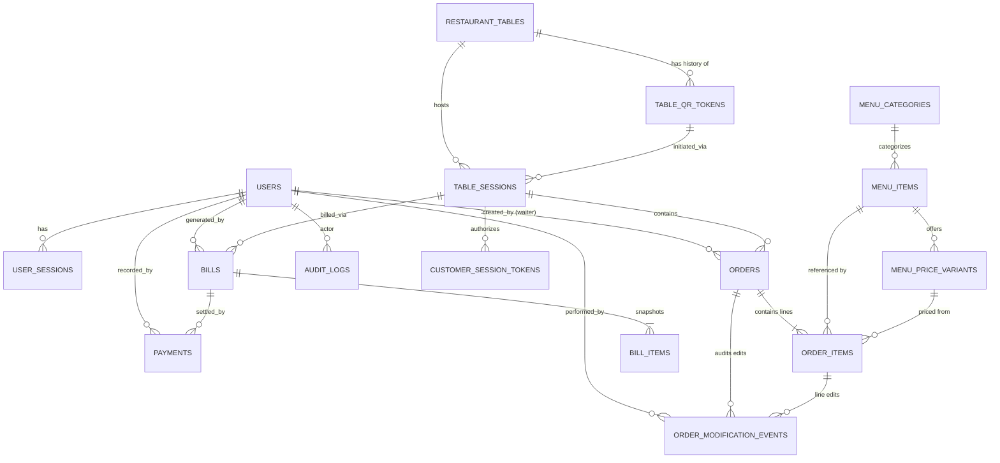

# Volume 3: Security Architecture & Normalized PostgreSQL Data Model

> **Document Status:** SOURCE OF TRUTH — Phase 0 (Documentation Only; No Application Code)

---

## 1. Dedicated Security Specification

### 1.1 Authentication Architecture
- **Staff Users (Admin, Waiter, Kitchen):**
  - Authenticate via username/employee_code + password against `POST /api/v1/auth/login`.
  - Passwords hashed using **Argon2id** (recommended memory: 64 MB, iterations: 3, parallelism: 4; or bcrypt cost factor $\ge 12$). Plaintext or reversible password storage is strictly prohibited.
  - Issues short-lived **Access Token (JWT, HS256/RS256, 15–30 min TTL)** containing `sub` (`user_id`), `role` (`ADMIN`, `WAITER`, `KITCHEN`), and `token_version`, paired with a rotatable **Refresh Token (7-day TTL)** stored in `user_sessions` (HttpOnly, Secure, SameSite=Strict cookie for Admin Web; encrypted `FlutterSecureStorage` on Waiter/Kitchen Android apps).
  - Deactivating a staff user (`users.is_active = false`) or incrementing `users.token_version` immediately invalidates all active tokens and WebSocket connections for that user.
- **Customers (QR Web):**
  - Zero account/login requirement.
  - Authenticated contextually via the table's active cryptographic `qr_token` exchanged for a signed, short-lived **`customer_session_token`** (`HttpOnly; Secure; SameSite=Strict` cookie + header fallback) bound to `table_id`, `qr_token_id`, and `table_session_id`.

### 1.2 Authorization & Role-Based Access Control (RBAC)
Every FastAPI endpoint enforces explicit role dependencies:
1. **Customer Boundary:** Can **only** read public active menu data, submit orders for the specific `table_id` / `table_session_id` encoded in their validated `customer_session_token`, and view order statuses belonging to their current active `table_session_id`. A customer can **never** pass an arbitrary `table_id` or `order_id` in a request body/path to view or mutate another table's orders.
2. **Waiter Boundary:** Can view tables, active table sessions, create orders, edit orders per state matrix, mark `READY -> SERVED`, generate bills, and record payments. Waiters **cannot** accept/reject orders in the kitchen queue, modify menu prices/items, regenerate QR codes, manage staff, or void paid bills.
3. **Kitchen Boundary:** Can view active kitchen queue orders (`PLACED`, `ACCEPTED`, `PREPARING`, `READY`), transition `PLACED -> ACCEPTED/REJECTED`, `ACCEPTED -> PREPARING`, `PREPARING -> READY`, and acknowledge order modification alerts. Kitchen staff **cannot** generate bills, record payments, access admin reports, or manage staff/tables.
4. **Admin Boundary:** Full administrative privileges, with mandatory `reason` enforcement and immutable `audit_logs` capture for all sensitive overrides, price updates, QR rotations, and financial adjustments.

### 1.3 Comprehensive Security Controls Matrix

| Security Domain | Mandatory Specification & Control Mechanism |
| :--- | :--- |
| **Customer Session Security** | Signed `customer_session_token` tied to `qr_token_id` and `table_session_id`. Idle expiry = 30 min (if no order placed); hard expiry = 3 hours or immediate revocation the instant `table_sessions.status` transitions to `COMPLETED` or `CLOSED_NO_CHARGE`. |
| **Secure QR Token Generation** | Generated using Python `secrets.token_urlsafe(32)` (256 bits of CSPRNG entropy). Never sequential, never derived from `table_number` via simple base64/MD5. Stored in `table_qr_tokens` with a unique index on `qr_token`. |
| **QR Token Rotation & Revocation** | Regenerating a table's QR code atomically sets `status = 'REVOKED'`, `revoked_at = NOW()` on the old token and creates a new `ACTIVE` token. Any scan or order using a `REVOKED` token fails immediately with HTTP `410 Gone`. |
| **Broken Access Control / IDOR Prevention** | 1) Use UUIDv4 (or unguessable public IDs) alongside internal references for customer-facing resources. 2) Customer endpoints derive `table_id` and `table_session_id` exclusively from the server-verified `customer_session_token`, ignoring any client-supplied `table_id`. 3) Customer `GET /api/v1/public/session/orders` filters strictly by `WHERE table_session_id = token.table_session_id`. |
| **Order Manipulation & Price Tampering Prevention** | Client payloads when creating/modifying orders submit **only** `menu_price_variant_id` and `quantity`. The client **never** sends unit prices, tax rates, or totals. The backend looks up authoritative prices from `menu_price_variants` inside the DB transaction. |
| **Authentication Brute-Force Protection** | Rate-limit `POST /api/v1/auth/login` to 5 failed attempts per 15 minutes per username and per IP. Lock account for 15 minutes after 5 consecutive failures and emit a security alert to Admin. |
| **Input & Output Validation** | Strict Pydantic v2 schemas on every FastAPI request and response (`extra="forbid"` on request models). Strict regex validation on `item_code`, string length caps on `special_instructions` (max 250 chars), positive integer bounds on `quantity` ($1 \le q \le \text{max\_qty}$). Output schemas strip password hashes, internal tokens, and stack traces. |
| **SQL Injection Prevention** | Parameterized queries / SQLAlchemy 2.0 ORM bound parameters exclusively. Raw string interpolation in SQL queries is strictly prohibited. |
| **XSS Prevention** | All free-text inputs (`special_instructions`, `rejection_reason`, `cancellation_reason`, dish descriptions) are HTML-escaped/sanitized on ingestion and rendered as text nodes (never `dangerouslySetInnerHTML`) in Customer and Admin React apps, with strict `Content-Security-Policy` headers. |
| **CORS & CSRF Protection** | CORS configured with explicit allowlist of exact origins (`https://menu.<domain>` and `https://admin.<domain>`); wildcard `*` with credentials is forbidden. If cookies are used for session tokens, enforce `SameSite=Strict` + custom `X-Requested-With` / CSRF token validation on state-mutating requests. |
| **Payment & Financial Security** | Only authenticated `WAITER` or `ADMIN` roles can generate bills or record payments. Bill totals are calculated server-side from DB snapshots. `Idempotency-Key` prevents double-recording payments. Paid bills are immutable at the application and database trigger levels. |
| **Secrets Management** | JWT signing keys, DB credentials, and HMAC secrets loaded strictly from environment variables (`.env` excluded from Git with `0600` permissions). Never hardcoded in source code or committed to version control; never exposed to frontend bundles (`VITE_`). |
| **Audit Logging, Error Handling & Sensitive Data** | Append-only `audit_logs` table records actor, role, IP, action, target entity, before/after JSON snapshots, and timestamp. Production API responses return structured error codes without internal Python tracebacks or SQL error details. Logs redact `password`, `Authorization` headers, and `qr_token` values. |

---

## 2. Normalized PostgreSQL Database Architecture

### 2.1 Entity-Relationship Diagram (Mermaid)

### 2.2 Complete Entity Catalog (17 Normalized Entities)

#### 1. `restaurant_settings` (Singleton Configuration Table)
- **Purpose:** Stores global operational, tax, billing, outstanding-limit, and rate-limiting parameters for the single restaurant.
- **Primary Key:** `id` (`SMALLINT`, constrained to `id = 1` via `CHECK (id = 1)`).
- **Important Fields:**
  - `restaurant_name` (`VARCHAR(120) NOT NULL`), `address` (`TEXT`), `phone` (`VARCHAR(30)`), `gstin` (`VARCHAR(30)`)
  - `currency_code` (`VARCHAR(3) DEFAULT 'INR'`), `currency_symbol` (`VARCHAR(5) DEFAULT '₹'`)
  - `is_restaurant_open` (`BOOLEAN NOT NULL DEFAULT TRUE`), `is_qr_ordering_enabled` (`BOOLEAN NOT NULL DEFAULT TRUE`)
  - `opening_time` (`TIME`), `closing_time` (`TIME`)
  - `tax_mode` (`VARCHAR(20) NOT NULL DEFAULT 'EXCLUSIVE'` — `'EXCLUSIVE' | 'INCLUSIVE' | 'NONE'`)
  - `cgst_percentage` (`NUMERIC(5,2) NOT NULL DEFAULT 2.50`), `sgst_percentage` (`NUMERIC(5,2) NOT NULL DEFAULT 2.50`)
  - `discounts_enabled` (`BOOLEAN NOT NULL DEFAULT FALSE`), `max_waiter_discount_percent` (`NUMERIC(5,2) NOT NULL DEFAULT 0.00`)
  - `max_outstanding_session_amount` (`NUMERIC(10,2) NOT NULL DEFAULT 5000.00`)
  - `qr_max_orders_short_window` (`INT NOT NULL DEFAULT 3`), `qr_short_window_seconds` (`INT NOT NULL DEFAULT 120`)
  - `qr_max_orders_long_window` (`INT NOT NULL DEFAULT 10`), `qr_long_window_seconds` (`INT NOT NULL DEFAULT 1800`)
  - `max_pending_placed_orders_per_table` (`INT NOT NULL DEFAULT 3`)
  - `max_distinct_items_per_order` (`INT NOT NULL DEFAULT 20`), `max_qty_per_order_item` (`INT NOT NULL DEFAULT 15`)
  - `duplicate_order_window_seconds` (`INT NOT NULL DEFAULT 15`)
  - `updated_at` (`TIMESTAMPTZ NOT NULL`), `updated_by_user_id` (`UUID FK -> users.id`)

#### 2. `users` (Staff Accounts & Roles)
- **Purpose:** Stores Admin, Waiter, and Kitchen Staff identities and credentials. (Roles are enforced via an enum/check constraint `role IN ('ADMIN', 'WAITER', 'KITCHEN')`; a separate `roles` lookup table may also be seeded if granular permission flags are desired).
- **Primary Key:** `id` (`UUID DEFAULT gen_random_uuid()`).
- **Important Fields:** `employee_code` (`VARCHAR(30) UNIQUE NOT NULL`), `username` (`VARCHAR(50) UNIQUE NOT NULL`), `full_name` (`VARCHAR(100) NOT NULL`), `phone` (`VARCHAR(20)`), `password_hash` (`TEXT NOT NULL`), `role` (`VARCHAR(20) NOT NULL`), `is_active` (`BOOLEAN NOT NULL DEFAULT TRUE`), `token_version` (`INT NOT NULL DEFAULT 1`), `failed_login_attempts` (`INT NOT NULL DEFAULT 0`), `locked_until` (`TIMESTAMPTZ NULL`), `last_login_at` (`TIMESTAMPTZ NULL`), `created_at`, `updated_at`.
- **Soft-Delete Strategy:** Never hard-delete staff users; set `is_active = FALSE` and increment `token_version` so historical orders, edits, bills, and payments retain valid foreign key references to `users.id`.

#### 3. `user_sessions` (Staff Refresh Tokens & Device Tracking)
- **Purpose:** Tracks active staff login sessions and allows instant revocation.
- **Primary Key:** `id` (`UUID`).
- **Foreign Keys:** `user_id` (`UUID NOT NULL FK -> users.id ON DELETE CASCADE`).
- **Important Fields:** `refresh_token_hash` (`VARCHAR(128) UNIQUE NOT NULL`), `device_info` (`VARCHAR(255)`), `ip_address` (`INET`), `expires_at` (`TIMESTAMPTZ NOT NULL`), `is_revoked` (`BOOLEAN NOT NULL DEFAULT FALSE`), `created_at` (`TIMESTAMPTZ NOT NULL`).

#### 4. `restaurant_tables` (Physical Restaurant Tables)
- **Purpose:** Represents each physical dining table in the restaurant.
- **Primary Key:** `id` (`UUID`).
- **Foreign Keys:** `active_session_id` (`UUID NULL FK -> table_sessions.id`).
- **Important Fields:** `table_number` (`VARCHAR(20) UNIQUE NOT NULL`, e.g., `'1'`, `'2'`, `'T1'`), `display_name` (`VARCHAR(50) NOT NULL`, e.g., `'Table 1 (Window)'`), `seating_capacity` (`SMALLINT NOT NULL DEFAULT 4`), `floor_section` (`VARCHAR(50) NULL`), `status` (`VARCHAR(20) NOT NULL DEFAULT 'AVAILABLE'` — `'AVAILABLE' | 'OCCUPIED' | 'DISABLED'`), `is_qr_enabled` (`BOOLEAN NOT NULL DEFAULT TRUE`), `is_active` (`BOOLEAN NOT NULL DEFAULT TRUE`), `version` (`INT NOT NULL DEFAULT 1`), `created_at`, `updated_at`.
- **Constraints & Indexes:** `UNIQUE (table_number)`, `CHECK (status IN ('AVAILABLE', 'OCCUPIED', 'DISABLED'))`, constraint ensuring `(status = 'OCCUPIED' AND active_session_id IS NOT NULL) OR (status != 'OCCUPIED' AND active_session_id IS NULL)`.

#### 5. `table_qr_tokens` (Cryptographic QR Tokens & Rotation History)
- **Purpose:** Stores the current active unpredictable QR token for each table and the full history of rotated/revoked tokens.
- **Primary Key:** `id` (`UUID`).
- **Foreign Keys:** `table_id` (`UUID NOT NULL FK -> restaurant_tables.id`), `created_by_user_id` (`UUID NOT NULL FK -> users.id`), `revoked_by_user_id` (`UUID NULL FK -> users.id`).
- **Important Fields:** `qr_token` (`VARCHAR(128) UNIQUE NOT NULL`), `status` (`VARCHAR(20) NOT NULL DEFAULT 'ACTIVE'` — `'ACTIVE' | 'REVOKED'`), `revocation_reason` (`VARCHAR(255) NULL`), `created_at` (`TIMESTAMPTZ NOT NULL`), `revoked_at` (`TIMESTAMPTZ NULL`).
- **Constraints & Indexes:**
  - `UNIQUE (qr_token)`
  - **Partial Unique Index:** `CREATE UNIQUE INDEX idx_one_active_qr_per_table ON table_qr_tokens(table_id) WHERE status = 'ACTIVE';` (guarantees at the database level that a table can never have two `ACTIVE` QR tokens simultaneously).

#### 6. `table_sessions` (Active & Historical Dining Sessions)
- **Purpose:** Tracks a complete dining visit on a table from the first valid order placed until payment completion or full cancellation.
- **Primary Key:** `id` (`UUID`).
- **Foreign Keys:** `table_id` (`UUID NOT NULL FK -> restaurant_tables.id`), `initiated_by_qr_token_id` (`UUID NULL FK -> table_qr_tokens.id`), `initiated_by_waiter_id` (`UUID NULL FK -> users.id`), `closed_by_user_id` (`UUID NULL FK -> users.id`).
- **Important Fields:**
  - `session_code` (`VARCHAR(30) UNIQUE NOT NULL`, e.g., `'SES-20261006-0018'`)
  - `status` (`VARCHAR(25) NOT NULL DEFAULT 'ACTIVE'` — `'ACTIVE' | 'COMPLETED' | 'CLOSED_NO_CHARGE'`)
  - `opened_by_source` (`VARCHAR(20) NOT NULL` — `'CUSTOMER_QR' | 'WAITER'`)
  - `current_outstanding_amount` (`NUMERIC(10,2) NOT NULL DEFAULT 0.00`)
  - `custom_max_outstanding_limit` (`NUMERIC(10,2) NULL` — overrides global ₹5,000 limit for this specific session if set by Admin)
  - `is_qr_ordering_locked` (`BOOLEAN NOT NULL DEFAULT FALSE` — set `TRUE` when bill is `ISSUED` or suspicious abuse detected)
  - `lock_reason` (`VARCHAR(255) NULL`)
  - `opened_at` (`TIMESTAMPTZ NOT NULL`), `closed_at` (`TIMESTAMPTZ NULL`), `version` (`INT NOT NULL DEFAULT 1`).
- **Constraints & Indexes:**
  - **Partial Unique Index:** `CREATE UNIQUE INDEX idx_one_active_session_per_table ON table_sessions(table_id) WHERE status = 'ACTIVE';` (strictly prevents race conditions creating two active sessions on the same table).

#### 7. `customer_session_tokens` (Ephemeral QR Browser Sessions)
- **Purpose:** Tracks customer browser sessions created when scanning a QR code, binding them to the table and active `TableSession` and supporting rate-limiting and instant revocation upon bill settlement.
- **Primary Key:** `id` (`UUID`).
- **Foreign Keys:** `table_id` (`UUID NOT NULL FK -> restaurant_tables.id`), `qr_token_id` (`UUID NOT NULL FK -> table_qr_tokens.id`), `table_session_id` (`UUID NULL FK -> table_sessions.id`).
- **Important Fields:** `token_hash` (`VARCHAR(128) UNIQUE NOT NULL`), `client_ip` (`INET`), `user_agent_hash` (`VARCHAR(64)`), `is_revoked` (`BOOLEAN NOT NULL DEFAULT FALSE`), `expires_at` (`TIMESTAMPTZ NOT NULL`), `last_activity_at` (`TIMESTAMPTZ NOT NULL`), `created_at` (`TIMESTAMPTZ NOT NULL`).

#### 8. `menu_categories` (Menu Categories)
- **Purpose:** Groups menu items into logical sections (*Soups*, *Starters*, *Biryani*, *Curries*, *Breads*, *Beverages*).
- **Primary Key:** `id` (`UUID`).
- **Important Fields:** `name` (`VARCHAR(80) UNIQUE NOT NULL`), `description` (`TEXT NULL`), `display_order` (`INT NOT NULL DEFAULT 0`), `is_available` (`BOOLEAN NOT NULL DEFAULT TRUE`), `is_active` (`BOOLEAN NOT NULL DEFAULT TRUE` — soft-delete flag), `created_at`, `updated_at`.

#### 9. `menu_items` (Dishes / Menu Items)
- **Purpose:** Represents a dish on the menu without hardcoding a single price.
- **Primary Key:** `id` (`UUID`).
- **Foreign Keys:** `category_id` (`UUID NOT NULL FK -> menu_categories.id`).
- **Important Fields:**
  - `item_code` (`VARCHAR(10) NOT NULL` — short memorable code, e.g., `'CB'`, `'CK'`)
  - `name` (`VARCHAR(120) NOT NULL` — e.g., `'Chicken Biryani'`)
  - `description` (`TEXT NULL`)
  - `image_url` (`TEXT NULL`)
  - `dietary_type` (`VARCHAR(20) NOT NULL DEFAULT 'NON_VEG'` — `'VEG' | 'NON_VEG' | 'EGG'`)
  - `is_available` (`BOOLEAN NOT NULL DEFAULT TRUE` — real-time stock toggle)
  - `is_active` (`BOOLEAN NOT NULL DEFAULT TRUE` — soft-delete flag)
  - `display_order` (`INT NOT NULL DEFAULT 0`), `created_at`, `updated_at`.
- **Constraints & Indexes:**
  - Case-insensitive unique index on active item codes: `CREATE UNIQUE INDEX idx_unique_item_code ON menu_items(UPPER(item_code)) WHERE is_active = TRUE;`
  - Trigram / GIN index on `name` and `item_code` for sub-10ms waiter search.

#### 10. `menu_price_variants` (Price & Serving Size Options)
- **Purpose:** Stores the 1-to-N pricing/portion variants for each `MenuItem` (e.g., *Half — ₹100*, *Full — ₹180*, *2 Pieces — ₹120*).
- **Primary Key:** `id` (`UUID`).
- **Foreign Keys:** `menu_item_id` (`UUID NOT NULL FK -> menu_items.id`).
- **Important Fields:**
  - `variant_code` (`VARCHAR(16) NOT NULL` — e.g., `'CB-H'`, `'CB-F'`, `'CK-2'`)
  - `variant_name` (`VARCHAR(60) NOT NULL` — e.g., `'Half'`, `'Full'`, `'2 Pieces'`, `'Regular'`)
  - `unit_type` (`VARCHAR(30) NOT NULL DEFAULT 'PORTION'` — `'PORTION' | 'PIECES' | 'ML' | 'GRAMS' | 'PLATE'`)
  - `unit_quantity` (`NUMERIC(8,2) NOT NULL DEFAULT 1.00` — e.g., `2` for 2 pieces, `250` for 250 ml)
  - `price` (`NUMERIC(10,2) NOT NULL CHECK (price >= 0)`)
  - `is_default` (`BOOLEAN NOT NULL DEFAULT FALSE`)
  - `is_available` (`BOOLEAN NOT NULL DEFAULT TRUE`)
  - `is_active` (`BOOLEAN NOT NULL DEFAULT TRUE` — soft-delete flag)
  - `display_order` (`INT NOT NULL DEFAULT 0`), `created_at`, `updated_at`.
- **Constraints & Indexes:**
  - `CREATE UNIQUE INDEX idx_unique_variant_code ON menu_price_variants(UPPER(variant_code)) WHERE is_active = TRUE;`
  - `UNIQUE (menu_item_id, variant_name) WHERE is_active = TRUE`

#### 11. `orders` (Customer & Waiter Orders)
- **Purpose:** Represents an individual order submission within a `TableSession`.
- **Primary Key:** `id` (`UUID`).
- **Foreign Keys:**
  - `table_session_id` (`UUID NOT NULL FK -> table_sessions.id`)
  - `table_id` (`UUID NOT NULL FK -> restaurant_tables.id`)
  - `created_by_waiter_id` (`UUID NULL FK -> users.id`)
  - `customer_session_token_id` (`UUID NULL FK -> customer_session_tokens.id`)
  - `accepted_by_user_id`, `rejected_by_user_id`, `preparing_by_user_id`, `ready_by_user_id`, `served_by_user_id`, `cancelled_by_user_id` (`UUID NULL FK -> users.id`).
- **Important Fields:**
  - `order_number` (`VARCHAR(30) UNIQUE NOT NULL` — e.g., `'ORD-20261006-0104'`)
  - `daily_token_number` (`INT NOT NULL` — resets daily `1, 2, 3...` for easy Kitchen/Waiter callout)
  - `source` (`VARCHAR(20) NOT NULL` — `'CUSTOMER_QR' | 'WAITER' | 'ADMIN'`)
  - `status` (`VARCHAR(20) NOT NULL DEFAULT 'PLACED'` — `'PLACED' | 'ACCEPTED' | 'PREPARING' | 'READY' | 'SERVED' | 'COMPLETED' | 'REJECTED' | 'CANCELLED'`)
  - `subtotal_amount` (`NUMERIC(10,2) NOT NULL CHECK (subtotal_amount >= 0)`)
  - `special_instructions` (`VARCHAR(250) NULL`)
  - `rejection_reason` (`VARCHAR(255) NULL`), `cancellation_reason` (`VARCHAR(255) NULL`)
  - `has_modifications` (`BOOLEAN NOT NULL DEFAULT FALSE`), `has_unacknowledged_kitchen_mods` (`BOOLEAN NOT NULL DEFAULT FALSE`)
  - `idempotency_key` (`VARCHAR(100) UNIQUE NOT NULL`)
  - `version` (`INT NOT NULL DEFAULT 1` — optimistic concurrency control)
  - `placed_at` (`TIMESTAMPTZ NOT NULL`), `accepted_at`, `preparing_at`, `ready_at`, `served_at`, `completed_at`, `rejected_at`, `cancelled_at` (`TIMESTAMPTZ NULL`).
- **Constraints:**
  - `CHECK (status != 'REJECTED' OR rejection_reason IS NOT NULL)` (enforces mandatory rejection reason at DB level).

#### 12. `order_items` (Order Lines with Immutable Historical Price Snapshots)
- **Purpose:** Stores each line item within an `Order`, capturing the exact item name, codes, variant name, and price charged at the time of order.
- **Primary Key:** `id` (`UUID`).
- **Foreign Keys:** `order_id` (`UUID NOT NULL FK -> orders.id ON DELETE RESTRICT`), `menu_item_id` (`UUID NOT NULL FK -> menu_items.id`), `menu_price_variant_id` (`UUID NOT NULL FK -> menu_price_variants.id`).
- **Important Fields:**
  - **Historical Snapshot Fields (Immutable):**
    - `item_code_snapshot` (`VARCHAR(10) NOT NULL`)
    - `item_name_snapshot` (`VARCHAR(120) NOT NULL`)
    - `variant_code_snapshot` (`VARCHAR(16) NOT NULL`)
    - `variant_name_snapshot` (`VARCHAR(60) NOT NULL`)
    - `unit_type_snapshot` (`VARCHAR(30) NOT NULL`)
    - `unit_quantity_snapshot` (`NUMERIC(8,2) NOT NULL`)
    - `unit_price_snapshot` (`NUMERIC(10,2) NOT NULL CHECK (unit_price_snapshot >= 0)`)
  - **Quantity & Status Fields:**
    - `original_quantity` (`INT NOT NULL CHECK (original_quantity > 0)`)
    - `active_quantity` (`INT NOT NULL CHECK (active_quantity >= 0)`)
    - `line_subtotal` (`NUMERIC(10,2) NOT NULL CHECK (line_subtotal >= 0)` — equals `active_quantity * unit_price_snapshot`)
    - `status` (`VARCHAR(20) NOT NULL DEFAULT 'ACTIVE'` — `'ACTIVE' | 'MODIFIED' | 'CANCELLED'`)
    - `item_notes` (`VARCHAR(200) NULL`)
    - `created_at`, `updated_at`.

#### 13. `order_modification_events` (Immutable Order Edit Ledger)
- **Purpose:** Preserves a complete, non-destructive audit history of every edit made to an order before or after kitchen acceptance.
- **Primary Key:** `id` (`UUID`).
- **Foreign Keys:** `order_id` (`UUID NOT NULL FK -> orders.id`), `order_item_id` (`UUID NULL FK -> order_items.id`), `performed_by_user_id` (`UUID NOT NULL FK -> users.id`), `kitchen_acknowledged_by_user_id` (`UUID NULL FK -> users.id`).
- **Important Fields:**
  - `modification_type` (`VARCHAR(40) NOT NULL` — `'ITEM_ADDED' | 'ITEM_QTY_INCREASED' | 'ITEM_QTY_DECREASED' | 'ITEM_CANCELLED' | 'ITEM_NOTE_UPDATED' | 'ORDER_CANCELLED'`)
  - `order_status_at_modification` (`VARCHAR(20) NOT NULL`)
  - `previous_quantity` (`INT NULL`), `new_quantity` (`INT NULL`)
  - `previous_order_subtotal` (`NUMERIC(10,2) NOT NULL`), `new_order_subtotal` (`NUMERIC(10,2) NOT NULL`), `price_delta` (`NUMERIC(10,2) NOT NULL`)
  - `reason` (`VARCHAR(255) NOT NULL`)
  - `is_wastage` (`BOOLEAN NOT NULL DEFAULT FALSE`)
  - `before_snapshot_json` (`JSONB NOT NULL`), `after_snapshot_json` (`JSONB NOT NULL`)
  - `requires_kitchen_ack` (`BOOLEAN NOT NULL DEFAULT TRUE`), `kitchen_acknowledged_at` (`TIMESTAMPTZ NULL`)
  - `created_at` (`TIMESTAMPTZ NOT NULL`).

#### 14. `bills` (Table Session Invoices)
- **Purpose:** Stores the generated bill/invoice for a `TableSession`.
- **Primary Key:** `id` (`UUID`).
- **Foreign Keys:** `table_session_id` (`UUID NOT NULL FK -> table_sessions.id`), `table_id` (`UUID NOT NULL FK -> restaurant_tables.id`), `generated_by_user_id` (`UUID NOT NULL FK -> users.id`), `discount_approved_by_user_id` (`UUID NULL FK -> users.id`), `voided_by_user_id` (`UUID NULL FK -> users.id`).
- **Important Fields:**
  - `bill_number` (`VARCHAR(30) UNIQUE NOT NULL` — e.g., `'INV-20261006-0042'`)
  - `status` (`VARCHAR(20) NOT NULL DEFAULT 'ISSUED'` — `'ISSUED' | 'PAID' | 'VOIDED'`)
  - `items_subtotal` (`NUMERIC(10,2) NOT NULL`)
  - `discount_type` (`VARCHAR(20) NULL` — `'PERCENTAGE' | 'FLAT'`), `discount_value` (`NUMERIC(10,2) NOT NULL DEFAULT 0.00`), `discount_amount` (`NUMERIC(10,2) NOT NULL DEFAULT 0.00`), `discount_reason` (`VARCHAR(255) NULL`)
  - `taxable_amount` (`NUMERIC(10,2) NOT NULL`)
  - `tax_mode_snapshot` (`VARCHAR(20) NOT NULL`), `cgst_rate_snapshot` (`NUMERIC(5,2) NOT NULL`), `sgst_rate_snapshot` (`NUMERIC(5,2) NOT NULL`)
  - `cgst_amount` (`NUMERIC(10,2) NOT NULL DEFAULT 0.00`), `sgst_amount` (`NUMERIC(10,2) NOT NULL DEFAULT 0.00`), `total_tax_amount` (`NUMERIC(10,2) NOT NULL DEFAULT 0.00`)
  - `rounding_adjustment` (`NUMERIC(5,2) NOT NULL DEFAULT 0.00`)
  - `grand_total` (`NUMERIC(10,2) NOT NULL CHECK (grand_total >= 0)`)
  - `amount_paid` (`NUMERIC(10,2) NOT NULL DEFAULT 0.00`)
  - `idempotency_key` (`VARCHAR(100) UNIQUE NOT NULL`)
  - `void_reason` (`VARCHAR(255) NULL`), `issued_at` (`TIMESTAMPTZ NOT NULL`), `paid_at` (`TIMESTAMPTZ NULL`), `voided_at` (`TIMESTAMPTZ NULL`).
- **Constraints:** Partial unique index `CREATE UNIQUE INDEX idx_one_active_bill_per_session ON bills(table_session_id) WHERE status IN ('ISSUED', 'PAID');` (prevents generating duplicate active bills for the same table session).

#### 15. `bill_items` (Immutable Bill Line Item Snapshots)
- **Purpose:** Freezes the exact consolidated line items printed on a `Bill`.
- **Primary Key:** `id` (`UUID`).
- **Foreign Keys:** `bill_id` (`UUID NOT NULL FK -> bills.id ON DELETE RESTRICT`), `order_id` (`UUID NOT NULL FK -> orders.id`), `order_item_id` (`UUID NOT NULL FK -> order_items.id`).
- **Important Fields:** `item_code_snapshot`, `item_name_snapshot`, `variant_code_snapshot`, `variant_name_snapshot`, `quantity` (`INT NOT NULL`), `unit_price` (`NUMERIC(10,2) NOT NULL`), `line_total` (`NUMERIC(10,2) NOT NULL`).

#### 16. `payments` (Financial Payment Ledger)
- **Purpose:** Records payment transactions collected against a `Bill`.
- **Primary Key:** `id` (`UUID`).
- **Foreign Keys:** `bill_id` (`UUID NOT NULL FK -> bills.id ON DELETE RESTRICT`), `table_session_id` (`UUID NOT NULL FK -> table_sessions.id`), `recorded_by_user_id` (`UUID NOT NULL FK -> users.id`).
- **Important Fields:**
  - `payment_reference_number` (`VARCHAR(40) UNIQUE NOT NULL` — internal receipt ref e.g., `'PAY-20261006-0042'`)
  - `payment_method` (`VARCHAR(20) NOT NULL` — `'CASH' | 'UPI' | 'CARD' | 'OTHER'`)
  - `amount` (`NUMERIC(10,2) NOT NULL CHECK (amount > 0)`)
  - `status` (`VARCHAR(20) NOT NULL DEFAULT 'SUCCESS'` — `'PENDING' | 'SUCCESS' | 'FAILED' | 'VOIDED'`)
  - `external_transaction_ref` (`VARCHAR(100) NULL` — optional UPI UTR / card slip number)
  - `notes` (`VARCHAR(255) NULL`)
  - `idempotency_key` (`VARCHAR(100) UNIQUE NOT NULL`)
  - `paid_at` (`TIMESTAMPTZ NOT NULL`), `created_at` (`TIMESTAMPTZ NOT NULL`).

#### 17. `notifications` & `audit_logs`
- **`notifications`:**
  - **PK:** `id` (`UUID`).
  - **Fields:** `target_role` (`'KITCHEN' | 'WAITER' | 'ADMIN'`), `target_user_id` (`UUID NULL`), `table_id` (`UUID NULL`), `order_id` (`UUID NULL`), `event_type` (`VARCHAR(50) NOT NULL`), `title` (`VARCHAR(120) NOT NULL`), `message` (`TEXT NOT NULL`), `priority` (`'NORMAL' | 'HIGH' | 'CRITICAL'`), `is_read` (`BOOLEAN DEFAULT FALSE`), `created_at` (`TIMESTAMPTZ NOT NULL`).
- **`audit_logs` (Append-Only Immutable Security & Financial Ledger):**
  - **PK:** `id` (`BIGSERIAL` or `UUID`).
  - **Fields:** `actor_user_id` (`UUID NULL FK -> users.id`), `actor_role` (`VARCHAR(20) NOT NULL` — `'CUSTOMER_QR' | 'WAITER' | 'KITCHEN' | 'ADMIN' | 'SYSTEM'`), `actor_ip` (`INET NULL`), `action` (`VARCHAR(80) NOT NULL`), `entity_type` (`VARCHAR(50) NOT NULL`), `entity_id` (`VARCHAR(64) NOT NULL`), `reason` (`TEXT NULL`), `before_state` (`JSONB NULL`), `after_state` (`JSONB NULL`), `metadata` (`JSONB NULL`), `created_at` (`TIMESTAMPTZ NOT NULL DEFAULT NOW()`).
  - **Immutability Rule:** A PostgreSQL `BEFORE UPDATE OR DELETE ON audit_logs` trigger raises an exception so audit log entries can never be altered or deleted.

---

## 3. Transaction Boundaries & Concurrency Control

| Critical Operation | Locking & Isolation Strategy | Atomic Transaction Boundary |
| :--- | :--- | :--- |
| **Order Creation (Customer QR or Waiter)** | `SELECT ... FROM restaurant_tables WHERE id = :table_id FOR UPDATE` | 1. Lock `restaurant_tables` row. 2. Verify QR/Session active & restaurant open. 3. If table `AVAILABLE`, insert `table_sessions` (`ACTIVE`) and update table to `OCCUPIED`. 4. Lock `table_sessions` row; calculate current outstanding total + new order subtotal $\le ₹5,000$. 5. Verify all `menu_price_variants` are `is_available = TRUE` and `is_active = TRUE`. 6. Insert `orders` + `order_items` (with price snapshots). 7. Update `table_sessions.current_outstanding_amount`. 8. Insert `audit_logs`. 9. Commit, then broadcast WebSocket events. |
| **Kitchen Accept vs. Waiter Edit Race Condition** | `SELECT ... FROM orders WHERE id = :order_id FOR UPDATE` + Optimistic `version` check | Both `POST /accept` and `PATCH /orders/{id}` acquire a row-level lock on `orders` and check `WHERE id = :id AND version = :expected_version`. If Kitchen accepts 5ms before Waiter submits a pre-acceptance edit, Waiter's request receives HTTP `409 Conflict` (`"Order was just accepted by Kitchen; reload to submit a post-acceptance modification with reason"`). |
| **Bill Generation & Payment Recording** | `SELECT ... FROM table_sessions WHERE id = :session_id FOR UPDATE` | Locks the `table_session` row, verifies no `ISSUED` or `PAID` bill already exists (enforced also by partial unique index `idx_one_active_bill_per_session`), verifies `Idempotency-Key`, inserts `payments`, transitions `bills -> PAID`, `orders -> COMPLETED`, `table_sessions -> COMPLETED`, `restaurant_tables -> AVAILABLE`, and revokes `customer_session_tokens` in a single atomic commit. |
