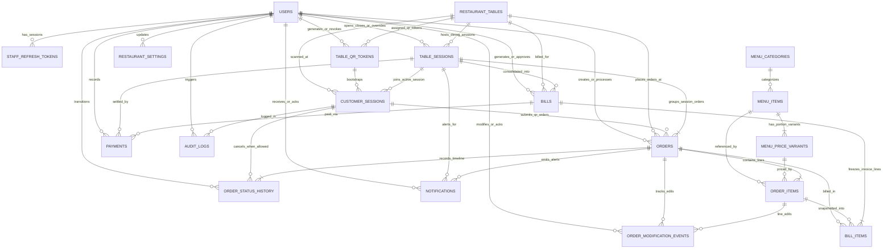

# RESTAURANT MANAGEMENT & QR ORDERING SYSTEM
## Database Design Specification

> **Artifact Path:** `docs/04-database-design.md`  
> **Phase:** Documentation Only (Source of Truth — Zero Application Code, Zero Executable SQL)  
> **Cross-Checked Against:** `docs/02-requirements-and-scope.md` & `docs/03-system-architecture.md`  
> **Target Scope:** Single Physical Restaurant (Non-SaaS)  
> **Target Database Engine:** PostgreSQL (15+ Open Source)  
> **Cost Mandate:** Strict Zero-Cost / Free-Tier-First (`₹0 / $0` Recurring Database Licensing or Extension Cost)

---

## 0. CROSS-CHECK & HARMONIZATION SUMMARY

Before finalizing this specification, every entity, field, relationship, state rule, and concurrency boundary was cross-checked against `docs/02-requirements-and-scope.md` (Software Requirements & Scope Specification) and `docs/03-system-architecture.md` (System Architecture Specification):

1. **Zero Business-Rule Contradictions Found:**
   - **Single-Restaurant Scope:** Confirmed. No multi-tenant `tenant_id` or `restaurant_id` foreign keys pollute the schema.
   - **Scan $\neq$ Occupied:** Confirmed. Scanning a table QR creates/resumes a `CustomerSession` while the table remains `AVAILABLE`. A `TableSession` (`ACTIVE`) is created atomically only when the first valid order (`Order`) is submitted.
   - **Authoritative Table Occupancy:** Confirmed. Whether a table is `AVAILABLE` or `OCCUPIED` is authoritatively determined by the existence of an `ACTIVE` `TableSession` for that table—never by trusting a standalone manual boolean flag.
   - **3-Tier Menu Hierarchy & Short Codes:** Confirmed. `MenuCategory -> MenuItem -> MenuPriceVariant -> OrderItem` supports both dish-level codes (`CB`) and variant-level codes (`CB-H`, `CB-F`, `CK-2`).
   - **Historical Price & Menu Immutability:** Confirmed. `OrderItem` stores immutable snapshots of item code, item name, variant code, variant name, unit, unit price, and tax rate at the moment of order creation.
   - **₹5,000.00 Initial Outstanding Limit:** Confirmed. Enforced server-side per active `TableSession` using row-level locking on `TableSession` and calculated from authoritative `Order` and `OrderItem` data.
2. **Architectural Refinements Formalized in This Database Specification:**
   - **Explicit `CustomerSession` Table (`customer_sessions`):** In `docs/03-system-architecture.md`, customer sessions were described primarily as signed stateless tokens with optional persistence. To satisfy Section 6, Section 20, and multi-device table security (`OD-01`) without requiring a paid external cache, this specification formalizes `customer_sessions` as a lightweight PostgreSQL table backing the signed token. This enables immediate session revocation upon bill settlement, per-device rate-limit tracking, and suspicious-session locking directly in PostgreSQL.
   - **Explicit `Notification` Table (`notifications`):** In `docs/03-system-architecture.md`, real-time events were broadcast over WebSockets with REST reconciliation. To satisfy Section 2 and Section 21, this specification adds a lightweight `notifications` table to persist actionable operational alerts (e.g., First-QR-Order Waiter Verification Alert, Kitchen Order Modification Alert, Order Ready Alert, Suspicious Activity Alert) so no critical alert is lost if a Waiter or Kitchen device disconnects from Wi-Fi.
   - **Table Administrative State vs. Derived Occupancy (`restaurant_tables`):** Section 4 refines `restaurant_tables` so that physical/administrative availability (`ENABLED`, `MAINTENANCE`, `DISABLED`) is stored on the table record, while dining occupancy (`AVAILABLE` vs. `OCCUPIED`) is derived from `table_sessions`.

---

## 1. DATABASE DESIGN GOALS

The PostgreSQL database serves as the single authoritative source of truth for the entire restaurant. Its design is governed by nine core engineering goals:

| Goal | How the Database Design Achieves It |
| :--- | :--- |
| **1. Correctness** | Strict relational modeling, explicit data types (`UUID`, `NUMERIC(10,2)`, `TIMESTAMPTZ`, constrained enums), non-nullable required columns, and database-enforced check constraints ensure invalid business states cannot be stored. |
| **2. Data Integrity** | Every relationship is enforced via foreign keys with explicit `ON DELETE RESTRICT` semantics on operational and financial tables so parent records (`MenuItem`, `RestaurantTable`, `User`, `TableSession`) can never be orphaned or destructively cascade-deleted. |
| **3. Historical Accuracy** | Past orders, modified line items, bills, and payments remain 100% reproducible years later even if Admin renames dishes, changes prices (`₹180 -> ₹200`), alters tax percentages, or deactivates menu items. |
| **4. Security** | Plaintext passwords and raw active QR/refresh tokens are never stored cleanly without cryptographic protection; customer table scoping is bound to `customer_sessions` and `table_sessions`; financial and audit tables reject destructive modifications. |
| **5. Auditability** | Three dedicated append-only tracking structures—`order_status_history`, `order_modification_events`, and `audit_logs`—record every state transition, item edit, price change, cancellation, rejection, and administrative override with actor, timestamp, reason, and before/after values. |
| **6. Concurrency Safety** | Pessimistic row-level locks on `restaurant_tables` and `table_sessions` (`FOR UPDATE` semantics), optimistic `version` counters on `orders`, and partial unique indexes prevent race conditions when multiple devices or staff act simultaneously. |
| **7. Performance** | Targeted B-Tree, Partial Unique, and Trigram (`pg_trgm`) indexes ensure sub-10ms lookups for waiter short-code search (`CB-H`), full-name search (`Chicken Biryani`), active kitchen queues, and session balance calculations. |
| **8. Maintainability** | Clear, consistent naming conventions (`snake_case`), normalized 3NF tables for configuration data paired with deliberate denormalized snapshot columns on transactional records (`order_items`, `bill_items`), and versioned schema migrations. |
| **9. Simplicity for One Restaurant** | Zero multi-tenant SaaS bloat. There are no `organization_id`, `tenant_id`, `subscription_plan`, or cross-branch inventory tables. Global restaurant configuration lives in a single-row `restaurant_settings` table. |

---

## 2. ENTITY INVENTORY

### 2.1 Evaluation of Required & Candidate Entities

We evaluated all candidate entities required for Version 1. Below is the complete inventory of **21 database entities** (20 operational tables + 1 singleton configuration table), including our evaluation of `Roles` / `Permissions` and `BillItems`:

- **Why Separate `roles` / `permissions` Tables Are Omitted in Favor of a Constrained `role` Column on `users`:**
  - The system has exactly three fixed staff roles (`ADMIN`, `WAITER`, `KITCHEN`) with fixed, non-overlapping responsibilities documented in the specification. Creating three extra join tables (`roles`, `permissions`, `role_permissions`, `user_roles`) adds join overhead without business value for a single restaurant. We therefore use a constrained `role` attribute on `users` (documented in detail in Section 3).
- **Why Both `order_items` and `bill_items` Are Included:**
  - While `order_items` captures line items per individual order batch (`Order #1001`, `Order #1002`), a `TableSession` often spans 2–5 separate orders over an hour. When a `Bill` is generated, `bill_items` stores the consolidated, immutable invoice line snapshot (excluding rejected/cancelled items) so the printed/displayed receipt is permanently frozen even if an order status is inspected later.

### 2.2 Master Entity Catalog (21 Entities)

| # | Entity Name (Table) | Purpose & Why It Exists | Primary Key | Foreign Keys | Required vs. Optional Fields | Unique Constraints | Check Constraints | Key Indexes | Relationships | Soft-Delete / Deactivation | Historical Data Requirement |
| :--- | :--- | :--- | :--- | :--- | :--- | :--- | :--- | :--- | :--- | :--- | :--- |
| **1** | **`users`** | Stores staff accounts (`ADMIN`, `WAITER`, `KITCHEN`). Customers do not have user accounts. | `id` (UUID) | `created_by_user_id -> users.id` (nullable self-FK) | **Req:** `username`, `full_name`, `password_hash`, `role`, `status`, `is_active`, `failed_login_attempts`, `created_at`, `updated_at`<br>**Opt:** `locked_until`, `last_login_at`, `created_by_user_id` | `UNIQUE(LOWER(username))` | `role IN ('ADMIN','WAITER','KITCHEN')`; `status IN ('ACTIVE','DISABLED','LOCKED')`; `failed_login_attempts >= 0` | Unique index on `LOWER(username)`; index on `(role, is_active)` | 1-to-many with `orders`, `bills`, `payments`, `audit_logs`, `staff_refresh_tokens` | Soft-deactivate only (`is_active = false`, `status = 'DISABLED'`). Never hard-delete. | Must persist forever so historical orders, bills, payments, and audit logs always resolve the staff actor's name. |
| **2** | **`staff_refresh_tokens`** | Tracks active/revoked staff JWT refresh sessions so Admin can immediately revoke access when a waiter or kitchen staff member is disabled or loses a device. | `id` (UUID) | `user_id -> users.id` | **Req:** `user_id`, `token_hash`, `expires_at`, `is_revoked`, `created_at`<br>**Opt:** `revoked_at`, `revoked_reason`, `device_label` | `UNIQUE(token_hash)` | `expires_at > created_at` | Index on `(user_id, is_revoked)`; index on `expires_at` | Many-to-1 with `users` | Revoked via `is_revoked = true`, `revoked_at = NOW()`. | Expired/revoked rows may be pruned after 90 days during maintenance. |
| **3** | **`restaurant_tables`** | Represents each physical dining table in the restaurant (`Table 1`, `Table 2`, etc.). | `id` (UUID) | None | **Req:** `table_number`, `display_name`, `operational_status`, `is_active`, `display_order`, `created_at`, `updated_at`<br>**Opt:** `seating_capacity`, `floor_or_zone`, `notes` | `UNIQUE(table_number)`; `UNIQUE(LOWER(display_name))` | `table_number > 0`; `operational_status IN ('ENABLED','MAINTENANCE','DISABLED')`; `seating_capacity IS NULL OR seating_capacity > 0` | Unique on `table_number`; index on `(is_active, display_order)` | 1-to-many with `table_qr_tokens`, `customer_sessions`, `table_sessions` | Soft-deactivate (`is_active = false`, `operational_status = 'DISABLED'`). Blocked if an `ACTIVE` `TableSession` exists. | Must never be hard-deleted so historical dining sessions and revenue reports by table remain intact. |
| **4** | **`table_qr_tokens`** | Stores the current and historical cryptographic QR tokens assigned to each physical table. | `id` (UUID) | `table_id -> restaurant_tables.id`; `created_by_user_id -> users.id`; `revoked_by_user_id -> users.id` (opt) | **Req:** `table_id`, `token_hash`, `token_prefix`, `printable_token_ciphertext`, `token_version`, `status`, `created_by_user_id`, `created_at`, `activated_at`<br>**Opt:** `revoked_by_user_id`, `revoked_at`, `revocation_reason`, `expires_at` | `UNIQUE(token_hash)`; `UNIQUE(table_id, token_version)`; Partial Unique: `UNIQUE(table_id) WHERE status = 'ACTIVE'` | `status IN ('ACTIVE','SUPERSEDED','REVOKED','DISABLED')`; `token_version >= 1` | Unique on `token_hash`; partial unique on `table_id WHERE status = 'ACTIVE'` | Many-to-1 with `restaurant_tables`; 1-to-many with `customer_sessions` | Never deleted; old tokens transition to `SUPERSEDED` or `REVOKED`. | Preserves complete regeneration and revocation history per table. |
| **5** | **`customer_sessions`** | Represents a temporary customer browser session created when a customer scans a table QR code. Bridges the customer's device to the table and active `TableSession`. | `id` (UUID) | `table_id -> restaurant_tables.id`; `qr_token_id -> table_qr_tokens.id`; `table_session_id -> table_sessions.id` (nullable until first order) | **Req:** `table_id`, `qr_token_id`, `session_token_hash`, `status`, `expires_at`, `created_at`, `last_seen_at`<br>**Opt:** `table_session_id`, `client_fingerprint_hash`, `revoked_at`, `revoked_reason` | `UNIQUE(session_token_hash)` | `status IN ('ACTIVE','LOCKED_SUSPICIOUS','EXPIRED','CLOSED_BY_PAYMENT','REVOKED')` | Unique on `session_token_hash`; index on `(table_id, status)`; index on `(table_session_id, status)` | Many-to-1 with `restaurant_tables`, `table_qr_tokens`, and `table_sessions`; 1-to-many with `orders` | Transitioned to `CLOSED_BY_PAYMENT`, `EXPIRED`, or `REVOKED`. | Retained with associated orders for security auditing; unlinked expired browse-only sessions can be pruned after 30 days. |
| **6** | **`table_sessions`** | Central dining session entity grouping all orders, modifications, bill, and payment for one customer party's visit at a table. | `id` (UUID) | `table_id -> restaurant_tables.id`; `opened_by_user_id -> users.id` (opt); `opened_by_customer_session_id -> customer_sessions.id` (opt); `closed_by_user_id -> users.id` (opt); `limit_override_by_user_id -> users.id` (opt) | **Req:** `session_code`, `table_id`, `status`, `opened_by_source`, `current_outstanding_amount`, `custom_outstanding_limit`, `is_locked_for_abuse`, `started_at`, `updated_at`<br>**Opt:** `opened_by_user_id`, `opened_by_customer_session_id`, `closed_by_user_id`, `closed_at`, `closed_reason`, `limit_override_by_user_id`, `limit_override_reason` | `UNIQUE(session_code)`; Partial Unique: `UNIQUE(table_id) WHERE status = 'ACTIVE'` | `status IN ('PENDING_CONFIRMATION','ACTIVE','CLOSED_PAID','CLOSED_CANCELLED','CLOSED_ADMIN_OVERRIDE')`; `opened_by_source IN ('CUSTOMER_QR','WAITER')`; `current_outstanding_amount >= 0`; `custom_outstanding_limit > 0` | Partial unique on `table_id WHERE status = 'ACTIVE'`; index on `(status, started_at DESC)` | Many-to-1 with `restaurant_tables`; 1-to-many with `orders`, `customer_sessions`; 1-to-1 (active) with `bills` | Never deleted; transitions from `ACTIVE` to one of the `CLOSED_*` terminal states. | Permanent financial/operational record of every table seating. |
| **7** | **`menu_categories`** | Groups menu items into logical dining sections (`Biriyani`, `Starters`, `Beverages`, etc.). | `id` (UUID) | None | **Req:** `name`, `display_order`, `is_active`, `created_at`, `updated_at`<br>**Opt:** `description` | `UNIQUE(LOWER(name))` | `display_order >= 0` | Index on `(is_active, display_order)` | 1-to-many with `menu_items` | Soft-deactivate (`is_active = false`). Cannot be hard-deleted if `menu_items` reference it. | Preserved so historical category reporting remains intact. |
| **8** | **`menu_items`** | Represents a dish or beverage (`Chicken Biryani`, code `CB`). Does **not** hold a single price directly; pricing belongs to `menu_price_variants`. | `id` (UUID) | `category_id -> menu_categories.id` | **Req:** `category_id`, `item_code`, `name`, `is_available`, `is_active`, `display_order`, `created_at`, `updated_at`<br>**Opt:** `description`, `image_url`, `dietary_type`, `spice_level`, `tax_rate_override` | `UNIQUE(UPPER(item_code))` | `dietary_type IS NULL OR dietary_type IN ('VEG','NON_VEG','EGG')`; `BTRIM(item_code) <> ''` | Unique on `UPPER(item_code)`; Trigram GIN index on `name`; index on `(category_id, is_active, is_available, display_order)` | Many-to-1 with `menu_categories`; 1-to-many with `menu_price_variants`, `order_items` | Soft-deactivate (`is_active = false`, `is_available = false`). | Never hard-deleted once referenced by any `order_items` row. |
| **9** | **`menu_price_variants`** | Represents portion/quantity-based pricing under a `MenuItem` (`Half - ₹100`, `Full - ₹180`, `2 pieces - ₹120`). | `id` (UUID) | `menu_item_id -> menu_items.id` | **Req:** `menu_item_id`, `variant_name`, `quantity_value`, `unit`, `price`, `is_default`, `is_available`, `is_active`, `display_order`, `created_at`, `updated_at`<br>**Opt:** `variant_code` | `UNIQUE(UPPER(variant_code))` (where not null); `UNIQUE(menu_item_id, LOWER(variant_name))` | `price >= 0`; `quantity_value > 0`; `unit IN ('PORTION','PIECE','ML','L','GRAM','KG','PLATE','BOWL','GLASS','BOTTLE')` | Unique on `UPPER(variant_code)`; index on `(menu_item_id, is_active, is_available, display_order)` | Many-to-1 with `menu_items`; 1-to-many with `order_items` | Soft-deactivate (`is_active = false`, `is_available = false`). | Mutable `price` is for future orders only; historical orders rely on `order_items` snapshots. |
| **10** | **`orders`** | Represents a single order batch placed via `CUSTOMER_QR` or `WAITER` inside an active `TableSession`. | `id` (UUID) | `table_session_id -> table_sessions.id`; `table_id -> restaurant_tables.id`; `customer_session_id -> customer_sessions.id` (opt); `created_by_user_id -> users.id` (opt); `accepted_by_user_id -> users.id` (opt); `rejected_by_user_id -> users.id` (opt); `cancelled_by_user_id -> users.id` (opt) | **Req:** `order_number`, `table_session_id`, `table_id`, `source`, `status`, `order_subtotal`, `version`, `has_unacknowledged_mods`, `placed_at`, `updated_at`<br>**Opt:** `customer_session_id`, `created_by_user_id`, `special_instructions`, `accepted_at`, `preparing_at`, `ready_at`, `served_at`, `completed_at`, `rejected_at`, `rejection_reason`, `cancelled_at`, `cancelled_by_role`, `cancellation_reason` | `UNIQUE(order_number)` | `source IN ('CUSTOMER_QR','WAITER')`; `status IN ('PENDING_CONFIRMATION','PLACED','ACCEPTED','PREPARING','READY','SERVED','COMPLETED','REJECTED','CANCELLED')`; `order_subtotal >= 0`; `version >= 1`; if `status = 'REJECTED'` then `rejection_reason IS NOT NULL`; if `status = 'CANCELLED'` then `cancellation_reason IS NOT NULL` | Index on `(table_session_id, status)`; index on `(status, placed_at ASC)` for Kitchen KDS; index on `(created_by_user_id, placed_at DESC)` | Many-to-1 with `table_sessions`, `restaurant_tables`, `customer_sessions`, `users`; 1-to-many with `order_items`, `order_status_history`, `order_modification_events` | Never deleted. Cancelled/rejected orders transition to `CANCELLED` or `REJECTED`. | Permanent operational and financial record. |
| **11** | **`order_items`** | Represents a line item within an `Order` with complete historical menu/price snapshots. | `id` (UUID) | `order_id -> orders.id`; `menu_item_id -> menu_items.id`; `menu_price_variant_id -> menu_price_variants.id` | **Req:** `order_id`, `menu_item_id`, `menu_price_variant_id`, `item_code_snapshot`, `item_name_snapshot`, `variant_name_snapshot`, `quantity_value_snapshot`, `unit_snapshot`, `unit_price_snapshot`, `tax_rate_snapshot`, `original_quantity`, `active_quantity`, `cancelled_quantity`, `line_subtotal`, `item_status`, `created_at`, `updated_at`<br>**Opt:** `variant_code_snapshot`, `item_notes`, `cancellation_reason` | None | `unit_price_snapshot >= 0`; `original_quantity >= 1`; `active_quantity >= 0`; `cancelled_quantity >= 0`; `line_subtotal = active_quantity * unit_price_snapshot`; `item_status IN ('ACTIVE','MODIFIED','CANCELLED')` | Index on `(order_id, item_status)`; index on `menu_item_id` for sales reporting | Many-to-1 with `orders`, `menu_items`, `menu_price_variants`; 1-to-many with `order_modification_events`, `bill_items` | Never deleted. Removed items set `active_quantity = 0` and `item_status = 'CANCELLED'`. | Immutable snapshot fields preserve historical pricing and naming forever. |
| **12** | **`order_status_history`** | Append-only timeline recording every status transition of an `Order` (`PLACED -> ACCEPTED -> PREPARING -> READY -> SERVED -> COMPLETED`). | `id` (UUID) | `order_id -> orders.id`; `changed_by_user_id -> users.id` (opt); `changed_by_customer_session_id -> customer_sessions.id` (opt) | **Req:** `order_id`, `new_status`, `changed_by_role`, `changed_at`<br>**Opt:** `previous_status`, `changed_by_user_id`, `changed_by_customer_session_id`, `reason`, `metadata_json` | None | `new_status IN ('PENDING_CONFIRMATION','PLACED','ACCEPTED','PREPARING','READY','SERVED','COMPLETED','REJECTED','CANCELLED')`; `changed_by_role IN ('CUSTOMER','WAITER','KITCHEN','ADMIN','SYSTEM')` | Index on `(order_id, changed_at ASC)` | Many-to-1 with `orders`, `users`, `customer_sessions` | Append-only; never updated or deleted. | Complete chronological audit trail of kitchen and waiter turnaround times. |
| **13** | **`order_modification_events`** | Append-only audit log of every edit made to an order or order line item (quantity increase, quantity decrease, item addition, item cancellation). | `id` (UUID) | `order_id -> orders.id`; `order_item_id -> order_items.id`; `modified_by_user_id -> users.id`; `acknowledged_by_kitchen_user_id -> users.id` (opt) | **Req:** `order_id`, `order_item_id`, `modification_type`, `order_status_at_modification`, `previous_quantity`, `new_quantity`, `unit_price_snapshot`, `price_delta`, `reason`, `modified_by_user_id`, `modified_by_role`, `kitchen_ack_required`, `created_at`<br>**Opt:** `previous_notes`, `new_notes`, `acknowledged_by_kitchen_user_id`, `acknowledged_at` | None | `modification_type IN ('ITEM_ADDED','QUANTITY_INCREASED','QUANTITY_DECREASED','ITEM_CANCELLED','NOTES_UPDATED')`; `previous_quantity >= 0`; `new_quantity >= 0`; `BTRIM(reason) <> ''` | Index on `(order_id, created_at ASC)`; partial index on `(kitchen_ack_required, acknowledged_at) WHERE kitchen_ack_required = true AND acknowledged_at IS NULL` | Many-to-1 with `orders`, `order_items`, `users` | Append-only (`acknowledged_at` is the only updatable field). | Preserves exact before/after quantities and price deltas forever. |
| **14** | **`bills`** | Represents the consolidated invoice generated for a `TableSession`. | `id` (UUID) | `table_session_id -> table_sessions.id`; `table_id -> restaurant_tables.id`; `generated_by_user_id -> users.id`; `discount_approved_by_user_id -> users.id` (opt); `voided_by_user_id -> users.id` (opt) | **Req:** `bill_number`, `table_session_id`, `table_id`, `status`, `subtotal_amount`, `discount_amount`, `taxable_amount`, `cgst_rate_snapshot`, `cgst_amount`, `sgst_rate_snapshot`, `sgst_amount`, `service_charge_amount`, `rounding_adjustment`, `grand_total`, `generated_by_user_id`, `generated_at`, `updated_at`<br>**Opt:** `discount_reason`, `discount_approved_by_user_id`, `paid_at`, `closed_at`, `voided_at`, `voided_by_user_id`, `void_reason` | `UNIQUE(bill_number)`; Partial Unique: `UNIQUE(table_session_id) WHERE status IN ('ISSUED','PAID')` | `status IN ('ISSUED','PAID','VOIDED_FOR_REVISION')`; `subtotal_amount >= 0`; `discount_amount >= 0`; `discount_amount <= subtotal_amount`; `grand_total >= 0` | Unique on `bill_number`; partial unique on `table_session_id WHERE status IN ('ISSUED','PAID')`; index on `(status, generated_at DESC)` | Many-to-1 with `table_sessions`, `restaurant_tables`, `users`; 1-to-many with `bill_items`, `payments` | Completed (`PAID`) bills are immutable. Superseded unpaid bills transition to `VOIDED_FOR_REVISION`. | Permanent tax and revenue ledger record. |
| **15** | **`bill_items`** | Frozen line-item snapshot attached to a generated `Bill` so the printed/displayed receipt is permanently reproducible. | `id` (UUID) | `bill_id -> bills.id`; `order_id -> orders.id`; `order_item_id -> order_items.id` | **Req:** `bill_id`, `order_id`, `order_item_id`, `order_number_snapshot`, `item_code_snapshot`, `item_name_snapshot`, `variant_name_snapshot`, `unit_snapshot`, `quantity_billed`, `unit_price_snapshot`, `line_total`, `created_at`<br>**Opt:** `variant_code_snapshot` | None | `quantity_billed >= 1`; `unit_price_snapshot >= 0`; `line_total = quantity_billed * unit_price_snapshot` | Index on `bill_id` | Many-to-1 with `bills`, `orders`, `order_items` | Immutable once created. | Guarantees invoice line items never drift from the bill's `subtotal_amount`. |
| **16** | **`payments`** | Records manual payment settlement (`CASH`, `UPI`, `CARD`, `OTHER`) against an issued `Bill`. | `id` (UUID) | `bill_id -> bills.id`; `table_session_id -> table_sessions.id`; `recorded_by_user_id -> users.id` | **Req:** `bill_id`, `table_session_id`, `payment_method`, `amount_paid`, `status`, `recorded_by_user_id`, `created_at`<br>**Opt:** `reference_number`, `notes`, `completed_at`, `failed_or_voided_at`, `failure_or_void_reason` | Partial Unique: `UNIQUE(bill_id) WHERE status = 'COMPLETED'` | `payment_method IN ('CASH','UPI','CARD','OTHER')`; `status IN ('PENDING','COMPLETED','FAILED','VOIDED')`; `amount_paid > 0` | Index on `(bill_id, status)`; index on `(payment_method, completed_at DESC)` | Many-to-1 with `bills`, `table_sessions`, `users` | Append-only; never hard-deleted. | Permanent settlement ledger. |
| **17** | **`idempotency_keys`** | Stores deduplication keys and cached responses for state-mutating POST requests (`orders`, `bills`, `payments`) to prevent duplicate submissions on network retries. | `id` (UUID) | None | **Req:** `idempotency_key`, `actor_scope`, `endpoint_path`, `request_hash`, `response_status_code`, `response_body_json`, `created_at`, `expires_at` | `UNIQUE(idempotency_key, actor_scope)` | `expires_at > created_at` | Unique on `(idempotency_key, actor_scope)`; index on `expires_at` | Standalone operational guard | Automatically pruned after `expires_at` (24 hours). | Transient operational protection (24h retention). |
| **18** | **`notifications`** | Persists actionable operational events/alerts for Kitchen, Waiter, Admin, and Table sessions so missed WebSocket messages are recovered upon reconnect. | `id` (UUID) | `table_id -> restaurant_tables.id` (opt); `table_session_id -> table_sessions.id` (opt); `order_id -> orders.id` (opt); `target_user_id -> users.id` (opt); `acknowledged_by_user_id -> users.id` (opt) | **Req:** `event_type`, `target_channel`, `severity`, `title`, `message`, `payload_json`, `requires_acknowledgment`, `is_acknowledged`, `created_at`<br>**Opt:** `table_id`, `table_session_id`, `order_id`, `target_user_id`, `acknowledged_by_user_id`, `acknowledged_at`, `expires_at` | None | `target_channel IN ('KITCHEN_ALL','WAITERS_ALL','ADMIN_ALL','USER_SPECIFIC','TABLE_SESSION')`; `severity IN ('INFO','WARNING','CRITICAL')` | Index on `(target_channel, is_acknowledged, created_at DESC)`; index on `(table_session_id, created_at DESC)` | Optional FKs to `restaurant_tables`, `table_sessions`, `orders`, `users` | Acknowledged via `is_acknowledged = true`; pruned after 30–90 days. | Operational recovery & acknowledgment tracking. |
| **19** | **`audit_logs`** | Immutable security, financial, and administrative audit trail across the entire system. | `id` (UUID) | `actor_user_id -> users.id` (opt); `actor_customer_session_id -> customer_sessions.id` (opt) | **Req:** `actor_role`, `action_type`, `entity_type`, `entity_id`, `created_at`<br>**Opt:** `actor_user_id`, `actor_customer_session_id`, `reason`, `old_value_json`, `new_value_json`, `metadata_json`, `ip_hash` | None | `actor_role IN ('ADMIN','WAITER','KITCHEN','CUSTOMER','SYSTEM')` | Index on `(entity_type, entity_id, created_at DESC)`; index on `(actor_user_id, created_at DESC)`; index on `(action_type, created_at DESC)` | Many-to-1 (optional) with `users`, `customer_sessions` | Protected by database trigger: **zero `UPDATE` or `DELETE` permitted**. | Retained indefinitely alongside financial records. |
| **20** | **`restaurant_settings`** | Single-row configuration table storing restaurant profile, tax rates, ₹5,000 limit default, operating hours, and rate-limit thresholds. | `id` (Integer fixed to `1`) | `updated_by_user_id -> users.id` (opt) | **Req:** `id`, `restaurant_name`, `currency_code`, `currency_symbol`, `cgst_percentage`, `sgst_percentage`, `service_charge_percentage`, `prices_include_tax`, `default_session_outstanding_limit`, `allow_multi_device_per_table`, `allow_customer_cancel_placed`, `kitchen_can_toggle_availability`, `is_ordering_enabled`, `updated_at`<br>**Opt:** `address`, `phone`, `logo_url`, `gstin`, `opening_time`, `closing_time`, `updated_by_user_id` | `PRIMARY KEY (id)` with `CHECK (id = 1)` | `id = 1`; `cgst_percentage >= 0`; `sgst_percentage >= 0`; `default_session_outstanding_limit > 0` | Primary key index on `id = 1` | Many-to-1 with `users` (`updated_by_user_id`) | Singleton row; updated in place with every change logged to `audit_logs`. | Historical tax/price values are snapshotted onto `order_items` and `bills`. |
| **21** | **`waiter_requests`** | Customer requests for waiter assistance, water, or cutlery, with claim and completion tracking. | `id` (UUID) | `customer_session_id -> customer_sessions.id`; `table_session_id -> table_sessions.id`; `table_id -> restaurant_tables.id`; `claimed_by_user_id -> users.id` (opt); `completed_by_user_id -> users.id` (opt) | **Req:** `id`, `customer_session_id`, `table_session_id`, `table_id`, `reason`, `status`, `expires_at`, `created_at`<br>**Opt:** `notes`, `claimed_by_user_id`, `claimed_at`, `completed_at`, `completed_by_user_id`, `cancelled_at` | Partial unique index on `table_session_id` for open requests | `status IN ('PENDING','CLAIMED','COMPLETED','CANCELLED','EXPIRED')`; `reason IN ('ASSISTANCE','CUTLERY','WATER','OTHER')` | Unique partial index on `table_session_id` for `PENDING`/`CLAIMED`; index on `(table_session_id, status)`; index on `(status, created_at DESC)` | Many-to-1 with `customer_sessions`, `table_sessions`, `restaurant_tables`, and `users` | Request history is retained; claim and completion record the responsible staff member. | Requests expire after 15 minutes by default; open requests are limited to one per table session. |

---

## 3. USERS AND ROLES

### 3.1 Role Model Evaluation & Recommendation
We evaluated three patterns for modeling `ADMIN`, `WAITER`, and `KITCHEN` roles:
1. **Option 1 — Constrained `role` Column on `users` (`role IN ('ADMIN', 'WAITER', 'KITCHEN')`):**
   - *Pros:* Zero extra joins on every authenticated API request; impossible for a user to have conflicting or orphaned roles; permissions are enforced deterministically by backend role guards.
   - *Cons:* Adding dynamic custom roles at runtime requires a schema constraint update.
2. **Option 2 — Separate `roles` Table (`users.role_id -> roles.id`):**
   - *Pros:* Normalizes role names.
   - *Cons:* Unnecessary join for three static roles.
3. **Option 3 — Full RBAC Tables (`roles`, `permissions`, `role_permissions`, `user_roles`):**
   - *Pros:* Useful for enterprise ERP systems where admins invent custom roles daily.
   - *Cons:* Over-engineered for a single restaurant with three well-defined personas.

> **Recommendation (Confirmed):** Use **Option 1** — a non-nullable `role` column on the `users` table with a database check constraint `role IN ('ADMIN', 'WAITER', 'KITCHEN')`. Fine-grained configurable toggles (such as whether Kitchen can toggle item availability `OD-05`) live cleanly on `restaurant_settings`.

### 3.2 `users` Entity Specification
- **Fields:**
  - `id` (`UUID`, Primary Key)
  - `username` (`VARCHAR(64)`, Required, Case-Insensitive Unique via `UNIQUE(LOWER(username))`)
  - `full_name` (`VARCHAR(120)`, Required)
  - `password_hash` (`VARCHAR(255)`, Required — stores **Argon2id** hash string including salt and parameters; plaintext passwords are **never** stored or logged)
  - `role` (`VARCHAR(20)`, Required — constrained to `'ADMIN'`, `'WAITER'`, `'KITCHEN'`)
  - `status` (`VARCHAR(20)`, Required — `'ACTIVE'`, `'DISABLED'`, `'LOCKED'`, default `'ACTIVE'`)
  - `is_active` (`BOOLEAN`, Required — `true` when `status = 'ACTIVE'`, `false` when `'DISABLED'`)
  - `failed_login_attempts` (`INTEGER`, Required, default `0`)
  - `locked_until` (`TIMESTAMPTZ`, Nullable — set to `NOW() + 15 minutes` after 5 consecutive failed logins)
  - `last_login_at` (`TIMESTAMPTZ`, Nullable)
  - `password_changed_at` (`TIMESTAMPTZ`, Required, default `NOW()`)
  - `created_by_user_id` (`UUID`, Nullable Foreign Key $\rightarrow$ `users.id`)
  - `created_at`, `updated_at` (`TIMESTAMPTZ`, Required)
- **Lifecycle Operations:**
  - **Account Creation:** Only an authenticated `ADMIN` can create a `WAITER`, `KITCHEN`, or additional `ADMIN` user. Writes an `audit_logs` record (`action_type = 'USER_CREATED'`).
  - **Account Disabling:** Admin sets `status = 'DISABLED'` and `is_active = false`. Within the same database transaction, all active rows in `staff_refresh_tokens` for that `user_id` are marked `is_revoked = true`, and any active WebSocket connections for that user are terminated.
  - **Password Reset:** Self-service password reset via email/SMS is excluded (zero-cost requirement). If a waiter or kitchen user forgets their password, an `ADMIN` resets it from the Admin Web Dashboard, generating a new Argon2id `password_hash`, revoking all existing `staff_refresh_tokens`, resetting `failed_login_attempts = 0`, clearing `locked_until = NULL`, and writing an `audit_logs` record (`action_type = 'USER_PASSWORD_RESET'`).

---

## 4. RESTAURANT TABLES

### 4.1 Separating Physical Table Configuration from Live Dining Occupancy
A critical design principle of this database is:
> **Never rely on a manually edited `OCCUPIED` flag on `restaurant_tables` as the sole source of truth for whether a table is occupied.**

Why? If a manual boolean flag on `restaurant_tables` gets out of sync due to an interrupted request or manual mistake, a table could appear permanently occupied with no active session, or appear available while a party is actively dining.

Therefore, table state is modeled across two distinct dimensions:
1. **Administrative / Physical Status (`restaurant_tables.operational_status`):**
   - Controlled by Admin:
     - `'ENABLED'`: Table is physically in service and eligible for dining.
     - `'MAINTENANCE'`: Table is temporarily out of service (e.g., broken chair, reserved for repair); new sessions cannot start.
     - `'DISABLED'`: Table is deactivated (`is_active = false`).
2. **Live Dining Occupancy (`AVAILABLE` vs. `OCCUPIED`):**
   - **Authoritatively derived** from `table_sessions`:
     - If an `'ACTIVE'` row exists in `table_sessions` for `table_id = T.id` $\rightarrow$ Table is **`OCCUPIED`**.
     - If no `'ACTIVE'` row exists in `table_sessions` for `T.id` (and `operational_status = 'ENABLED'`) $\rightarrow$ Table is **`AVAILABLE`**.

### 4.2 `restaurant_tables` Entity Specification
- **Fields:**
  - `id` (`UUID`, Primary Key)
  - `table_number` (`INTEGER`, Required, Unique, `CHECK (table_number > 0)` — e.g., `1`, `2`, `12` used by Waiters for instant numeric lookup)
  - `display_name` (`VARCHAR(50)`, Required, Case-Insensitive Unique — e.g., `"Table 1"`, `"Table 12"`, `"Patio 3"`)
  - `seating_capacity` (`INTEGER`, Optional, `CHECK (seating_capacity > 0)` — e.g., `4`)
  - `floor_or_zone` (`VARCHAR(50)`, Optional — e.g., `"Ground Floor"`, `"AC Hall"`)
  - `operational_status` (`VARCHAR(20)`, Required — `'ENABLED'`, `'MAINTENANCE'`, `'DISABLED'`)
  - `is_active` (`BOOLEAN`, Required, default `true`)
  - `display_order` (`INTEGER`, Required, default `0`)
  - `created_at`, `updated_at` (`TIMESTAMPTZ`, Required)
- **Deactivation & Historical References:**
  - Admin cannot set a table to `MAINTENANCE` or `DISABLED` while an `ACTIVE` `TableSession` exists on that table (`409 Conflict`).
  - Tables are **never** hard-deleted (`ON DELETE RESTRICT` from `table_sessions`, `orders`, and `bills`), preserving historical table revenue and turnover analytics.

---

## 5. QR TOKEN MODEL

### 5.1 Token Storage Strategy: Raw vs. Hashed
Should `table_qr_tokens` store the raw 256-bit token or a cryptographic hash?
- **Clean Zero-Cost Solution:** Because the QR code encodes `https://<domain>/q/<raw_qr_token>`, we store:
  1. `token_hash` (`CHAR(64)` SHA-256 hex digest of the raw token, indexed with `UNIQUE(token_hash)`) for constant-time, indexed lookup on every customer scan.
  2. `token_prefix` (`VARCHAR(10)` — first 8 characters for visual identification in Admin logs, e.g., `r9Kx2mPq`).
  3. `printable_token_ciphertext` (`TEXT`, encrypted using the backend's `SECRET_KEY` via Fernet/AES-GCM): allows the authenticated Admin endpoint (`GET /api/v1/admin/tables/{id}/qr-print`) to render the printable SVG/PNG QR sheet without exposing usable raw tokens in plaintext database dumps.

### 5.2 `table_qr_tokens` Entity Specification
- **Fields:**
  - `id` (`UUID`, Primary Key)
  - `table_id` (`UUID`, Required Foreign Key $\rightarrow$ `restaurant_tables.id`)
  - `token_hash` (`CHAR(64)`, Required, Unique — SHA-256 digest of the 256-bit URL-safe token)
  - `token_prefix` (`VARCHAR(10)`, Required — first 8 chars of token for Admin audit visibility)
  - `printable_token_ciphertext` (`TEXT`, Required — AES-GCM / Fernet encrypted token used only when Admin renders the printable QR card)
  - `token_version` (`INTEGER`, Required — monotonically increasing per table: `1, 2, 3...`, with `UNIQUE(table_id, token_version)`)
  - `status` (`VARCHAR(20)`, Required — `'ACTIVE'`, `'SUPERSEDED'`, `'REVOKED'`, `'DISABLED'`)
  - `created_by_user_id` (`UUID`, Required Foreign Key $\rightarrow$ `users.id`)
  - `created_at` (`TIMESTAMPTZ`, Required)
  - `activated_at` (`TIMESTAMPTZ`, Required)
  - `revoked_by_user_id` (`UUID`, Nullable Foreign Key $\rightarrow$ `users.id`)
  - `revoked_at` (`TIMESTAMPTZ`, Nullable)
  - `revocation_reason` (`VARCHAR(255)`, Nullable)
  - `expires_at` (`TIMESTAMPTZ`, Nullable — optional policy expiry if Admin configures periodic QR rotation)
- **Partial Unique Constraint:**
  - `UNIQUE (table_id) WHERE status = 'ACTIVE'` guarantees a physical table can have **at most one** active QR token at any instant.
- **QR Regeneration, Revocation & Disabling Lifecycle:**
  1. **Regeneration:** When Admin clicks "Regenerate QR" for Table 12, a single transaction marks the existing `'ACTIVE'` row as `status = 'SUPERSEDED'`, `revoked_at = NOW()`, `revocation_reason = 'ROTATED_BY_ADMIN'`, and inserts a new row with `token_version = old_version + 1` and `status = 'ACTIVE'`.
  2. **Old Token Invalidation:** Any customer or remote bad actor scanning a photograph of the old QR code hits `GET /api/v1/public/qr/{qr_token}`, which finds `status IN ('SUPERSEDED', 'REVOKED', 'DISABLED')` and immediately rejects the request with `HTTP 410 Gone`.
  3. **Emergency Disable:** Admin can set a table's active QR token to `status = 'DISABLED'` without generating a replacement until ready.

---

## 6. CUSTOMER SESSION

### 6.1 Distinguishing `CUSTOMER SESSION` vs. `TABLE DINING SESSION`

```
Customer Scans QR on Phone
       │
       ▼
[ CustomerSession ]  ──(1 per customer browser/device)──► References [ RestaurantTable ] & [ TableQrToken ]
       │
       │  (When first valid order is placed)
       ▼
[ TableSession ]     ──(1 per dining party visit at table)──► Groups all [ Orders ], [ Bill ], and [ Payment ]
```

| Dimension | `CustomerSession` (`customer_sessions`) | `TableSession` (`table_sessions`) |
| :--- | :--- | :--- |
| **What It Represents** | A single customer's mobile browser session after scanning a table's QR code. | The shared dining visit (seating) at a physical table from first order until bill payment. |
| **When It Is Created** | Immediately upon scanning a valid table QR code (`GET /api/v1/public/qr/{qr_token}`). | **Only** when the first valid order is placed for an `AVAILABLE` table (by Customer QR or Waiter). |
| **Does Creation Occupy the Table?** | **NO.** Scanning and browsing keep the table `AVAILABLE`. | **YES.** An `ACTIVE` `TableSession` defines the table as `OCCUPIED`. |
| **Cardinality per Table Visit** | **0, 1, or Many** per table visit (0 if waiter-only visit; 1 if one guest scans; 2+ if multiple guests at the same table scan the QR). | **Exactly 1** `ACTIVE` session per occupied table at a time. |
| **Why It Exists** | Authenticates the guest's browser requests, binds them to a specific table without a user account, enforces per-device rate limits, and revokes access the moment payment completes. | Aggregates all orders (`CUSTOMER_QR` + `WAITER`), tracks the ₹5,000 outstanding limit, anchors the `Bill`, and controls table release upon payment. |

### 6.2 `customer_sessions` Entity Specification
- **Fields:**
  - `id` (`UUID`, Primary Key)
  - `table_id` (`UUID`, Required Foreign Key $\rightarrow$ `restaurant_tables.id`)
  - `qr_token_id` (`UUID`, Required Foreign Key $\rightarrow$ `table_qr_tokens.id`)
  - `table_session_id` (`UUID`, Nullable Foreign Key $\rightarrow$ `table_sessions.id` — `NULL` while the table is still `AVAILABLE` and the customer is only browsing; populated automatically as soon as the table's `ACTIVE` `TableSession` is created or joined)
  - `session_token_hash` (`CHAR(64)`, Required, Unique — SHA-256 hash of the bearer token stored in the customer's browser)
  - `status` (`VARCHAR(25)`, Required — `'ACTIVE'`, `'LOCKED_SUSPICIOUS'`, `'EXPIRED'`, `'CLOSED_BY_PAYMENT'`, `'REVOKED'`)
  - `client_fingerprint_hash` (`CHAR(64)`, Optional — privacy-preserving daily-salted SHA-256 hash of IP + User-Agent for rate-limiting only; raw IP is never stored here)
  - `created_at` (`TIMESTAMPTZ`, Required)
  - `last_seen_at` (`TIMESTAMPTZ`, Required)
  - `expires_at` (`TIMESTAMPTZ`, Required — defaults to `created_at + 2 hours` for idle browse sessions, extended up to session completion once an order is placed)
  - `revoked_at` (`TIMESTAMPTZ`, Nullable)
  - `revoked_reason` (`VARCHAR(100)`, Nullable)
- **Multi-Device Support & Cross-Table Isolation:**
  - **Multi-Device at Same Table (`OD-01`):** When `restaurant_settings.allow_multi_device_per_table = true` (Recommended), a second friend at Table 12 scanning Table 12's QR gets their own `CustomerSession` row linked to Table 12's active `table_session_id`. Both devices see Table 12's live orders and share Table 12's ₹5,000 session limit.
  - **Cross-Table Isolation (Zero IDOR):** Customer API endpoints never accept `table_id` or `table_session_id` from URL parameters or JSON bodies. They resolve `CustomerSession` via `session_token_hash`, guaranteeing a customer at Table 12 can **never** read or modify Table 5's orders, nor can they view an earlier party's closed `TableSession` at Table 12.

---

## 7. TABLE DINING SESSION

### 7.1 Central Role of `table_sessions`
`table_sessions` is the operational and financial anchor of a dining visit:
- **Table 12** $\rightarrow$ **Session `#TS-20261006-0042` (`ACTIVE`)**
  - **Orders:** `Order #1001` (Customer QR), `Order #1002` (Customer QR), `Order #1003` (Waiter)
  - **Bill:** `Bill #INV-20261006-0019`
  - **Payment:** `Payment #PAY-7001` (`UPI`, `COMPLETED`)

### 7.2 `table_sessions` Entity Specification
- **Fields:**
  - `id` (`UUID`, Primary Key)
  - `session_code` (`VARCHAR(32)`, Required, Unique — human-readable reference e.g. `TS-20261006-0042`)
  - `table_id` (`UUID`, Required Foreign Key $\rightarrow$ `restaurant_tables.id`)
  - `status` (`VARCHAR(30)`, Required — `'PENDING_CONFIRMATION'` (QR first order held until a waiter confirms guests are seated; table stays AVAILABLE), `'ACTIVE'`, `'CLOSED_PAID'`, `'CLOSED_CANCELLED'`, `'CLOSED_ADMIN_OVERRIDE'`)
  - `opened_by_source` (`VARCHAR(20)`, Required — `'CUSTOMER_QR'` or `'WAITER'`)
  - `opened_by_customer_session_id` (`UUID`, Nullable Foreign Key $\rightarrow$ `customer_sessions.id`)
  - `opened_by_user_id` (`UUID`, Nullable Foreign Key $\rightarrow$ `users.id`)
  - `current_outstanding_amount` (`NUMERIC(10,2)`, Required, default `0.00`, `CHECK (current_outstanding_amount >= 0)`)
  - `custom_outstanding_limit` (`NUMERIC(10,2)`, Required, default `5000.00`, `CHECK (custom_outstanding_limit > 0)`)
  - `limit_override_by_user_id` (`UUID`, Nullable Foreign Key $\rightarrow$ `users.id`)
  - `limit_override_reason` (`VARCHAR(255)`, Nullable)
  - `is_locked_for_abuse` (`BOOLEAN`, Required, default `false`)
  - `started_at` (`TIMESTAMPTZ`, Required — timestamp of the first valid order that opened the session)
  - `updated_at` (`TIMESTAMPTZ`, Required)
  - `closed_at` (`TIMESTAMPTZ`, Nullable)
  - `closed_by_user_id` (`UUID`, Nullable Foreign Key $\rightarrow$ `users.id`)
  - `closed_reason` (`VARCHAR(255)`, Nullable — `'PAYMENT_COMPLETED'`, `'ALL_ORDERS_CANCELLED_OR_REJECTED'`, `'ADMIN_FORCE_CLOSE'`)

### 7.3 Stored vs. Derived Values on `table_sessions`
- **Authoritatively Derived:** Order counts, pending/ready counts, and itemized tax/discount breakdowns are derived from `orders`, `order_items`, and `bills`.
- **Synchronously Stored Under Row Lock (`current_outstanding_amount`):** Every order placement, modification, rejection, or cancellation locks the `table_sessions` row (`FOR UPDATE`), recomputes the sum of `orders.order_subtotal` for non-rejected/non-cancelled orders in that session, updates `current_outstanding_amount`, and enforces `current_outstanding_amount <= custom_outstanding_limit`.
- **Session Closure Rules:**
  1. **Payment Completion:** Transitions `table_sessions.status` to `'CLOSED_PAID'`, `closed_at = NOW()`, revokes linked `customer_sessions`, and releases the table to `AVAILABLE`.
  2. **All Active Orders Cancelled/Rejected:** If zero active orders remain in the session, `table_sessions.status` transitions to `'CLOSED_CANCELLED'`, `current_outstanding_amount = 0.00`, and the table returns to `AVAILABLE`.

---

## 8. MENU CATEGORIES

### 8.1 `menu_categories` Entity Specification
Supports logical menu sections such as `Biriyani`, `Starters`, `Main Course`, `Chinese`, `Breads`, `Beverages`, and `Desserts`.
- **Fields:**
  - `id` (`UUID`, Primary Key)
  - `name` (`VARCHAR(80)`, Required, Case-Insensitive Unique via `UNIQUE(LOWER(name))`)
  - `description` (`VARCHAR(255)`, Optional)
  - `display_order` (`INTEGER`, Required, default `0`, `CHECK (display_order >= 0)`)
  - `is_active` (`BOOLEAN`, Required, default `true`)
  - `created_at`, `updated_at` (`TIMESTAMPTZ`, Required)
- **Category Deactivation vs. Deletion Behavior:**
  - `menu_items.category_id` references `menu_categories.id` with `ON DELETE RESTRICT`.
  - Hard deletion is blocked if any `menu_items` reference the category. Admin deactivates the category (`is_active = false`), hiding it from active ordering while keeping historical reports intact.

---

## 9. MENU ITEMS

### 9.1 `menu_items` Entity Specification
Represents a conceptual dish or beverage (e.g., `Chicken Biryani`, short code `CB`).
> **Crucial Rule:** `menu_items` **does not** store a single price column. All pricing belongs to `menu_price_variants` (Section 10) so every dish cleanly supports 1 or many portion/quantity variants.

- **Fields:**
  - `id` (`UUID`, Primary Key)
  - `category_id` (`UUID`, Required Foreign Key $\rightarrow$ `menu_categories.id`)
  - `item_code` (`VARCHAR(16)`, Required, Case-Insensitive Unique via `UNIQUE(UPPER(item_code))` — e.g., `CB`, `PBM`, `CK`, `COKE`)
  - `name` (`VARCHAR(150)`, Required — e.g., `"Chicken Biryani"`)
  - `description` (`TEXT`, Optional)
  - `dietary_type` (`VARCHAR(15)`, Optional — `'VEG'`, `'NON_VEG'`, `'EGG'`)
  - `spice_level` (`VARCHAR(15)`, Optional — `'MILD'`, `'MEDIUM'`, `'HOT'`)
  - `image_url` (`VARCHAR(500)`, Optional)
  - `tax_rate_override` (`NUMERIC(5,2)`, Optional)
  - `is_available` (`BOOLEAN`, Required, default `true` — real-time stock toggle)
  - `is_active` (`BOOLEAN`, Required, default `true` — soft-delete flag)
  - `display_order` (`INTEGER`, Required, default `0`)
  - `created_at`, `updated_at` (`TIMESTAMPTZ`, Required)

---

## 10. PRICE VARIANTS

### 10.1 Direct Ownership vs. Reusable Global Variants
> **Recommendation (Confirmed):** **Direct ownership (`MenuItem 1 ──► 1..* MenuPriceVariant`)** is the simplest, cleanest, and most accurate model. Even a single-price dish (e.g., `Masala Papad — ₹50`) has **one** default `MenuPriceVariant` row (`variant_name = 'Standard'`, `quantity_value = 1`, `unit = 'PORTION'`, `price = 50.00`, `is_default = true`), so `order_items` always references `menu_price_variant_id` uniformly.

### 10.2 `menu_price_variants` Entity Specification
- **Fields:**
  - `id` (`UUID`, Primary Key)
  - `menu_item_id` (`UUID`, Required Foreign Key $\rightarrow$ `menu_items.id`)
  - `variant_code` (`VARCHAR(24)`, Optional, Case-Insensitive Unique via `UNIQUE(UPPER(variant_code))` — e.g., `CB-H`, `CB-F`, `CK-2`, `CK-4`, `COKE-250`)
  - `variant_name` (`VARCHAR(80)`, Required — e.g., `"Half"`, `"Full"`, `"2 Pieces"`, `"250 ml"`, `"Standard"`)
  - `quantity_value` (`NUMERIC(8,2)`, Required, `CHECK (quantity_value > 0)`)
  - `unit` (`VARCHAR(20)`, Required — `'PORTION'`, `'PIECE'`, `'ML'`, `'L'`, `'GRAM'`, `'KG'`, `'PLATE'`, `'BOWL'`, `'GLASS'`, `'BOTTLE'`)
  - `price` (`NUMERIC(10,2)`, Required, `CHECK (price >= 0)` — current menu selling price in `₹`)
  - `is_default` (`BOOLEAN`, Required, default `false`)
  - `is_available` (`BOOLEAN`, Required, default `true`)
  - `is_active` (`BOOLEAN`, Required, default `true`)
  - `display_order` (`INTEGER`, Required, default `0`)
  - `created_at`, `updated_at` (`TIMESTAMPTZ`, Required)

### 10.3 How Various Portion & Quantity Pricing Models Are Supported

| Menu Item (`item_code`) | `variant_code` | `variant_name` | `quantity_value` | `unit` | `price` (`₹`) |
| :--- | :--- | :--- | :--- | :--- | :--- |
| **Chicken Biryani (`CB`)** | `CB-H` | `Half` | `0.50` | `PORTION` | `100.00` |
| **Chicken Biryani (`CB`)** | `CB-F` | `Full` | `1.00` | `PORTION` | `180.00` |
| **Chicken Kebab (`CK`)** | `CK-2` | `2 Pieces` | `2.00` | `PIECE` | `120.00` |
| **Chicken Kebab (`CK`)** | `CK-4` | `4 Pieces` | `4.00` | `PIECE` | `220.00` |
| **Fresh Lime Soda (`FLS`)** | `FLS-250` | `250 ml` | `250.00` | `ML` | `60.00` |
| **Fresh Lime Soda (`FLS`)** | `FLS-500` | `500 ml` | `500.00` | `ML` | `100.00` |
| **Veg Fried Rice (`VFR`)** | `VFR-S` | `Small` | `1.00` | `BOWL` | `90.00` |
| **Veg Fried Rice (`VFR`)** | `VFR-M` | `Medium` | `1.50` | `BOWL` | `130.00` |
| **Veg Fried Rice (`VFR`)** | `VFR-L` | `Large` | `2.00` | `BOWL` | `170.00` |

---

## 11. HISTORICAL PRICING

### 11.1 Complete Snapshot Strategy on `order_items`
If `Chicken Biryani Full` is `₹180` when ordered and Admin later changes it to `₹200`, existing orders **must remain `₹180`**. Every row inserted into `order_items` captures a complete snapshot at order creation:

| Snapshot Field on `order_items` | Source at Order Creation | Why It Must Be Snapshotted |
| :--- | :--- | :--- |
| **`menu_item_id` & `menu_price_variant_id`** | `menu_items.id`, `menu_price_variants.id` | Preserves foreign-key lineage for dish popularity and sales volume analytics. |
| **`item_code_snapshot`** | `menu_items.item_code` (e.g., `"CB"`) | Preserves the exact code used at order time even if Admin later changes the code. |
| **`item_name_snapshot`** | `menu_items.name` (e.g., `"Chicken Biryani"`) | Ensures historical bills and kitchen tickets display the exact dish name ordered. |
| **`variant_code_snapshot`** | `menu_price_variants.variant_code` (e.g., `"CB-F"`) | Preserves variant short code for waiter/kitchen display. |
| **`variant_name_snapshot`** | `menu_price_variants.variant_name` (e.g., `"Full"`) | Preserves portion label even if variant is later renamed. |
| **`quantity_value_snapshot`** | `menu_price_variants.quantity_value` (e.g., `1.00` or `2.00`) | Preserves portion size metadata (`2` pieces, `250` ml). |
| **`unit_snapshot`** | `menu_price_variants.unit` (e.g., `'PORTION'`, `'PIECE'`) | Preserves measurement unit on historical bills. |
| **`unit_price_snapshot`** | `menu_price_variants.price` (e.g., `180.00`) | **Critical:** Freezes the unit price (`₹180.00`) so subsequent menu price changes (`₹200.00`) have **zero** effect on existing orders. |
| **`tax_rate_snapshot`** | `COALESCE(menu_items.tax_rate_override, restaurant_settings.cgst_percentage + sgst_percentage)` | Freezes applicable tax percentage at order time. |

---

## 12. ORDERS

### 12.1 Unified Order Entity (`orders`)
Both `CUSTOMER_QR` orders and `WAITER` manual orders are stored in the same `orders` table:
- **Fields:**
  - `id` (`UUID`, Primary Key)
  - `order_number` (`VARCHAR(32)`, Required, Unique — e.g. `ORD-20261006-0104`)
  - `table_session_id` (`UUID`, Required Foreign Key $\rightarrow$ `table_sessions.id`)
  - `table_id` (`UUID`, Required Foreign Key $\rightarrow$ `restaurant_tables.id`)
  - `source` (`VARCHAR(20)`, Required — `'CUSTOMER_QR'` or `'WAITER'`)
  - `customer_session_id` (`UUID`, Nullable Foreign Key $\rightarrow$ `customer_sessions.id`)
  - `created_by_user_id` (`UUID`, Nullable Foreign Key $\rightarrow$ `users.id`)
  - `status` (`VARCHAR(20)`, Required — `'PLACED'`, `'ACCEPTED'`, `'PREPARING'`, `'READY'`, `'SERVED'`, `'COMPLETED'`, `'REJECTED'`, `'CANCELLED'`)
  - `order_subtotal` (`NUMERIC(10,2)`, Required, `CHECK (order_subtotal >= 0)`)
  - `special_instructions` (`VARCHAR(500)`, Optional)
  - `is_first_qr_order_of_session` (`BOOLEAN`, Required, default `false`)
  - `has_unacknowledged_mods` (`BOOLEAN`, Required, default `false`)
  - `version` (`INTEGER`, Required, default `1` — optimistic concurrency counter)
  - **Lifecycle Timestamps & Actors:** `placed_at`, `updated_at`, `accepted_at`/`accepted_by_user_id`, `preparing_at`/`preparing_by_user_id`, `ready_at`/`ready_by_user_id`, `served_at`/`served_by_user_id`, `completed_at`, `rejected_at`/`rejected_by_user_id`/`rejection_reason`, `cancelled_at`/`cancelled_by_user_id`/`cancelled_by_role`/`cancellation_reason`.
- **Consistency of `order_subtotal`:** Every insert or modification of `order_items` runs inside a single transaction that recalculates `orders.order_subtotal = SUM(order_items.line_subtotal)` (and `0.00` if `REJECTED` or `CANCELLED`).

---

## 13. ORDER ITEMS

### 13.1 `order_items` Entity Specification
- **Fields:**
  - `id` (`UUID`, Primary Key)
  - `order_id` (`UUID`, Required Foreign Key $\rightarrow$ `orders.id`)
  - `menu_item_id` (`UUID`, Required Foreign Key $\rightarrow$ `menu_items.id`)
  - `menu_price_variant_id` (`UUID`, Required Foreign Key $\rightarrow$ `menu_price_variants.id`)
  - **Snapshots:** `item_code_snapshot`, `item_name_snapshot`, `variant_code_snapshot`, `variant_name_snapshot`, `quantity_value_snapshot`, `unit_snapshot`, `unit_price_snapshot`, `tax_rate_snapshot`
  - **Quantities & Totals:** `original_quantity` (`>= 1`), `active_quantity` (`>= 0`), `cancelled_quantity` (`>= 0`), `line_subtotal` (`= active_quantity * unit_price_snapshot`)
  - **Status & Metadata:** `item_status` (`'ACTIVE'`, `'MODIFIED'`, `'CANCELLED'`), `item_notes`, `cancellation_reason`, `created_at`, `updated_at`

---

## 14. ORDER STATUS HISTORY

### 14.1 Dedicated `order_status_history` Table
Provides an append-only chronological timeline of every status transition (`Order #1001: 10:02 PLACED -> 10:03 ACCEPTED -> 10:10 PREPARING -> 10:25 READY -> 10:32 SERVED -> 10:50 COMPLETED`):
- **Fields:** `id` (`UUID`, PK), `order_id` (`UUID`, FK $\rightarrow$ `orders.id`), `previous_status` (`VARCHAR(20)`, Nullable), `new_status` (`VARCHAR(20)`, Required), `changed_by_role` (`VARCHAR(20)`, Required), `changed_by_user_id` (`UUID`, Nullable FK $\rightarrow$ `users.id`), `changed_by_customer_session_id` (`UUID`, Nullable FK $\rightarrow$ `customer_sessions.id`), `reason` (`VARCHAR(255)`, Nullable), `changed_at` (`TIMESTAMPTZ`, Required).

---

## 15. ORDER MODIFICATIONS

### 15.1 Non-Destructive Modification Model (`order_modification_events`)
- **Increasing Quantity (`Chicken Biryani × 2 -> +1 = 3`):** `original_quantity` stays `2`, `active_quantity` becomes `3`, `line_subtotal` updates to `3 * unit_price_snapshot`, and `order_modification_events` records `QUANTITY_INCREASED`, `previous_quantity = 2`, `new_quantity = 3`, `price_delta = +180.00`, `reason`, `modified_by_user_id`, and `kitchen_ack_required`.
- **Reducing Quantity (`Coke × 2 -> reduced to 1`):** `original_quantity` stays `2`, `active_quantity` becomes `1`, `cancelled_quantity` becomes `1`, `line_subtotal` updates to `1 * unit_price_snapshot`, and `order_modification_events` records `QUANTITY_DECREASED`, `previous_quantity = 2`, `new_quantity = 1`, `price_delta = -40.00`, `reason`, and `kitchen_ack_required`.

---

## 16. CANCELLATIONS AND REJECTIONS

- **Non-Destructive Representation:** Customer cancellation (when `PLACED` if enabled), Waiter cancellation (`PLACED`/`ACCEPTED`), Kitchen rejection (`PLACED`), and Admin cancellation/void never delete rows. They transition `orders.status` to `'CANCELLED'` or `'REJECTED'`, store the actor, timestamp, and mandatory reason, and append to `order_status_history` and `audit_logs`.
- **Downstream Effects:**
  1. **Outstanding Amount:** Decrements `table_sessions.current_outstanding_amount`, restoring ₹5,000 headroom.
  2. **Table Occupancy:** If zero active orders remain in the `TableSession`, `table_sessions.status` transitions to `'CLOSED_CANCELLED'` and the table immediately becomes **`AVAILABLE`**.
  3. **Billing:** `REJECTED` and `CANCELLED` orders/items are excluded from `bills` and `bill_items`.
  4. **Kitchen Workflow:** Emits `order.cancelled` alert to Kitchen KDS if already accepted.

---

## 17. BILLS

### 17.1 `bills` Entity Specification
A `Bill` belongs to a `TableSession` and consolidates all billable orders placed during that seating.
- **Fields:**
  - `id` (`UUID`, Primary Key)
  - `bill_number` (`VARCHAR(32)`, Required, Unique — sequential human-readable invoice number e.g. `INV-20261006-0042`)
  - `table_session_id` (`UUID`, Required Foreign Key $\rightarrow$ `table_sessions.id`)
  - `table_id` (`UUID`, Required Foreign Key $\rightarrow$ `restaurant_tables.id`)
  - `status` (`VARCHAR(25)`, Required — `'ISSUED'`, `'PAID'`, `'VOIDED_FOR_REVISION'`)
  - `subtotal_amount` (`NUMERIC(10,2)`, Required, `CHECK (subtotal_amount >= 0)` — sum of `bill_items.line_total`)
  - `discount_amount` (`NUMERIC(10,2)`, Required, default `0.00`, `CHECK (discount_amount >= 0 AND discount_amount <= subtotal_amount)`)
  - `discount_reason` (`VARCHAR(255)`, Nullable — required if `discount_amount > 0`)
  - `discount_approved_by_user_id` (`UUID`, Nullable Foreign Key $\rightarrow$ `users.id`)
  - `taxable_amount` (`NUMERIC(10,2)`, Required, `CHECK (taxable_amount = subtotal_amount - discount_amount)`)
  - `cgst_rate_snapshot` (`NUMERIC(5,2)`, Required — snapshotted from `restaurant_settings.cgst_percentage`)
  - `cgst_amount` (`NUMERIC(10,2)`, Required, `CHECK (cgst_amount >= 0)`)
  - `sgst_rate_snapshot` (`NUMERIC(5,2)`, Required — snapshotted from `restaurant_settings.sgst_percentage`)
  - `sgst_amount` (`NUMERIC(10,2)`, Required, `CHECK (sgst_amount >= 0)`)
  - `service_charge_amount` (`NUMERIC(10,2)`, Required, default `0.00`, `CHECK (service_charge_amount >= 0)`)
  - `rounding_adjustment` (`NUMERIC(5,2)`, Required, default `0.00`)
  - `grand_total` (`NUMERIC(10,2)`, Required, `CHECK (grand_total >= 0)`)
  - `generated_by_user_id` (`UUID`, Required Foreign Key $\rightarrow$ `users.id`)
  - `generated_at`, `updated_at` (`TIMESTAMPTZ`, Required)
  - `paid_at`, `closed_at`, `voided_at` (`TIMESTAMPTZ`, Nullable)
  - `voided_by_user_id` (`UUID`, Nullable Foreign Key $\rightarrow$ `users.id`)
  - `void_reason` (`VARCHAR(255)`, Nullable)

### 17.2 Why Completed Bills Are Never Overwritten & Why `bill_items` Is Recommended
- **Partial Unique Index:** `UNIQUE (table_session_id) WHERE status IN ('ISSUED', 'PAID')` guarantees a `TableSession` can have at most **one** active (`ISSUED` or `PAID`) bill at any time.
- **No Silent Overwrites:** Once a bill reaches `status = 'PAID'`, it is **permanently immutable**. If an `ISSUED` (unpaid) bill needs revision before payment, the existing `ISSUED` bill is marked `status = 'VOIDED_FOR_REVISION'` and a new `ISSUED` bill is generated.
- **Recommendation (Confirmed):** Copy all active billable `order_items` (`active_quantity > 0` from orders in `ACCEPTED`, `PREPARING`, `READY`, `SERVED`) into a dedicated **`bill_items`** snapshot table when a `Bill` is generated so the consolidated receipt line items remain permanently frozen.

---

## 18. PAYMENTS

### 18.1 `payments` Entity Specification (Zero-Cost Manual Recording)
Version 1 records offline/counter and table-side settlements (`CASH`, `UPI`, `CARD`, `OTHER`) without any paid payment gateway integration.
- **Fields:**
  - `id` (`UUID`, Primary Key)
  - `bill_id` (`UUID`, Required Foreign Key $\rightarrow$ `bills.id`)
  - `table_session_id` (`UUID`, Required Foreign Key $\rightarrow$ `table_sessions.id`)
  - `payment_method` (`VARCHAR(20)`, Required — `'CASH'`, `'UPI'`, `'CARD'`, `'OTHER'`)
  - `amount_paid` (`NUMERIC(10,2)`, Required, `CHECK (amount_paid > 0)`)
  - `status` (`VARCHAR(20)`, Required — `'PENDING'`, `'COMPLETED'`, `'FAILED'`, `'VOIDED'`)
  - `reference_number` (`VARCHAR(100)`, Optional — optional UPI UTR / 12-digit transaction reference or card slip number)
  - `notes` (`VARCHAR(255)`, Optional)
  - `recorded_by_user_id` (`UUID`, Required Foreign Key $\rightarrow$ `users.id`)
  - `created_at` (`TIMESTAMPTZ`, Required)
  - `completed_at`, `failed_or_voided_at` (`TIMESTAMPTZ`, Nullable)
  - `failure_or_void_reason` (`VARCHAR(255)`, Nullable)

### 18.2 Preventing Duplicate Payment Recording & Closing the Table Session
1. **Database-Enforced Duplicate Prevention:**
   - Partial Unique Index: `UNIQUE (bill_id) WHERE status = 'COMPLETED'` ensures it is mathematically impossible for two waiters (or a double-tapped button) to record two `COMPLETED` payments for the same `Bill`.
   - Furthermore, the payment endpoint requires an `Idempotency-Key` header checked against `idempotency_keys`.
2. **Atomic Relationship Between Payment Completion and Table Session Closure:**
   - When a `Payment` row is inserted with `status = 'COMPLETED'` and `amount_paid = bills.grand_total`, the **same ACID database transaction** automatically sets `bills.status = 'PAID'`, transitions all active session `orders` to `status = 'COMPLETED'`, updates `table_sessions.status = 'CLOSED_PAID'` (`current_outstanding_amount = 0.00`), revokes linked `customer_sessions` (`'CLOSED_BY_PAYMENT'`), and writes an `audit_logs` entry. Because `table_sessions` no longer has an `ACTIVE` row for that `table_id`, the table immediately becomes **`AVAILABLE`**.

---

## 19. ₹5,000 OUTSTANDING LIMIT

### 19.1 Authoritative Calculation & Counted Order States
- **Default Limit:** `₹5,000.00` per active `TableSession` (stored in `restaurant_settings.default_session_outstanding_limit = 5000.00` and copied into `table_sessions.custom_outstanding_limit`).
- **Counted Order States:** `PLACED`, `ACCEPTED`, `PREPARING`, `READY`, `SERVED` (using each order item's `active_quantity * unit_price_snapshot`). `REJECTED` and `CANCELLED` orders/items are excluded.

### 19.2 Concurrency Handling: Preventing Simultaneous Orders from Bypassing ₹5,000
- **Scenario:** Current outstanding = `₹4,500.00`. `Order A = ₹300.00` and `Order B = ₹400.00` arrive simultaneously (`₹4,500 + ₹300 + ₹400 = ₹5,200 > ₹5,000`).
- **Database Locking Resolution:**
  1. Every order creation or upward modification transaction **first acquires an exclusive row-level lock (`FOR UPDATE`) on the parent `table_sessions` row**.
  2. **Transaction A** acquires the lock first, computes `₹4,500.00 + ₹300.00 = ₹4,800.00 <= ₹5,000.00`, inserts Order A, updates `table_sessions.current_outstanding_amount = 4800.00`, and **commits**.
  3. **Transaction B** unblocks from the lock, reads the freshly committed `current_outstanding_amount = 4800.00`, computes `₹4,800.00 + ₹400.00 = ₹5,200.00 > ₹5,000.00`, **rolls back**, and returns `HTTP 422 OUTSTANDING_LIMIT_EXCEEDED` (remaining headroom = `₹200.00`).

---

## 20. RATE LIMITING AND IDEMPOTENCY

- **Privacy-Conscious Rate Limiting:** Zero personal customer data (no phone/email/name) is collected. Anonymous scan/burst limits use a daily-salted SHA-256 hash of `(IP + User-Agent + daily_salt)`. Repeated violations set `customer_sessions.status = 'LOCKED_SUSPICIOUS'` and `table_sessions.is_locked_for_abuse = true`.
- **Idempotency & Duplicate Prevention (`idempotency_keys`):**
  - Stores `(idempotency_key, actor_scope)` with `UNIQUE(idempotency_key, actor_scope)`, `endpoint_path`, `request_hash`, `response_status_code`, `response_body_json`, and `expires_at` (24h).
  - Network retries with the same `Idempotency-Key` return the cached response without creating duplicate orders or payments.
  - A secondary 15-second identical cart-fingerprint check inside the `table_sessions` row lock blocks accidental double-taps even across page reloads.

---

## 21. NOTIFICATIONS

- **Hybrid Persistence Strategy:** All 12 real-time events (`New order`, `Order accepted`, `Order rejected`, `Order preparing`, `Order ready`, `Order modified`, `Order cancelled`, `Bill ready`, `Payment completed`, `Suspicious activity`) are broadcast over WebSockets (`WSS`) immediately, while actionable operational alerts (`FIRST_QR_ORDER_ALERT`, `ORDER_CREATED`, `ORDER_MODIFIED`, `ORDER_READY`, `SUSPICIOUS_ACTIVITY`) are also persisted in `notifications` (`id`, `event_type`, `target_channel`, `severity`, `table_id`, `table_session_id`, `order_id`, `title`, `message`, `payload_json`, `requires_acknowledgment`, `is_acknowledged`, `acknowledged_by_user_id`, `acknowledged_at`, `created_at`).
- When a Kitchen or Waiter device reconnects after a temporary Wi-Fi drop, it fetches active orders + unacknowledged `notifications` so zero operational events are missed.

---

## 22. AUDIT LOGS

- **Mandatory Audited Events:** Admin price changes, availability changes, QR generation/rotation/revocation, user creation/disabling/password resets, waiter order creation, order modifications, order cancellations, kitchen rejections, bill generation/discounts/voids, payment recording, and security events.
- **Fields on `audit_logs`:** `id`, `actor_user_id`, `actor_customer_session_id`, `actor_role`, `action_type`, `entity_type`, `entity_id`, `reason`, `old_value_json`, `new_value_json`, `metadata_json`, `ip_hash` (salted hash only), `created_at`.
- **Immutability:** Enforced by a PostgreSQL `BEFORE UPDATE OR DELETE` trigger that unconditionally blocks any modification or deletion of `audit_logs`.

---

## 23. RESTAURANT SETTINGS

- **Typed Singleton Table (`restaurant_settings`, `PRIMARY KEY (id)` with `CHECK (id = 1)`):**
  - Stores `restaurant_name`, `address`, `phone`, `gstin`, `logo_url`, `currency_code` (`'INR'`), `currency_symbol` (`'₹'`), `prices_include_tax`, `cgst_percentage` (`2.50`), `sgst_percentage` (`2.50`), `service_charge_percentage` (`0.00`), `allowed_payment_methods_json`, `default_session_outstanding_limit` (`5000.00`), rate-limit thresholds, operating hours (`is_ordering_enabled`, `opening_time`, `closing_time`), and policy switches for `OD-01` through `OD-08`.

---

## 24. DATABASE CONSTRAINTS

| Constraint Rule | Enforced in PostgreSQL Database? | Enforced in FastAPI Backend? | Exact Mechanism |
| :--- | :---: | :---: | :--- |
| **1. Unique Table Number & Name** | **Yes** | **Yes** | `UNIQUE(table_number)` and `UNIQUE(LOWER(display_name))` on `restaurant_tables`, plus `CHECK (table_number > 0)`. |
| **2. Unique Item Code & Variant Code** | **Yes** | **Yes** | `UNIQUE(UPPER(item_code))` on `menu_items`; `UNIQUE(UPPER(variant_code)) WHERE variant_code IS NOT NULL` on `menu_price_variants`. |
| **3. At Most One Active QR Token per Table** | **Yes** | **Yes** | Partial Unique Index on `table_qr_tokens(table_id) WHERE status = 'ACTIVE'`, plus `UNIQUE(token_hash)`. |
| **4. At Most One Active Dining Session per Table** | **Yes** | **Yes** | Partial Unique Index on `table_sessions(table_id) WHERE status = 'ACTIVE'`. |
| **5. Valid Order Quantities** | **Yes** | **Yes** | `CHECK (original_quantity >= 1 AND active_quantity >= 0 AND cancelled_quantity >= 0)` on `order_items`. |
| **6. Non-Negative Prices, Subtotals & Taxes** | **Yes** | **Yes** | `CHECK (price >= 0)` on `menu_price_variants`; `CHECK (unit_price_snapshot >= 0 AND line_subtotal = active_quantity * unit_price_snapshot)` on `order_items`; `CHECK (grand_total >= 0)` on `bills`. |
| **7. Valid Payment Amounts & No Duplicate Paid Bills** | **Yes** | **Yes** | `CHECK (amount_paid > 0)` on `payments`; Partial Unique Index `UNIQUE(bill_id) WHERE status = 'COMPLETED'` on `payments`. |
| **8. Valid Order Status Values & Transition Rules** | **Values: DB**<br>**Transitions: Backend + Lock** | **Yes** | DB enforces valid status enum values and mandatory reasons. Backend state machine + optimistic `version` check enforces valid transitions. |
| **9. Foreign Key Integrity** | **Yes** | **Yes** | All 20 tables enforce strict `FOREIGN KEY ... ON DELETE RESTRICT`. |
| **10. Unique Bill Number & Single Active Bill** | **Yes** | **Yes** | `UNIQUE(bill_number)` and Partial Unique Index `UNIQUE(table_session_id) WHERE status IN ('ISSUED', 'PAID')` on `bills`. |
| **11. Unique Idempotency Key per Actor** | **Yes** | **Yes** | `UNIQUE(idempotency_key, actor_scope)` on `idempotency_keys`. |
| **12. Immutable Audit Logs** | **Yes** | **Yes** | PostgreSQL trigger blocking `UPDATE` and `DELETE` on `audit_logs`. |

---

## 25. INDEXING STRATEGY

| Query Use Case | Target Table | Recommended Index Definition | Index Type | Why It Is Needed |
| :--- | :--- | :--- | :--- | :--- |
| **1. Find Table by Number (Waiter Lookup)** | `restaurant_tables` | `(table_number)` | Unique B-Tree | Instant lookup when a waiter enters Table `12` to retrieve its order or bill. |
| **2. Find Active Table Session** | `table_sessions` | `(table_id) WHERE status = 'ACTIVE'` | Partial Unique B-Tree | Enforces 1 active session per table and makes occupancy checks instantaneous. |
| **3. Find Active QR Token** | `table_qr_tokens` | `(token_hash)` and `(table_id) WHERE status = 'ACTIVE'` | Unique B-Tree + Partial Unique | Validates every customer QR scan (`GET /api/v1/public/qr/{qr_token}`). |
| **4. Find Menu Items by Code (`CB`, `CB-H`)** | `menu_items` & `menu_price_variants` | `UPPER(item_code)` on `menu_items`; `UPPER(variant_code)` on `menu_price_variants` | Unique Functional B-Tree | Powers instant exact and prefix (`CB%`) short-code search in the Waiter Flutter app. |
| **5. Search Menu Items by Name (`Biryani`)** | `menu_items` | `LOWER(name) gin_trgm_ops` (via built-in `pg_trgm`) | GIN Trigram Index | Fast substring/fuzzy dish name search without paid search engines. |
| **6. Find Pending Kitchen Orders (FIFO)** | `orders` | `(status, placed_at ASC) WHERE status IN ('PLACED', 'ACCEPTED', 'PREPARING', 'READY')` | Partial Composite B-Tree | Keeps the Kitchen KDS board fast even after 100,000+ historical completed orders. |
| **7. Find Waiter Orders** | `orders` | `(created_by_user_id, placed_at DESC)` | Composite B-Tree | Powers the Waiter app's order history view. |
| **8. Find Orders by Table Session** | `orders` | `(table_session_id, placed_at ASC)` | Composite B-Tree | Used for table running tab, ₹5,000 limit check, and bill generation. |
| **9. Find Unpaid Bills** | `bills` | `(table_session_id) WHERE status IN ('ISSUED', 'PAID')` and `(status, generated_at DESC)` | Partial Unique + Composite B-Tree | Fast bill lookup and unpaid bill monitoring. |
| **10. Find Payments** | `payments` | `(bill_id, status)` and `(completed_at DESC, payment_method) WHERE status = 'COMPLETED'` | Composite B-Tree | Duplicate-payment prevention and revenue reporting by payment method. |
| **11. Audit Log Filtering** | `audit_logs` | `(created_at DESC)`, `(entity_type, entity_id, created_at DESC)`, `(action_type, created_at DESC)` | Composite B-Tree | Fast Admin filtering of audit logs. |

---

## 26. CONCURRENCY AND TRANSACTIONS

All state-mutating operations run inside explicit PostgreSQL ACID transactions (`READ COMMITTED` isolation paired with targeted pessimistic row locks and optimistic version checks):

1. **Creating First Order and Occupying Table:** Lock the `restaurant_tables` row (`FOR UPDATE`), check `table_sessions` for an `ACTIVE` session on that table, create the `ACTIVE` `TableSession` if none exists (protected by `UNIQUE(table_id) WHERE status = 'ACTIVE'`), insert the order, and commit.
2. **Creating Order Within ₹5,000 Limit:** Lock the `table_sessions` row (`FOR UPDATE`), recompute active session orders + new order subtotal from authoritative `menu_price_variants.price`, reject with `422` if `> ₹5,000.00`, otherwise insert the order, update `current_outstanding_amount`, and commit.
3. **Accepting / Rejecting Order:** Lock `table_sessions` and `orders` rows (`FOR UPDATE`), verify `orders.version == expected_version` and `status == 'PLACED'`, transition to `'ACCEPTED'` or `'REJECTED'` (recomputing `current_outstanding_amount` and closing session if all orders are rejected), insert `order_status_history`, and commit.
4. **Editing Order:** Lock `table_sessions` and `orders` (`FOR UPDATE`), verify `orders.version == expected_version` and editable status, verify positive `price_delta` stays within `₹5,000.00`, update `order_items`, append `order_modification_events`, set `has_unacknowledged_mods = true` if already accepted, update `current_outstanding_amount`, and commit.
5. **Cancelling Order:** Lock `table_sessions` and `orders` (`FOR UPDATE`), verify role permission for current state and non-empty reason, set `orders.status = 'CANCELLED'`, zero `active_quantity` on `order_items`, update `current_outstanding_amount`, and if zero active orders remain in the session, set `table_sessions.status = 'CLOSED_CANCELLED'` (returning table to `AVAILABLE`).
6. **Generating Bill:** Lock `table_sessions` and all session `orders` (`FOR UPDATE`), verify no `PLACED` unaccepted orders remain and no active bill exists (`UNIQUE(table_session_id) WHERE status IN ('ISSUED','PAID')`), aggregate active `order_items` into `bills` (`status = 'ISSUED'`) and `bill_items`, and commit.
7. **Recording Payment & 8. Closing Table Session:** Lock `table_sessions` and `bills` (`FOR UPDATE`), verify `bills.status == 'ISSUED'` and `amount_paid == grand_total`, insert `payments` (`status = 'COMPLETED'`), set `bills.status = 'PAID'`, transition session `orders` to `'COMPLETED'`, set `table_sessions.status = 'CLOSED_PAID'` (`current_outstanding_amount = 0.00`), revoke linked `customer_sessions`, and commit atomically.
8. **Preventing Duplicate Payment & 10. Preventing Duplicate Order Submission:** Enforced via `idempotency_keys` (`UNIQUE(idempotency_key, actor_scope)`), partial unique index `UNIQUE(bill_id) WHERE status = 'COMPLETED'` on `payments`, and the 15-second identical cart-hash check inside the `table_sessions` row lock.

---

## 27. DATA RETENTION

| Data Category | Retention Policy | Rationale |
| :--- | :--- | :--- |
| **Orders, Order Items, Status History & Modifications** | **Permanent (Never Deleted)** | Historical bill reproduction, dish analytics, and financial audit trail (~150–350 MB/year for one restaurant). |
| **Bills, Bill Items & Payments** | **Permanent (Min 7–8 Years)** | Core tax and accounting ledger; never deleted or overwritten. |
| **Audit Logs (`audit_logs`)** | **Permanent (Append-Only)** | Security forensics and administrative accountability. |
| **Table Sessions (`table_sessions`)** | **Permanent** | Historical seating and turnover metrics. |
| **Customer Sessions (`customer_sessions`)** | **Linked to Orders: Permanent**<br>**Unlinked Browse-Only: Prune after 30 Days** | Browse-only expired rows with `table_session_id IS NULL` are cleaned up after 30 days. |
| **Idempotency Keys (`idempotency_keys`)** | **Prune after 24 Hours** | Deduplicates retries within a dining day. |
| **Notifications (`notifications`)** | **Prune Acknowledged Info Alerts after 90 Days** | Keeps notification table compact. |
| **Application Logs** | **30 Days Rotating Local Files** (`10 MB × 5`) | Prevents disk exhaustion. |

---

## 28. ENTITY RELATIONSHIP DIAGRAM



---

## 29. EXAMPLE DATA FLOWS

### Example 1: Customer Scans Table 12 QR $\rightarrow$ Orders `Chicken Biryani Full × 2` $\rightarrow$ Kitchen $\rightarrow$ Ready $\rightarrow$ Served $\rightarrow$ Bill $\rightarrow$ Payment $\rightarrow$ Session Closed
1. **QR Scan:** Backend verifies `table_qr_tokens` (`status = 'ACTIVE'`) for Table 12 and inserts `customer_sessions` (`CS-01`, `table_id = Table 12`, `table_session_id = NULL`, `status = 'ACTIVE'`). Table 12 remains **`AVAILABLE`**.
2. **First Order (`Chicken Biryani Full × 2` @ `₹180`):** Locks `restaurant_tables` (`Table 12`), inserts `table_sessions` (`TS-1201`, `status = 'ACTIVE'`, `current_outstanding_amount = 360.00`), links `CS-01.table_session_id = TS-1201`, inserts `orders` (`ORD-1001`, `source = 'CUSTOMER_QR'`, `status = 'PLACED'`, `order_subtotal = 360.00`), inserts `order_items` (`item_code_snapshot = 'CB'`, `variant_code_snapshot = 'CB-F'`, `unit_price_snapshot = 180.00`, `active_quantity = 2`, `line_subtotal = 360.00`), and inserts `order_status_history` (`NULL -> PLACED`). Table 12 is now **`OCCUPIED`**.
3. **Kitchen & Waiter Progression:** Kitchen transitions `ORD-1001` through `ACCEPTED -> PREPARING -> READY`; Waiter marks `SERVED`. Each step increments `orders.version` and appends to `order_status_history`.
4. **Bill & Payment:** Waiter enters Table `12` and generates `bills` (`INV-5001`, `status = 'ISSUED'`, `subtotal_amount = 360.00`, `cgst_amount = 9.00`, `sgst_amount = 9.00`, `grand_total = 378.00`) + `bill_items`. Waiter records `payments` (`PAY-7001`, `UPI`, `378.00`, `COMPLETED`), which atomically marks `INV-5001` as `'PAID'`, `ORD-1001` as `'COMPLETED'`, `TS-1201` as `'CLOSED_PAID'`, and `CS-01` as `'CLOSED_BY_PAYMENT'`. Table 12 returns to **`AVAILABLE`**.

### Example 2: Waiter Manually Orders `Chicken Biryani Half × 1` for Table 8
- Waiter selects `Table 8`, searches code `CB-H` (`₹100.00`), and submits quantity `1`. Backend locks `Table 8`, opens or joins `table_sessions` (`TS-0801`), and inserts `orders` (`source = 'WAITER'`, `created_by_user_id = waiter.id`, `order_subtotal = 100.00`) + `order_items` (`variant_code_snapshot = 'CB-H'`, `unit_price_snapshot = 100.00`, `active_quantity = 1`).

### Example 3: Admin Changes `Chicken Biryani Full` from `₹180` to `₹200` While Existing Order Remains `₹180`
- Admin updates `menu_price_variants.price = 200.00` (logged in `audit_logs`). Existing `ORD-1001` already stored `order_items.unit_price_snapshot = 180.00` and `line_subtotal = 360.00`. When Table 12's bill is generated, it reads `order_items.unit_price_snapshot` (`₹180.00`), so Table 12 is billed at `₹180.00`, while new orders placed after the change snapshot `₹200.00`.

### Example 4: Two Simultaneous Orders Attempt to Exceed `₹5,000` (`₹4,500 + ₹300 + ₹400`)
- Both transactions request `FOR UPDATE` on `table_sessions` (`TS-1201`). Order A (`₹300`) locks first, updates `current_outstanding_amount` from `₹4,500` to `₹4,800 <= ₹5,000`, and commits. Order B (`₹400`) unblocks, reads `₹4,800`, sees `₹4,800 + ₹400 = ₹5,200 > ₹5,000`, rolls back, and returns `422 OUTSTANDING_LIMIT_EXCEEDED`.

### Example 5: Customer Submits the Same Order Twice Because of a Network Retry
- Retry request carries the same `Idempotency-Key`. The database matches `UNIQUE(idempotency_key, actor_scope)` in `idempotency_keys`, verifies `request_hash`, and returns the cached `201 Created` order JSON without creating a duplicate order.

---

## 30. ZERO-COST CONSIDERATIONS

- **100% Open-Source PostgreSQL (15+):** Uses only built-in UUID and `pg_trgm` extensions; zero paid database features, zero paid search engines, and zero paid Redis dependency.
- **Local & Free-Tier Compatible:** Annual growth (`~150–350 MB/year`) fits comfortably on local restaurant PC storage or free-tier managed PostgreSQL instances.

---

## 31. DATABASE MIGRATION STRATEGY

- **Versioned Migrations (Alembic):** Stored in `/backend/alembic/versions/` with `upgrade()` and `downgrade()` revisions.
- **Three Isolated Databases:** `restaurant_dev` (Development), `restaurant_test` (Automated Pytest), and `restaurant_prod` (Production).
- **Pre-Migration Backup Rule:** Every production migration automatically runs `pg_dump` before applying `alembic upgrade head`, and destructive column drops on historical tables are prohibited.

---

## 32. FINAL DATABASE REVIEW

### A. Final Entity List (21 Entities)
1. `users`
2. `staff_refresh_tokens`
3. `restaurant_tables`
4. `table_qr_tokens`
5. `customer_sessions`
6. `table_sessions`
7. `menu_categories`
8. `menu_items`
9. `menu_price_variants`
10. `orders`
11. `order_items`
12. `order_status_history`
13. `order_modification_events`
14. `bills`
15. `bill_items`
16. `payments`
17. `idempotency_keys`
18. `notifications`
19. `audit_logs`
20. `restaurant_settings`
21. `waiter_requests`

### B. Confirmed Database Decisions
- Single-restaurant schema (zero SaaS tenant overhead).
- Table occupancy (`AVAILABLE` vs. `OCCUPIED`) derived authoritatively from `table_sessions` (`status = 'ACTIVE'`), never a manual flag.
- QR scan creates `customer_sessions` while keeping table `AVAILABLE`; first valid order creates `table_sessions` (`OCCUPIED`).
- 3-tier menu (`menu_categories -> menu_items -> menu_price_variants`) with historical snapshots on `order_items` and `bill_items`.
- Append-only `order_status_history`, `order_modification_events`, and trigger-protected `audit_logs`.

### C. Recommended Decisions
- Constrained `role` column on `users` (`ADMIN`, `WAITER`, `KITCHEN`).
- Direct ownership of `menu_price_variants` under `menu_items`.
- SHA-256 `token_hash` + encrypted `printable_token_ciphertext` on `table_qr_tokens`.
- Dedicated `bill_items` table freezing invoice lines per `Bill`.

### D. Decisions Requiring Approval (`OD-01` through `OD-08`)
All 8 open policy items (`OD-01` multi-device per table, `OD-02` customer cancel while `PLACED`, `OD-03` cancelling `PREPARING` items, `OD-04` `READY -> SERVED` actor, `OD-05` kitchen availability toggle, `OD-06` subtotal vs. tax-inclusive ₹5,000 limit, `OD-07` waiter ₹5,000 limit applicability, `OD-08` waiter discount permission) are stored as configurable policy fields in `restaurant_settings`.

### E. Important Constraints
- Partial Unique Indexes on active `table_sessions(table_id)`, active `table_qr_tokens(table_id)`, active `bills(table_session_id)`, and completed `payments(bill_id)`.
- Case-insensitive unique constraints on `users.username`, `menu_items.item_code`, and `menu_price_variants.variant_code`.
- `ON DELETE RESTRICT` across all operational and financial foreign keys.

### F. Important Indexes
- `restaurant_tables(table_number)`, `UPPER(item_code)`, `UPPER(variant_code)`, `GIN(LOWER(name) gin_trgm_ops)`, partial Kitchen KDS index on `orders(status, placed_at ASC)`, and `idempotency_keys(idempotency_key, actor_scope)`.

### G. Security Risks & Mitigations
- Cross-table IDOR prevented via `customer_sessions` token binding; price tampering prevented via server-side variant lookup; QR photo abuse mitigated via token rotation (`410 Gone`), session closure on payment, and First-QR-Order Waiter Alert.

### H. Concurrency Risks & Mitigations
- Simultaneous first orders serialized via `FOR UPDATE` on `restaurant_tables` + partial unique index on `table_sessions`; ₹5,000 limit bypass prevented via `FOR UPDATE` on `table_sessions`; kitchen vs. waiter edit race prevented via `FOR UPDATE` + `orders.version`.

### I. Historical Data Risks & Mitigations
- Menu price/name edits never affect existing or past orders/bills due to `order_items` and `bill_items` snapshots and soft-deactivation (`is_active = false`).

### J. Zero-Cost Considerations
- 100% open-source PostgreSQL with built-in extensions, zero paid add-ons, and compact storage (`< 350 MB/year`).

### K. Database Readiness Checklist
- [x] All 21 entities specified with PKs, FKs, constraints, indexes, soft-delete rules, and historical snapshot guarantees.
- [x] Cross-checked against project requirements, system architecture, menu/pricing rules, order lifecycle, billing rules, ₹5,000 limit, and QR security with zero contradictions.

