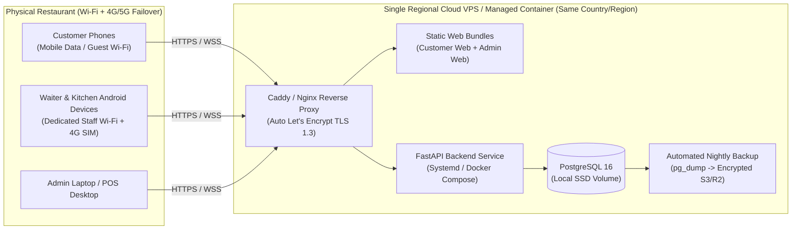

# Volume 6: Testing Strategy, Deployment Architecture & Final Governance Checklist

> **Document Status:** SOURCE OF TRUTH — Phase 0 (Documentation Only; No Application Code)

---

## 1. Complete Testing Strategy

To ensure zero regressions across financial calculations, state transitions, and real-time multi-client synchronization, the implementation phase in Antigravity must execute the following **16-part testing strategy**:

| Testing Dimension | Tooling & Scope | Mandatory Test Scenarios to Verify |
| :--- | :--- | :--- |
| **1. Unit Testing** | `pytest` (Backend domain logic), `Vitest` (Web), `flutter test` (Dart models) | - Historical price snapshot math (`active_quantity * unit_price_snapshot`). - Tax calculation in both `EXCLUSIVE` and `INCLUSIVE` GST modes. - Outstanding session value formula with mixed `PLACED`, `SERVED`, `REJECTED`, `CANCELLED`, and modified items. - Short item code regex & normalization (`cb-f` -> `CB-F`). |
| **2. API Contract Testing** | `pytest` + `httpx.AsyncClient` against FastAPI | - Verify every endpoint's request Pydantic validation (`extra="forbid"`), status codes (`200`, `201`, `400`, `401`, `403`, `404`, `409`, `410`, `422`, `429`), and standard error envelope. |
| **3. Integration Testing** | FastAPI + Testcontainers PostgreSQL + WebSocket test client | - Full Customer QR scan -> bootstrap -> place order -> Kitchen accept -> preparing -> ready -> Waiter mark served -> generate bill -> record payment -> verify table returns to `AVAILABLE`. |
| **4. Database & Constraint Testing** | PostgreSQL schema & trigger tests | - Verify partial unique index `idx_one_active_session_per_table` rejects duplicate active sessions. - Verify partial unique index `idx_one_active_qr_per_table` rejects two active QR tokens. - Verify `CHECK (status != 'REJECTED' OR rejection_reason IS NOT NULL)` fails when rejection reason is omitted. - Verify `audit_logs` trigger blocks `UPDATE` and `DELETE`. |
| **5. UI Component Testing** | React Testing Library + Flutter Widget Tests | - Unavailable items render visibly with `"Unavailable"` badge and disabled Add button. - Variant selector modal requires selecting a variant before enabling Add to Cart. - Kitchen reject modal keeps Confirm button disabled until reason is entered. |
| **6. Flutter Mobile Testing** | `flutter_test` + `integration_test` on Android Studio Emulator | - Waiter short-code search (`CB`, `CB-H`) vs full-name search (`Biryani`). - Waiter table number lookup (`12`) -> active session -> bill generation. - Kitchen multi-column KDS live ticket rendering and modification diff acknowledgment. |
| **7. Web Application Testing** | Playwright (Mobile viewport 390x844 for Customer Web; Desktop 1440x900 for Admin Web) | - Customer mobile web responsive layout, cart persistence on page refresh, and ₹5,000 limit warning. - Admin menu price update, QR regeneration, and audit log inspection. |
| **8. Security Testing** | OWASP API Top 10 automated & manual suite | - Price tampering test: send `unit_price: 1.00` in `POST /orders` payload -> verify rejected (`422` extra field forbidden) and DB price used. - SQLi payloads in search query `q` and `qr_token`. - XSS `<script>` payloads in `special_instructions` and `rejection_reason`. - Brute-force login lockout after 5 failed attempts. |
| **9. Authorization & IDOR Testing** | Role-matrix boundary tests | - Customer A (`Table 1` session token) attempts to query or cancel `Table 2`'s orders -> verify `403`/`404`. - `WAITER` token attempts to call `/api/v1/kitchen/orders/{id}/accept` or `/api/v1/admin/settings` -> verify `403 Forbidden`. - `KITCHEN` token attempts to generate bill or record payment -> verify `403 Forbidden`. |
| **10. QR Security Testing** | Token lifecycle & abuse suite | - Scan valid QR -> verify table remains `AVAILABLE`. - Admin regenerates QR -> verify old QR token immediately returns `410 Gone`. - Complete payment on table session -> verify customer's existing `customer_session_token` can no longer submit orders (`401`). |
| **11. Concurrency & Race-Condition Testing** | `asyncio.gather` parallel load tests | - Fire 10 simultaneous `POST /orders` for an `AVAILABLE` table -> verify exactly 1 `TableSession` is created and all valid orders attach to it. - Fire simultaneous Kitchen `POST /accept` and Waiter `PATCH /modify` with `expected_version=1` -> verify one succeeds (`200`) and the other receives `409 Conflict`. - Fire 5 simultaneous `POST /payments` -> verify exactly 1 payment succeeds. |
| **12. Rate-Limit & Idempotency Testing** | Burst & replay test suite | - Replay `POST /orders` 5 times with same `Idempotency-Key` -> verify 1 order in DB and 5 identical `201` responses. - Submit 4 orders within 60 seconds on same table -> verify 4th order blocked with `429 RATE_LIMIT_EXCEEDED`. |
| **13. Order Lifecycle & Editing Testing** | State machine transition matrix tests | - Verify every invalid transition (e.g., `PLACED -> READY`, `SERVED -> PREPARING`, `REJECTED -> ACCEPTED`) returns `409 INVALID_STATE_TRANSITION`. - Verify editing an `ACCEPTED` order preserves `original_quantity`, updates `active_quantity`, creates `OrderModificationEvent`, and flags Kitchen. |
| **14. Billing, Historical Price & Limit Testing** | Financial accuracy suite | - Place order for `CB-F` at `₹180` -> Admin updates `CB-F` price to `₹220` -> Generate bill for existing order -> verify bill charges `₹180.00`. - Active session at `₹4,850` -> submit `₹300` order -> verify blocked (`422`). Reject a `₹500` order in that session (dropping active total to `₹4,350`) -> resubmit `₹300` order -> verify succeeds (`₹4,650 <= ₹5,000`). |
| **15. Regression Testing** | Automated CI test pipeline | - Run full database, API, state-machine, and financial calculation test suites on every commit before merging. |
| **16. End-to-End (E2E) Multi-Actor Testing** | Orchestrated 4-client scenario | - Simulate Customer Web + Waiter App + Kitchen App + Admin Web simultaneously across a complete dining shift including QR ordering, waiter code ordering, order editing, kitchen rejection, bill generation, payment, and table reset. |

---

## 2. Future Deployment Architecture (Single Restaurant, Cost-Practical)

> **Note:** Nothing is deployed in this documentation phase. This blueprint defines the target production topology for the single restaurant.

### 2.1 Practical Single-Restaurant Hosting Topology
Because this system serves **one physical restaurant** (not a global multi-tenant SaaS), the infrastructure should be reliable, low-latency, and cost-effective (~$15–$40/month total cloud cost, or an on-premise/hybrid edge server with cloud backup):

### 2.2 Infrastructure & Configuration Specifications

| Aspect | Production Specification |
| :--- | :--- |
| **Web Hosting (Customer & Admin)** | Built as static production bundles (`npm run build` -> `/dist`) and served directly by Nginx/Caddy with Brotli/Gzip compression and immutable asset caching, hosted on subpaths or subdomains (`https://order.<restaurant-domain>.com` and `https://admin.<restaurant-domain>.com`). |
| **Backend Hosting** | Single Linux VPS (e.g., 2 vCPU, 4 GB RAM on DigitalOcean, Hetzner, AWS Lightsail, or GCP e2-medium in the nearest Indian region e.g., Mumbai `ap-south-1`) running FastAPI via Docker Compose or `systemd` with Uvicorn. |
| **PostgreSQL Hosting** | Co-located PostgreSQL 16 container/service on SSD storage (bound strictly to `127.0.0.1:5432` / internal Docker network, never exposed to public internet `0.0.0.0`) OR Managed PostgreSQL. |
| **Domain, HTTPS & TLS** | Dedicated restaurant domain with automatic Let's Encrypt TLS 1.2/1.3 certificates via Caddy/Certbot. HTTP (`80`) redirects `301` to HTTPS (`443`). |
| **CORS Policy** | Strict origin allowlist: `CORS_ALLOWED_ORIGINS=["https://order.<domain>.com", "https://admin.<domain>.com"]`. |
| **Environment Variables & Secrets** | Stored in `/etc/restaurant-app/.env` (`chmod 600`): `DATABASE_URL`, `JWT_SECRET_KEY` (64-byte hex), `CUSTOMER_SESSION_HMAC_SECRET` (64-byte hex), `CORS_ALLOWED_ORIGINS`, `ENVIRONMENT=production`, `LOG_LEVEL=INFO`. |
| **Flutter Mobile Build Process (Android APK/AAB)** | Built using Android Studio / Flutter SDK: - Configure `API_BASE_URL` and `WS_BASE_URL` via `--dart-define=API_BASE_URL=https://api.<domain>.com`. - Generate signed release builds (`flutter build apk --release` for direct sideloading/MDM installation on restaurant-owned Waiter & Kitchen Android devices, or `flutter build appbundle --release` for Google Play Internal/Private Enterprise track). |
| **Logging & Monitoring** | - Structured JSON logs via Python `structlog` rotated daily (`logrotate`, 30-day retention). - Lightweight health check endpoint `GET /api/v1/health` (verifies PostgreSQL connectivity) monitored by UptimeRobot / BetterStack with instant WhatsApp/SMS/Email alert if down. |
| **Backup Strategy** | - Automated `pg_dump -Fc` cron job running every 6 hours + end-of-day (3:00 AM local time). - Encrypted with GPG/age and uploaded to off-site object storage (Cloudflare R2 or AWS S3) with 30-day daily and 12-month monthly retention. - Monthly automated restore verification test. |
| **Database Migration Strategy** | Managed strictly via **Alembic** (`alembic upgrade head`). Destructive column drops or table truncations are blocked in production migration lint checks; pre-migration `pg_dump` snapshot runs automatically before applying any schema upgrade. |

---

## 3. Final Governance & Source-of-Truth Summary

### 3.1 Confirmed Requirements (Non-Negotiable)
1. **Single-Restaurant System:** Built strictly for ONE physical restaurant (not a multi-restaurant SaaS).
2. **Four Distinct Applications:**
   - Customer: Mobile-responsive web app (no app install, no login/account, no 4-digit PIN, no waiter pre-activation).
   - Waiter: Flutter Android mobile app.
   - Kitchen Staff: Flutter Android mobile app (KDS).
   - Admin: Web dashboard.
3. **Core Tech Stack:** FastAPI (Python) backend + PostgreSQL database + WebSockets real-time layer + Flutter mobile apps + Web apps, to be implemented in Antigravity with Android Studio tooling.
4. **QR & Table Session Rules:**
   - Every table has a unique QR code using an unpredictable cryptographic token (never sequential table ID alone).
   - Admin can generate, regenerate (invalidating old token), revoke, or disable QR codes.
   - Scanning a QR code **never** marks a table `OCCUPIED`.
   - A table becomes `OCCUPIED` automatically after the **first valid order is placed** (by Customer QR or Waiter).
   - If all orders in the active table session are cancelled or rejected before completion, the table reverts to `AVAILABLE`.
   - After successful payment and session completion, the table becomes `AVAILABLE`.
5. **Unified Order Pipeline:** Customer QR orders and Waiter manual orders feed into the exact same central order pipeline and `TableSession`.
6. **Multi-Variant Menu & Unique Short Codes:**
   - Menu modeled as `MenuCategory -> MenuItem -> MenuPriceVariant -> OrderItem`.
   - Supports serving/quantity variants (`Half ₹100 / Full ₹180`, `2 pieces ₹120`).
   - Supports unique short item/variant codes (`CB`, `CB-H`, `CB-F`, `CK-2`) AND full-name search for waiters.
   - Unavailable items remain visible as `"Unavailable"` and cannot be ordered.
   - Historical orders retain immutable price snapshots charged at the time of ordering.
7. **Order Lifecycle & Audited Editing:**
   - Canonical states: `PLACED -> ACCEPTED -> PREPARING -> READY -> SERVED -> COMPLETED`, plus `REJECTED` (mandatory reason) and `CANCELLED`.
   - Waiter order edits after kitchen acceptance never silently overwrite history; all modifications are logged in `order_modification_events`, update bill calculations accurately, and alert Kitchen in real time.
8. **₹5,000 Outstanding Limit:** Active unpaid orders per table session cannot exceed ₹5,000 (configurable by Admin). Example: ₹4,850 unpaid + ₹300 new order = ₹5,150 -> blocked with prompt to contact staff.
9. **Staff-Controlled Billing & Immutable Finance:** Customers call waiter verbally for bill; waiter enters/selects table, reviews items, generates bill, and records payment. Financial records are never silently deleted or overwritten.

---

### 3.2 Recommended Decisions (Architectural Best Practices)
1. **[REC-01] Dual-Level Short Codes (`item_code` + `variant_code`):** Support both dish-level codes (`CB` for Chicken Biryani) and direct variant codes (`CB-H`, `CB-F`) so waiters can either pick from variants or type the exact variant code in one stroke.
2. **[REC-02] Ephemeral Signed `customer_session_token`:** Exchange the scanned `qr_token` on bootstrap for a signed session cookie/token bound to `table_id` and `table_session_id` that automatically revokes the instant the bill is paid.
3. **[REC-03] First-Order Waiter Alert for Physical Verification:** Emit an instant notification to Waiter devices whenever an `AVAILABLE` table transitions to `OCCUPIED` via a Customer QR order so staff immediately notice if an empty table received a remote order.
4. **[REC-04] Realistic Multi-Tier Rate Limits:** Default to **max 3 orders per 2 minutes**, **max 10 orders per 30 minutes**, **max 3 concurrent unaccepted (`PLACED`) orders**, **max 20 line items per order**, and **max 15 quantity per item variant**—all configurable by Admin.
5. **[REC-05] Event-Sourced Modification Diffs (`order_modification_events`) Over Blocking Order States:** Keep the order progressing in its canonical state (`ACCEPTED`/`PREPARING`) while attaching a high-visibility `has_unacknowledged_kitchen_mods = true` alert badge and immutable `OrderModificationEvent` diff card for Kitchen acknowledgment.

---

### 3.3 Decisions Requiring Your Approval (`Decision Required` Registry)

Before starting implementation in Antigravity, please review and confirm your preference on these **8 ambiguous business policy points** (each includes a sensible recommended default):

| ID | Ambiguous Business Rule | Option A (Recommended Default) | Option B (Alternative) |
| :--- | :--- | :--- | :--- |
| **DR-01** | **Multi-Device Ordering on an `OCCUPIED` Table:** When Table 4 already has an active session started by Guest 1's phone, can Guest 2 at the same table also scan the QR and place orders into the same session? | **Yes (until Bill is `ISSUED`):** Any phone scanning the valid QR while the session is active (and not locked/billed) can add orders to the table session, while broadcasting live alerts to Guest 1's screen and the Waiter app. | **Strict Single-Device Lock:** Only the first browser device that placed the opening order can submit QR orders for that session unless a Waiter taps "Allow Additional Device". |
| **DR-02** | **Customer Self-Cancellation in `PLACED` State:** Can a customer cancel their own QR order from their phone *before* the Kitchen accepts it (`status == 'PLACED'`)? | **No Self-Cancellation (Staff Only):** Once a customer confirms "Place Order", they must call a waiter to cancel/edit even if still `PLACED` (prevents prank order-and-cancel flickering on the Kitchen screen). | **Allowed While `PLACED`:** Customer can tap "Cancel Order" on their phone as long as `status == 'PLACED'` (blocked the millisecond Kitchen taps `Accept`). |
| **DR-03** | **Order Cancellation / Item Reduction While `PREPARING`:** Who can cancel an order or reduce item quantity once Kitchen has already marked it `PREPARING`? | **Admin Override Only (or Kitchen Confirmation):** Waiters can freely edit/cancel in `PLACED` and `ACCEPTED`, but once status is `PREPARING`, `READY`, or `SERVED`, reducing/cancelling items requires Admin authorization (or Kitchen approval) with a `wastage` flag. | **Waiter Allowed with Reason:** Waiters can cancel/reduce items even during `PREPARING` as long as they enter a mandatory reason. |
| **DR-04** | **Marking an Order `READY -> SERVED`:** Who transitions an order from `READY` to `SERVED`? | **Waiter (and Admin):** Kitchen marks `PREPARING -> READY`; Waiter marks `READY -> SERVED` upon picking up/delivering to the table. | **Both Waiter and Kitchen:** Allow Kitchen staff to also tap `Mark Served` from the pass if waiters are busy. |
| **DR-05** | **Kitchen Staff Menu Availability Toggle:** Can Kitchen staff directly toggle an item/variant to `Unavailable` (Out of Stock) from the Kitchen Flutter App, or is that strictly Admin-only? | **Allow Kitchen Quick Stock-Out Toggle (Plus Admin):** Allowing Kitchen staff to mark a dish "Sold Out" when rejecting an out-of-stock order prevents further orders while Admin is away from the desk (fully logged in `audit_logs`). | **Strictly Admin Only:** Only Admin Web Dashboard can change `is_available`. |
| **DR-06** | **₹5,000 Outstanding Limit Tax Basis:** Is the ₹5,000 cap evaluated against the **Menu Item Subtotal** or the **Tax-Inclusive Estimated Total**? | **Menu Item Subtotal:** Sum of `active_quantity * unit_price_snapshot` $\le ₹5,000.00$, so numbers match the menu prices visible to the customer. | **Estimated Grand Total (Including CGST/SGST):** Subtotal + estimated taxes $\le ₹5,000.00$. |
| **DR-07** | **₹5,000 Limit on Waiter-Created Orders:** When a table reaches ₹5,000, are Waiter-created orders also blocked until partial payment or Admin override? | **Enforced for Both Customer QR & Waiter Orders (with Admin Per-Session Override):** Waiter is alerted at ₹5,000 and must either record an interim payment or have Admin increase `custom_max_outstanding_limit` for that table session. | **Waiter Can Bypass Limit Directly:** Waiter app shows a warning at ₹5,000 but allows Waiters to force-submit above ₹5,000 without Admin approval. |
| **DR-08** | **Bill Discounts Authorization:** Who is permitted to apply a discount when generating a bill? | **Admin Only (or Waiter up to a configurable cap, default `0%`):** By default `discounts_enabled = false` for Waiters; only Admin can apply/approve bill discounts with a mandatory reason. | **Waiters Can Apply Discounts Directly:** Waiters can enter percentage/flat discounts on the Bill Generation screen with a mandatory reason. |

---

### 3.4 Documented Assumptions
1. **Local Network / Internet Connectivity:** Customer phones and Staff Android devices connect to the FastAPI backend over HTTPS/WSS (either via restaurant Wi-Fi or mobile 4G/5G data).
2. **Currency & Rounding:** All monetary values are in Indian Rupees (`INR`, `₹`), stored as `NUMERIC(10,2)` using exact decimal arithmetic (never IEEE-754 floating point).
3. **Thermal Receipt Printing (Optional Hardware Interface):** Bills generated in the system produce a structured receipt layout printable via browser print dialog (Admin Web) or standard Bluetooth/Network ESC/POS thermal printer from the Waiter Flutter app.

---

### 3.5 Future Enhancements (Explicitly Out of Scope for Phase 1)
1. **Online Customer Payment Gateway (Razorpay / PhonePe / UPI Intent on Customer Web):** Currently out of scope; waiters handle billing and payment manually.
2. **Optional 4-Digit Table Verification PIN / Dynamic Rotating Table Display:** Can be added later if physical QR photography abuse ever exceeds the current 8-layer defense-in-depth controls.
3. **Kitchen Station Routing:** Splitting a single order across multiple kitchen sub-displays (e.g., *Tandoor Counter*, *Main Kitchen*, *Beverage Bar*).
4. **Raw Ingredient Inventory & Recipe Deduction:** Automatically deducting raw stock (kg of chicken/rice) per variant sold.
5. **Customer Loyalty / Digital WhatsApp Invoice Delivery:** Optional post-payment phone number capture for PDF receipt delivery.

---

### 3.6 Final Implementation Checklist (For Antigravity Execution)

- [ ] **Phase 1 — Database & Core Backend Foundation**
  - [ ] Initialize FastAPI project, SQLAlchemy 2.0 async engine, and Alembic migrations.
  - [ ] Create all 17 normalized PostgreSQL tables, enums, `CHECK` constraints, partial unique indexes (`idx_one_active_session_per_table`, `idx_one_active_qr_per_table`, `idx_one_active_bill_per_session`), and the immutable `audit_logs` trigger.
  - [ ] Seed initial `restaurant_settings` (`max_outstanding_session_amount = 5000.00`), initial `ADMIN` account, and sample menu categories/items/variants (`CB`, `CB-H`, `CB-F`, `CK`, `CK-2`).
- [ ] **Phase 2 — Security, Auth, QR Tokens & WebSocket Engine**
  - [ ] Implement Argon2id staff authentication (`POST /auth/login`, `/refresh`, `/logout`) and RBAC dependencies (`ADMIN`, `WAITER`, `KITCHEN`).
  - [ ] Implement CSPRNG QR token generation, regeneration, revocation, and `customer_session_token` issuance (`GET /public/qr/{qr_token}/bootstrap`).
  - [ ] Implement WebSocket Connection Manager (`room:kitchen`, `room:waiters`, `room:admin`, `room:table_session:{id}`, `room:public_menu`).
- [ ] **Phase 3 — Menu, Central Order Pipeline, State Machine & Billing APIs**
  - [ ] Implement Menu CRUD, variant management, short-code search (`GET /waiter/menu/search`), and live availability toggling.
  - [ ] Implement transactional Order Placement (`POST /public/orders` and `POST /waiter/orders`) with `FOR UPDATE` table locking, automatic `AVAILABLE -> OCCUPIED` transition on first order, historical price snapshotting, ₹5,000 limit validation, `Idempotency-Key` enforcement, and rate limiting.
  - [ ] Implement Kitchen state transitions (`accept`, `reject` with mandatory reason, `preparing`, `ready`) and automatic `OCCUPIED -> AVAILABLE` reversion when all session orders are rejected/cancelled.
  - [ ] Implement Order Modification engine (`PATCH /orders/{id}/modify`) with `order_modification_events` logging and Kitchen modification acknowledgment.
  - [ ] Implement Bill Generation (`POST /waiter/tables/{id}/bills`) and atomic Payment Recording (`POST /waiter/bills/{id}/payments`) completing the session and freeing the table.
- [ ] **Phase 4 — Client Applications**
  - [ ] Build **Customer Mobile Web App** (`CW-1` through `CW-9`).
  - [ ] Build **Admin Web Dashboard** (`AW-1` through `AW-15`).
  - [ ] Build **Waiter Flutter Mobile App** (`WM-1` through `WM-13`) with instant short-code + full-name search.
  - [ ] Build **Kitchen Flutter Mobile App** (`KM-1` through `KM-9`) with real-time KDS board and audio notifications.
- [ ] **Phase 5 — Verification & Quality Assurance**
  - [ ] Execute unit, integration, concurrency, RBAC/IDOR, QR security, ₹5,000 limit, and E2E test suites.
